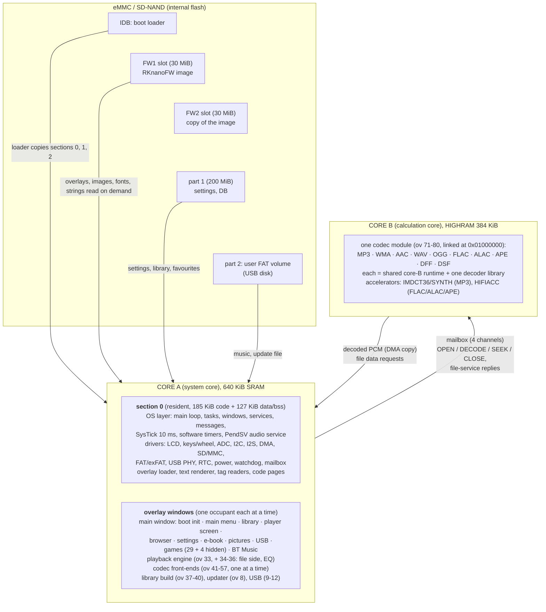
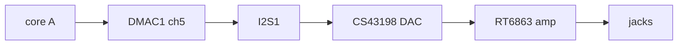

# The stock firmware ("HidizsOS")

Status: draft, 2026-11

The AP30 runs a firmware that Hidizs calls "HidizsOS". It is built on Rockchip's **RKnano SDK** for the RKNanoD
(dual Cortex-M3), and it shares one code base with the Snowsky / FiiO **Echo Mini** player [AP30]. It is not a
preemptive RTOS. One main loop on core A runs the current "task" (a screen such as the main menu, the music player or
a game) and a list of background services. Code that is not always needed sits in **overlays**: numbered sections
that are copied from flash into shared RAM windows on demand. Core B is used only as an audio decoder. It loads one
codec module per track and talks to core A through a hardware mailbox [AP30]. This section of the collection
describes that firmware as found in the official images, mainly **V1.7.8** (`HIFIYF18.IMG`).

## Contents

- [Structure at a glance](#structure-at-a-glance)
- [Pages in this section](#pages-in-this-section)
- [Which firmware versions are covered](#which-firmware-versions-are-covered)
- [Naming and addresses used in these pages](#naming-and-addresses-used-in-these-pages)
- [Open questions](#open-questions)
- [Sources](#sources)

## Structure at a glance

PCM out:

[AP30, analysis of firmware V1.7.8.] Sizes and windows: [architecture.md](architecture.md). The flash layout is
described in full in [../formats/idb_and_flash_layout.md](../formats/idb_and_flash_layout.md).

## Pages in this section

| Page | What it covers |
|---|---|
| [architecture.md](architecture.md) | SDK lineage, sections and overlays, the overlay map by number, overlay windows, tasks / windows / services, the message model, interrupts, the configuration block, RAM use |
| [boot_loader.md](boot_loader.md) | the boot loader in the IDB area: boot flow, boot markers, button check, FW1/FW2 choice, loader USB mode |
| [startup.md](startup.md) | from reset to the main menu: trampoline, vector tables, init order, boot checks, update scan, library rebuild after an unclean shutdown |
| [audio_playback.md](audio_playback.md) | player flow, codec selection, the track-change sequence and its gap, EQ, fades, volume, gain, filters, DSD, sample-rate switching |
| [core_b_codecs.md](core_b_codecs.md) | the core-B runtime, the full mailbox protocol, the info struct, each codec module 71-80 and the accelerators it uses |
| [storage_and_filesystems.md](storage_and_filesystems.md) | storage drivers, FAT16/FAT32/exFAT, partitions, the media library database and its limits, favourites, bookmarks |
| [ui_and_settings.md](ui_and_settings.md) | windows, menus, the settings tree, the configuration block fields, languages |
| [display_and_input.md](display_and_input.md) | screen driver, screen-off modes, key handling, volume wheel |
| [power_management.md](power_management.md) | power-off paths, battery, backlight, watchdog, clock policy |
| [usb_modes.md](usb_modes.md) | USB mass storage, vendor SCSI commands, the hand-over to the Realtek USB DAC |
| [bluetooth.md](bluetooth.md) | Bluetooth control from the firmware side |
| [update_process.md](update_process.md) | how `HIFIYFnn.IMG` updates work, what is checked, how FW1/FW2 are written |
| [games.md](games.md) | the built-in games, including four hidden ones, and how they are launched |
| [third_party_components.md](third_party_components.md) | libraries and code inside the firmware, and their licences |
| [known_bugs.md](known_bugs.md) | firmware bugs found by analysis, with impact and workarounds |

## Which firmware versions are covered

| File | Header date / version | Role in these pages |
|---|---|---|
| `HIFIYF18.IMG` (V1.7.8) | 2026-10-19 / 8.0.0 | the reference: every address and fact is from this image unless another version is named [AP30] |
| `HIFIYF05.IMG` ("11-Game Firmware") | 2026-08-19 / 5.0.0 | the factory firmware; used for differences (codec modules, EQ gating, open limits) [AP30] |
| `HIFIYF26.IMG` | 2026-07-23 / 0.0.0 | the oldest image available; used for differences [AP30] |
| `HIFIYF23.IMG` (V1.8.3) | 2026-11-23 / 3.0.0 | the newest release; compared function by function with V1.7.8. Pages describe its changes (gapless FLAC, saved game progress) where they matter and tag them "V1.8.3" [AP30] |

Hashes, download links and the full release history: [../overview/firmware_releases.md](../overview/firmware_releases.md).

## Naming and addresses used in these pages

- **Addresses** are run-time addresses in the core-A or core-B map, e.g. `0x0308bf84`. For overlays they are given
  with the overlay number ("overlay 33 at 0x0308bf84"), because several overlays share one address window.
- **Overlay numbers** are the slot numbers in the image's section table (0-112). The table format is in
  [../formats/stage3_sections.md](../formats/stage3_sections.md).
- **Tasks** are the firmware's screen numbers (0-47); see [architecture.md](architecture.md#tasks).
- **Messages** are numbered flags (e.g. message 0x192 = "update file found"); see
  [architecture.md](architecture.md#messages).
- These pages describe behaviour in their own words. They do not reproduce vendor code or SDK function names.

## Open questions

- Which parts of the firmware differ between V1.7.8 and the two earlier images beyond the codec modules, EQ gating
  and the game list? Partly answered per page; no complete list yet.
- The "1.x.y" version strings reviewers saw in Settings → About (1.2.9, 1.3.5) do not map one-to-one to the header
  versions; see [../overview/firmware_releases.md](../overview/firmware_releases.md).

## Sources

- [AP30] analysis of firmware V1.7.8, cross-checked with 5.0.0 and 0.0.0 images; measured on a device where stated.
- [EM] Echo Mini RKNanoD study: [berettavexee/echo-mini-newfw](https://github.com/berettavexee/echo-mini-newfw)
  (`ETUDE.md`), also published as [iamcheyan/echo-mini-newfw](https://github.com/iamcheyan/echo-mini-newfw).
- [WEB] [brnomt/ReChord](https://github.com/brnomt/ReChord): open firmware for the Echo Mini that contains a copy of
  the Rockchip RKNanoD SDK, used to confirm library code in the AP30 image.
- [WEB] [Hidizs Download Center](https://www.hidizs.net/pages/download-center): official images.
