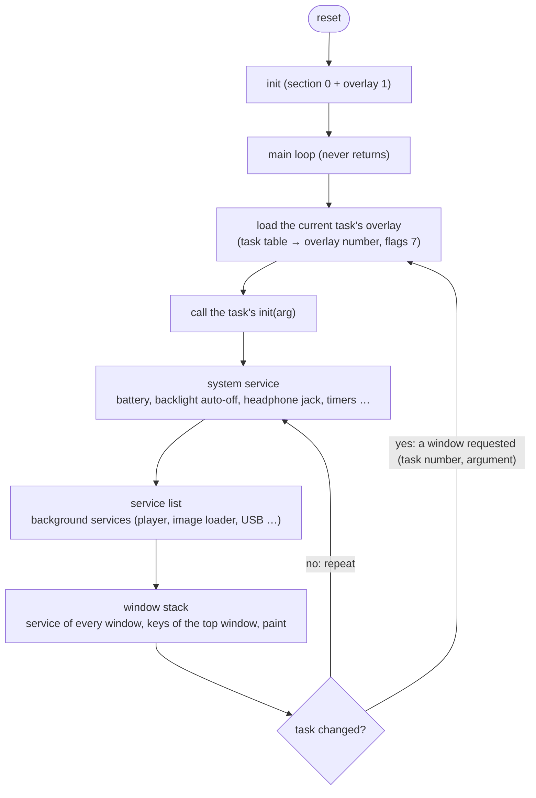

# Firmware architecture

Status: draft, 2026-11

The stock firmware is a Rockchip RKnano SDK application with Hidizs' changes and additions. Its code stage holds
**113 section slots** (92 non-empty): section 0 is resident, every other section is an **overlay** that is copied
from flash into a shared RAM window when needed. Core A runs a cooperative main loop: one **task** (a screen) at a
time, each task a stack of **windows**, plus a list of background **services**. Parts of the system talk through
numbered **message flags**. Core B runs one codec module at a time, only while music plays. All facts are from V1.7.8
unless another version is named [AP30].

## Contents

- [Lineage: SDK, Echo Mini, Hidizs](#lineage-sdk-echo-mini-hidizs)
- [Sections and overlays](#sections-and-overlays)
- [Overlay windows](#overlay-windows)
- [The overlay map](#the-overlay-map)
- [How an overlay is loaded](#how-an-overlay-is-loaded)
- [OS layer: main loop, tasks, windows, services](#os-layer-main-loop-tasks-windows-services)
- [Tasks](#tasks)
- [Messages](#messages)
- [Interrupts](#interrupts)
- [The configuration block](#the-configuration-block)
- [RAM use](#ram-use)
- [Debug output](#debug-output)
- [Open questions](#open-questions)
- [Sources](#sources)

## Lineage: SDK, Echo Mini, Hidizs

| Layer | Evidence | Tag |
|---|---|---|
| **Rockchip RKnano SDK** (RKNanoD branch) | the image header names the vendor "Rockchip" and the model "RKnano SDK 1.0"; source-file names from the SDK appear in the image's debug strings; the core-B codec libraries and the AP-side EQ and fade libraries are byte-identical to the libraries of the RKNanoD SDK copy published inside ReChord; tasks 0-13 keep the SDK's task numbering | [AP30], [WEB] ReChord |
| **Shared with the Snowsky / FiiO Echo Mini** | the updater accepts `ECHOMINI.IMG`, which is the Echo Mini's own second update-file name; whole core-B modules are byte-identical to Echo Mini releases; the dormant USB-audio overlay 11 is the Echo Mini's USB DAC; the Echo Mini's codec modules sit two slots higher (73-82 from Echo Mini V1.5.0 on) | [AP30] + [EM] |
| **Hidizs additions** | 29 menu games + 4 hidden ones (overlays 81-111), BT Music (overlay 112), the volume-wheel code, the single-CS43198 DAC driver, the 296×240 panel driver | [AP30] |
| **Dropped SDK features** | video, FM radio and recording tasks exist as task numbers 4, 5, 7 but their overlays (13, 28, 29) are empty and their task slots are zero | [AP30] |

More on the relation with the Echo Mini: [../related/snowsky_echo_mini.md](../related/snowsky_echo_mini.md). On the
SDK family: [../related/rockchip_rknano_family.md](../related/rockchip_rknano_family.md).

## Sections and overlays

The image's code stage ("stage 3") is a table of 113 records, each with a code, data and bss part (file position,
load address and size for each). The record format is in [../formats/stage3_sections.md](../formats/stage3_sections.md).

| Kind | Slots | Where it runs | Loaded by |
|---|---|---|---|
| Resident system | 0 | code 0x03050000 (0x2e300 bytes), data 0x03004000 (0x1a8a), bss 0x03005a8c (0x1e0b8) | the boot loader, once |
| Boot init | 1 | main window 0x030815c4 | the boot loader (with section 0); called piece by piece during start-up |
| System overlays | 4-40 | several windows (below) | the overlay loader, on demand |
| Codec front-ends (core A) | 41, 42, 50-57 | front-end window 0x0308ffbc | the playback engine, per track |
| Code-page tables | 63-69 | not loaded: read in place from flash (load address 0) | the text code |
| Core-B codec modules | 71-80 | core B: code 0x01000000 (HIGHRAM0), data 0x01020000 (HIGHRAM1) | core A, per track |
| Games | 81-111 | main window 0x030815c4 | the task switch |
| BT Music | 112 | main window 0x030815c4 | the task switch |

The boot loader copies sections 0, 1 and 2 (slot 2 is empty) [AP30, loader]. Everything else comes through the
overlay loader. Empty slots in V1.7.8: 2, 3, 13-16, 28, 29, 43-49, 58-62, 70 [AP30].

## Overlay windows

Overlays share RAM windows. Two overlays with the same window can never be loaded at the same time, which is why
tasks that share a window can never run together.

**Core A code (SYSRAM)**

| Run address | Occupant |
|---|---|
| 0x03050000 | section 0 code (resident, 185 KiB), up to 0x0307e300 |
| 0x03080e9c | ov 4 LCD panel driver (chosen by a driver index in the config block) |
| 0x030815c4 | **main window**, one of these at a time: 1 boot init · 5 library-build screen · 6 charge screen · 10 USB device stack · 17 picture viewer · 21 main menu · 22 library menu · 23 library lists · 27 now playing / lyrics · 30 e-book · 31 file browser · 32 settings · 81-111 games · 112 BT Music (13.5 KiB used by the largest) |
| 0x03081924 | ov 7 (free space), ov 37 (CUE + WMA tags), ov 39 (library sort, 0x1dea8: mostly tables) |
| 0x03082028 | ov 8 updater |
| 0x03082400 | ov 38 library scan |
| 0x03082928 | ov 11 USB audio |
| 0x03083030 | ov 24-26 library popups / start playback |
| 0x03083610 | ov 12 USB mass storage |
| 0x03084590 | ov 9 USB mode menu |
| 0x03084664 | ov 18 image service (cover art, thumbnails) |
| 0x03089654 | ov 19 JPEG / ov 20 BMP decoder |
| 0x0308bf84 | ov 33 playback engine (13.9 KiB) |
| 0x0308f724 | ov 34 playback file side · ov 35 EQ tables (data only) · ov 36 equaliser |
| 0x0308ffbc | codec front-ends 41, 42, 50-57 · ov 40 library stage 3 |

**Core B (HIGHRAM)**

| Run address | Occupant |
|---|---|
| 0x01000000 | ov 71-80 codec module code (seen by core B at address 0) |
| 0x01020000 | ov 71-80 codec module data (first 0x90 bytes: clock block written by core A) |

[AP30 section records.] Data windows follow the same rule: most main-window occupants put their data and bss at
0x03023b48; the playback engine owns 0x030360e8-0x03048b50 (see [RAM use](#ram-use)).

## The overlay map

| Slot | Purpose | Window | Notes |
|---|---|---|---|
| 0 | resident system: OS layer, drivers, file system, text and image drawing, tag readers, overlay loader | resident | 819 functions [AP30] |
| 1 | boot init: globals, clocks and interrupts, storage devices, settings load, ADC, boot battery check, display and logo, keys, system services, file-system init and update-file scan | main | see [startup.md](startup.md) |
| 4 | LCD panel driver (15-entry operation table) | 0x03080e9c | [display_and_input.md](display_and_input.md) |
| 5 | library-build screen (task 13): runs overlays 38 → 39 → 40, progress screen | main | [storage_and_filesystems.md](storage_and_filesystems.md) |
| 6 | charge screen (task 12, the first task when USB power is present at boot) | main | |
| 7 | free-space calculation (FAT16/FAT32 free clusters, exFAT bitmap) | 0x03081924 | |
| 8 | firmware updater | 0x03082028 | [update_process.md](update_process.md) |
| 9 | USB mode menu (task 11): "USB data copy" / "USB audio decoding" | 0x03084590 | [usb_modes.md](usb_modes.md) |
| 10 | USB device controller driver and standard requests | main | |
| 11 | USB audio class 1 + HID (48 kHz / 16-bit) | 0x03082928 | never selected on the AP30 [AP30]; the Echo Mini's USB DAC [EM] |
| 12 | USB mass storage (bulk-only, SCSI, Rockchip vendor commands) | 0x03083610 | |
| 17 | picture viewer (task 6) | main | |
| 18 | image service: cover art from ID3, APE, FLAC/OGG, ASF, MP4 tags; EXIF thumbnails | 0x03084664 | |
| 19 / 20 | baseline JPEG decoder / BMP decoder | 0x03089654 | |
| 21 | main menu (task 0); also runs the firmware update | main | |
| 22 | library menu (task 1) | main | |
| 23 | library list browser (task 2) | main | |
| 24 | start playback of the selected list entry | 0x03083030 | |
| 25 / 26 | library item popup / favourites popup | 0x03083030 | |
| 27 | now-playing screen and lyrics (task 3) | main | |
| 30 | e-book reader for TXT (task 8), bookmarks | main | |
| 31 | file browser (task 9) | main | |
| 32 | settings (task 10): settings tree, About, date/time, custom EQ, factory reset; also the game menu | main | [ui_and_settings.md](ui_and_settings.md) |
| 33 | **playback engine**: player service, commands, core-B control, mailbox handlers, output, fades | 0x0308bf84 | [audio_playback.md](audio_playback.md) |
| 34 | playback file side: codec choice by extension and content, extra file handles, resume info | 0x0308f724 | |
| 35 | equaliser coefficient tables (data only, read piece by piece) | (not loaded as code) | |
| 36 | equaliser: presets → filter bank + biquads, pre-gain | 0x0308f724 | |
| 37 | CUE sheet parser + ASF/WMA tag reader | 0x03081924 | |
| 38 / 39 / 40 | media library build: scan / sort / favourites area reset | 0x03082400 / 0x03081924 / 0x0308ffbc | |
| 41 | MP3 front-end | 0x0308ffbc | one front-end per codec, ~1 KiB each |
| 42 | WMA front-end | 0x0308ffbc | |
| 50 | AAC front-end | 0x0308ffbc | |
| 51 | WAV front-end | 0x0308ffbc | |
| 52 | OGG Vorbis front-end | 0x0308ffbc | |
| 53 | FLAC front-end | 0x0308ffbc | |
| 54 | ALAC front-end | 0x0308ffbc | |
| 55 | APE front-end | 0x0308ffbc | |
| 56 | DSDIFF front-end | 0x0308ffbc | |
| 57 | DSF front-end | 0x0308ffbc | |
| 63 | single-byte code pages → Unicode | not loaded | tables for tags and file names in legacy encodings |
| 64-66 | Shift-JIS (CP932) → Unicode | not loaded | |
| 67 | Big5 (CP950) → Unicode | not loaded | |
| 68-69 | Korean (CP949) → Unicode | not loaded | GBK uses a separate resource (gbk0) |
| 71 | MP3 decoder module | core B | [core_b_codecs.md](core_b_codecs.md) |
| 72 | WMA decoder module (with DRM code) | core B | |
| 73 | AAC decoder module | core B | |
| 74 | WAV / ADPCM module (+ noise suppression) | core B | |
| 75 | OGG Vorbis module | core B | |
| 76 | FLAC module | core B | |
| 77 | ALAC module | core B | |
| 78 | APE module | core B | |
| 79 | DSDIFF (.dff) module | core B | |
| 80 | DSF module | core B | |
| 81-111 | games (two games share 100, two share 109) | main | [games.md](games.md) |
| 112 | BT Music: the Bluetooth output screen (loads the playback engine) | main | [bluetooth.md](bluetooth.md) |

[AP30, analysis of firmware V1.7.8.] The two overlays 35 and 36 have a recorded data window
(0x03048b50-0x03055384) that would run past 0x03050000 into section 0's code; most likely overlay 35's tables are
never loaded into RAM and are read in place from flash, like the code-page tables [?].

## How an overlay is loaded

The overlay loader lives in section 0 at **0x030683de** (a wrapper at 0x030684e4 has about 40 call sites)
[AP30]. Its behaviour, in steps:

1. Block the deferred audio service and the playback mailbox interrupts (so audio code does not run while its
   window may change).
2. Read the stage-3 header (base address 0x03050000 and record count) from the firmware area.
3. Read the 32-byte record of the requested section.
4. Depending on flag bits: bit 0 copies the code part to its load address, bit 1 copies the data part, bit 2 zeroes
   the bss part. Most callers pass all three (7).
5. Unblock the audio service.

All reads go through the storage device "firmware area" (FW1 starting at the slot's first sector). A flag that would
redirect these reads to FW2 exists, but in V1.7.8 nothing sets it, so **overlays, images, fonts and strings always come
from FW1**, even after the boot loader fell back to FW2 [AP30]. See [boot_loader.md](boot_loader.md) and
[update_process.md](update_process.md).

Related helpers: reading bytes out of a section's data image without loading it (0x0306847e; used for the EQ tables of
overlay 35), and locating a section's code in flash (0x03065f60) [AP30].

## OS layer: main loop, tasks, windows, services

| Interrupt | Work |
|---|---|
| SysTick, every 10 ms | tick counter + software-timer list (key scan runs here, every tick) |
| PendSV | deferred audio work: refill the I2S output buffers |

[AP30.] Details:

- **Not preemptive.** A task runs until a window requests another task. Interrupts do the time-critical work
  (SysTick, DMA completion, mailbox, USB).
- **Window** = `{child, parent, service, key, paint, init, deinit}` (seven words). A screen is a stack of windows:
  popups are pushed on top. Each loop pass runs the service callback of every window in the stack (top down), the
  key callback of the top window only, then paint (skipped while the key lock is on). Closing a stack runs every
  deinit from the top down [AP30].
- **Service list**: a doubly linked list of `{prev, next, init, service, deinit, arg}` nodes for background
  services. The player is one such node (0x030361a4), which is why music keeps playing while other screens (and
  games) run [AP30].
- **Software timers**: `{next, count, period, repeat, callback}`, run from the SysTick interrupt; the key scan timer
  has period 1 (10 ms) [AP30].
- **Deferred "user ISR"**: the I2S DMA-done interrupt requests PendSV, which refills audio buffers. A nesting
  counter can block it together with the playback mailbox interrupts (IRQs 10 and 11); a request made while blocked
  is remembered [AP30].
- **Critical sections**: global interrupt disable with a nesting counter; a USB-only variant masks IRQ 5 [AP30].
- **Clock management**: each subsystem enters and leaves a numbered "frequency module" (a 64-bit mask of active
  modules); the highest combined requirement decides the PLL and dividers. Before a change, core A asks core B to
  hold still over the mailbox, and SysTick is re-timed to stay at 10 ms [AP30]. Policy and tables:
  [power_management.md](power_management.md).
- **Popups in section 0**: a Yes/No dialog, the key-lock popup (closes after 3 s), a message box (closes after 1 s)
  and the low-battery popup (power-off after 3 s) [AP30].
- **Idle**: blocking waits and the main loop execute `WFI` [AP30].

## Tasks

The task table at 0x03005884 maps 48 task numbers to overlays and entry windows [AP30].

| Task | Overlay | Screen | | Task | Overlay | Screen |
|---|---|---|---|---|---|---|
| 0 | 21 | main menu | | 8 | 30 | e-book (TXT) |
| 1 | 22 | library menu | | 9 | 31 | file browser |
| 2 | 23 | library lists | | 10 | 32 | settings (and the game menu) |
| 3 | 27 | now playing / lyrics | | 11 | 9 | USB mode menu |
| 4 | 13 | video (empty, dropped) | | 12 | 6 | charge screen |
| 5 | 28 | radio (empty, dropped) | | 13 | 5 | library build |
| 6 | 17 | picture viewer | | 14-46 | 81-111 | games (see [games.md](games.md)) |
| 7 | 29 | recording (empty, dropped) | | 47 | 112 | BT Music |

Tasks 0-13 keep the SDK's numbering; tasks 14-47 are Hidizs additions [AP30]. The main menu is a 2 × 3 grid
(music, games, e-book, files, Bluetooth, settings per reviews [WEB]): item 0 opens task 1, the others open the settings
task or the browser with different arguments [AP30].

## Messages

Parts of the firmware signal each other through a bitmap of numbered flags at 0x03023280: "send" sets a flag,
"get" tests and clears it, "check" only tests [AP30]. Selected messages:

| Message | Meaning |
|---|---|
| 0x0a | USB: leave / disconnect handling |
| 0x15 | sent together with 0x17 by the backlight auto-off [?] |
| 0x16 | power key released (unlocked); also forces the backlight off |
| 0x17 | backlight is off |
| 0x18 | key-lock hint |
| 0x1a, 0x1a6 | power-off request (saves settings with the clean-shutdown mark, then powers down) |
| 0x1b | low battery (< 3450 mV for 21 samples) |
| 0x1c | backlight hold: auto-off suspended |
| 0x1d | set/cleared by the picture viewer and LCD code [?] |
| 0x1e | battery level changed |
| 0x21 | charger present |
| 0x25 | headphone jack state changed (the player pauses) |
| 0x4f | codec open error (posted by the playback engine) |
| 0xb8 | reboot into loader USB mode |
| 0xb9 | reboot into MaskROM USB mode |
| 0x183 | plain reboot |
| 0x186 / 0x189 / 0x18b | games: full redraw / partial redraw / status redraw |
| 0x18d | boot file-system init done (also sent after a library rebuild) |
| 0x191 | run the FW1/FW2 sync routine (checked in three places, **never sent** in V1.7.8) |
| 0x192 | update file found by the boot scan → the main menu runs the updater |
| 0x1a7 / 0x1a8 / 0x1a9 | key actions in a media mode (next / previous / play? [?]) |
| 400 (0x190) | settings block was invalid and defaults were loaded |
| 0xd7-0xdb | Yes/No dialog |

[AP30.] Key and power-key messages are described in [display_and_input.md](display_and_input.md) and
[power_management.md](power_management.md).

## Interrupts

On first registration of a handler, the firmware builds a 57-entry RAM vector table at **0x03004000** (the place the
boot table occupied) and points VTOR at it [AP30]. Handlers registered by V1.7.8:

| Vector | IRQ | Handler role |
|---|---|---|
| 14 | (PendSV) | deferred audio service |
| 15 | (SysTick) | 10 ms tick + software timers |
| 0x15 | 5 | USB OTG controller (plus a handler in overlay 10) |
| 0x16 | 6 | DMAC1 |
| 0x18 | 8 | watchdog (first timeout: spin until the second timeout resets) |
| 0x19 | 9 | mailbox channel 0 from core B (ready, hold acknowledge) |
| 0x1a / 0x1b | 10 / 11 | mailbox channels 1 / 2 (playback engine: decoder status / file service) |
| 0x1c | 12 | mailbox channel 3 (core-B print request) |
| 0x23 | 19 | timer |
| 0x24 | 20 | SAR-ADC |
| 0x25-0x2a | 21-26 | UART5 … UART0 |
| 0x2d-0x2f | 29-31 | I2C2 / I2C1 / I2C0 |
| 0x34 | 36 | GPIO2 bank (per-pin handler table) |

Every unregistered vector goes to a crash handler that prints PC, LR, MSP and PSP on UART1 (on the AP30 that UART is
the Bluetooth module's link) and hangs until the watchdog or the 8 s power-key reset [AP30]. The SoC's interrupt
list: [../hardware/soc_rknanod.md](../hardware/soc_rknanod.md).

## The configuration block

The settings live in one RAM structure at **0x03022894**, 0x2f5 bytes, saved in a 0x800-byte block in the reserved
partition (part 1, block 0) [AP30]. On load it is checked with a CRC-8 (polynomial 0x1d, initial value 0x0f, over
0x2f1 bytes) and two magics, "SAVE" and "INFO"; every field is range-checked [AP30]. Known fields:

| Offset | Meaning |
|---|---|
| +0x08 / +0x0a / +0x0c | installed firmware version = the update image's header version (5.0.0 → 8.0.0); reported by a USB vendor command [AP30, device] |
| +0x0e / +0x0f | current disk (2 = internal, 4 = microSD) |
| +0x12 | volume 0-100 (default 30) |
| +0x17 | backlight level (index into the duty table) |
| +0x18 | backlight timeout (index: 15 / 30 / 60 / 180 / 300 / 1800 s) |
| +0x1a | sleep timer (off / 10 / 15 / 30 / 60 / 120 min) [?] |
| +0x1b | idle power-off (off / 1 / 5 / 10 min, held during playback) |
| +0x2a | last-used disk, restored at boot (2 or 4) |
| +0x2e … +0x38 | library counters: all, All Music, Artist, Album, Genre, Favorites |
| +0x42 | **library dirty**: rebuild the media library at the next chance |
| +0x2de / +0x2df | number of the update file found (nn of `HIFIYFnn.IMG`, 0xF5 = `ECHOMINI.IMG`) and its copy after an update |
| +0x2e6 | DAC filter (0-4) |
| +0x2e7 | gain (low / high) |
| +0x2e9 (u32) | **clean-shutdown mark**: 0x55aa = powered off cleanly |
| +0x2f1 (u32) | CRC-8 |

[AP30.] Field-by-field description and the settings menu: [ui_and_settings.md](ui_and_settings.md). The stage-3
image also carries a block of factory defaults used by "factory reset" [AP30].

## RAM use

Core A sees 640 KiB (SYSRAM0 320 KiB + SYSRAM1 256 KiB + PMU-SRAM 64 KiB); core B's HIGHRAM adds 384 KiB
[TRM]. Stock V1.7.8 uses it like this [AP30, from the section records]:

| Region | Range | Size | Used by |
|---|---|---|---|
| Main stack | 0x03000000-0x03004000 | 16 KiB | core A stack |
| Section 0 data + bss | 0x03004000-0x03023b44 | 127 KiB | all resident globals |
| Overlay data windows | 0x03023b44-0x03048b50 | 148 KiB | shared between overlay groups |
| ↳ main window data | 0x03023b48-0x030250fc | 5.4 KiB | data + bss of the current screen or game |
| ↳ playback engine | 0x030360e8-0x03048b50 | 74.6 KiB | two 36 KiB PCM ping-pong buffers (0x030361bc, 0x0303f1bc) + player state |
| ↳ library build (ov 7, 37, 39) | 0x03023b70-0x0304388c | 127 KiB | only while the library is rebuilt |
| ↳ USB audio / USB disk (ov 11, 12) | 0x03023e0c-0x0304690c | ~140 KiB | only in USB mode |
| ↳ picture decoders (ov 19, 20) | 0x030264f4-0x030360e8 | 63 KiB | picture viewer, cover art |
| Section 0 code | 0x03050000-0x0307e300 | 185 KiB | resident code |
| Overlay code windows | 0x03080e9c-0x0309f7cc | 123 KiB | largest user: library build |
| ↳ main window code | 0x030815c4-0x03084bac | 13.5 KiB | largest occupant: overlay 86 (a game) |
| ↳ playback engine code | 0x0308bf84-0x0308f724 | 13.9 KiB | overlay 33 |
| Reboot flag | 0x0309fff0-0x0309ffff | 16 B | the text "NanoCRebootFlag", written just before a software reboot |
| HIGHRAM0 | 0x01000000-0x01020000 | 128 KiB | core-B module code, only while playing |
| HIGHRAM1 | 0x01020000-0x01060000 | 256 KiB | core-B module data, buffers, only while playing |

The playback window is "always on" in practice: music keeps playing while other screens run, so no task that can
coexist with playback may use that window. The overlays whose windows overlap it (USB, library build, picture
decoders) belong to tasks that stop playback first [AP30]. A stock game therefore gets about **13.5 KiB of code and
5.4 KiB of data** [AP30]. A community project reports using data up to 0x0302fd98 and code at
0x03084c00-0x0308bc00 while a game runs, without trouble [WEB nkahoang]. Frame buffer: 296×240 RGB565, split in two
strips (rows 0-189 and rows 190-239 at 0x0306fd50, a zero area inside the section 0 image) [AP30].

## Debug output

The release build prints nothing: the formatted debug calls are compiled to an empty function and the console
writes to a null sink [AP30]. The UART console code is still present but unreferenced. Two exceptions: the crash
handler writes registers straight to UART1, and core B's print requests (mailbox channel 3) are forwarded to UART0,
which V1.7.8 never initialises (its pins carry the DAC's I2C bus) [AP30]. Details:
[core_b_codecs.md](core_b_codecs.md#channel-3-debug-text) and [../hardware/bluetooth.md](../hardware/bluetooth.md).

## Open questions

- Whether overlay 35's EQ tables are ever loaded into RAM, or only read in place (the recorded data window overlaps
  section 0 code) [?].
- Roles of messages 0x15, 0x1d and the "media mode" (0x1aa) that turns some keys into 0x1a7-0x1a9 [?].
- Who reads the RAM reboot flag at 0x0309fff0: a power-key check in overlay 1 reads it, but no caller of that check
  was found [?].

## Sources

- [AP30] analysis of firmware V1.7.8 (section table, overlay loader, OS layer, task table, message and interrupt use).
- [TRM] Rockchip RKNanoD technical reference manual V1.0 (memory sizes, interrupt numbers).
- [EM] Echo Mini firmware comparison (official Echo Mini images, 26 releases) and the RKNanoD study
  [berettavexee/echo-mini-newfw](https://github.com/berettavexee/echo-mini-newfw) `ETUDE.md`.
- [WEB] [brnomt/ReChord](https://github.com/brnomt/ReChord) (contains the RKNanoD SDK copy used for library matches).
- [WEB] [nkahoang/hidizs-ap30-game-emu](https://github.com/nkahoang/hidizs-ap30-game-emu) `docs/FINDINGS.md` (memory
  free during a game).
- [WEB] main-menu layout: reviews collected in [../community/user_feedback.md](../community/user_feedback.md).
