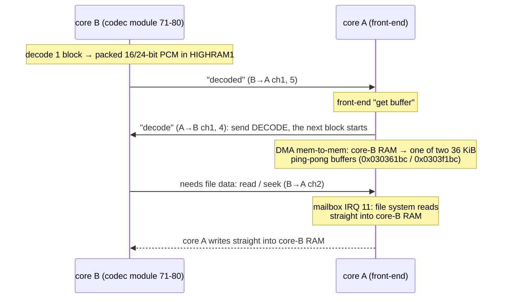
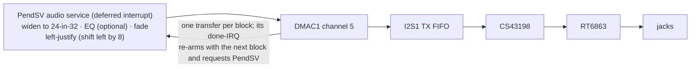

# Audio playback

Status: draft, 2026-11

Playback is split between the two cores. The **playback engine** (overlay 33, with its file side in overlay 34)
runs on core A as a background service, so music continues while other screens are open. For each track it opens the
file, picks a codec from the extension and the content, loads a small **front-end** overlay on core A and the matching
**codec module** on core B, and starts core B. Core B decodes block by block into its own RAM; core A copies each block
into one of two 36 KiB ping-pong buffers, widens it to 24-in-32-bit, applies EQ and fades, and sends it with DMA to
**I2S1** and the **CS43198** DAC. At every track boundary the whole chain is torn down and rebuilt, with a fixed 80 ms
wait and a deliberate 250 ms fade-out at the end of each track, so the stock firmware has **no gapless playback**.
DSD files are converted to 44.1 kHz PCM on core B. All facts are from V1.7.8 [AP30] unless tagged otherwise.

## Contents

- [The pipeline](#the-pipeline)
- [Player commands](#player-commands)
- [Codec selection](#codec-selection)
- [Starting a track](#starting-a-track)
- [The front-end interface](#the-front-end-interface)
- [Steady state: one block of look-ahead](#steady-state-one-block-of-look-ahead)
- [Track change and the gap](#track-change-and-the-gap)
- [Fades, mute and pop avoidance](#fades-mute-and-pop-avoidance)
- [Volume](#volume)
- [Gain and DAC filters](#gain-and-dac-filters)
- [Equaliser and custom EQ](#equaliser-and-custom-eq)
- [Sample-rate switching](#sample-rate-switching)
- [DSD](#dsd)
- [CPU clock during playback](#cpu-clock-during-playback)
- [Play order, resume, errors](#play-order-resume-errors)
- [Headphone jacks](#headphone-jacks)
- [Differences between releases](#differences-between-releases)
- [Open questions](#open-questions)
- [Sources](#sources)

## The pipeline

[AP30, analysis of firmware V1.7.8.] The mailbox protocol is in [core_b_codecs.md](core_b_codecs.md); the hardware
(I2S, DAC, amplifier) in [../hardware/audio_dac_cs43198.md](../hardware/audio_dac_cs43198.md) and
[../hardware/audio_amp_rt6863.md](../hardware/audio_amp_rt6863.md).

Output format to I2S1: stereo, 32-bit slots, 64 bit clocks per frame, 24 significant bits left-justified, I2S
(Philips) format, the SoC is clock master. 16-bit sources are shifted up; 32-bit sources lose their low 8 bits [AP30].
The audio clock comes from the internal ACODEC's PLL, not from the system PLL, so CPU clock changes do not disturb
the audio clock [AP30].

## Player commands

The UI drives the engine through one command entry (a thunk at overlay 33, 0x0308bf84) with a command number and an
argument [AP30]:

| Command | Action |
|---|---|
| 0xe5 | start |
| 0xe6 | pause |
| 0xe7 | resume |
| 0xe8 | stop |
| 0xe9 | restart the output |
| 0xea | stop and save the resume position |
| 0xf2 | fast forward |
| 0xf3 | rewind (position − step) |
| 0xf4 | seek |
| 0xf5 / 0xf6 / 0xf7 | A-B repeat: set A / set B / off (the A key on the now-playing screen, per reviews [WEB]) |
| 0xf8 | apply volume |
| 0xfa | apply sound settings and EQ level |
| 0x106 | refresh the time display |
| 0x109 | change track |

The player itself is a service-list node (0x030361a4) with init / service / deinit callbacks [AP30].

## Codec selection

Overlay 34 decides the codec from the file name and the first bytes of the file [AP30]:

| Codec id | Format | Extensions | Core-A front-end | Core-B module |
|---|---|---|---|---|
| 0 | MPEG audio layer I/II/III | MP1, MP2, MP3 | 41 | 71 |
| 1 | WMA | WMA | 42 | 72 |
| 2 | AAC (in MP4 / M4A / 3GP, or ADTS) | AAC, M4A, MP4, 3GP | 50 | 73 |
| 3 | WAV (PCM, MS/IMA ADPCM) | WAV | 51 | 74 |
| 4 | Ogg Vorbis | OGG | 52 | 75 |
| 5 | Monkey's Audio | APE | 55 | 78 |
| 6 | FLAC | FLA(C) | 53 | 76 |
| 7 | ALAC (in MP4 / M4A) | M4A, MP4 | 54 | 77 |
| 8 | DSDIFF | DFF | 56 | 79 |
| 9 | DSF | DSF | 57 | 80 |

- The extension filter is a list of **3-letter** extensions: `MP1 MP2 MP3 WMA WAV APE FLA AAC M4A OGG MP4 3GP DFF DSF`
  [AP30]. `.flac` files therefore match by their first three letters [?].
- The MP4 family is sniffed: an M4A/MP4 file is sent to the AAC or the ALAC module depending on its content [AP30].
  A routine in section 0 identifies the container from the first 512 bytes [AP30].
- MP4 files (AAC, ALAC) are opened **three times** (sample table, chunk offsets, data); DSD files get one extra
  handle [AP30].
- Formats not in the list (Opus, WavPack, AIFF, MQA…) are not played. No release of the AP30 or of the Echo Mini added
  a codec module [AP30, EM].

## Starting a track

In order, for a start from the UI or after a track change [AP30]:

1. Load overlay 34, register the PendSV audio service, open the file, choose the codec, open the extra handles.
2. Read the tags (title, artist, album, genre, year) with a second open of the file (WMA tags come from an overlay).
3. Load the codec's front-end overlay (window 0x0308ffbc).
4. Power core B's domain (first track only), load the core-B module from flash, start core B and wait for its
   "ready" message, send the file descriptor ([core_b_codecs.md](core_b_codecs.md#starting-and-stopping-core-b)).
5. OPEN: core B parses the headers, pulling data through the file service. The reply carries the first decoded
   block. An OPEN failure posts message 0x4f ("codec open error").
6. Seek to the start position if resuming.
7. Select the CPU clock profile from codec, sample rate, bit rate and channels.
8. Set the DAC sample rate (I2C), load the EQ (overlay 36 and coefficient tables) if EQ is on, set the volume.
9. Copy and widen the first block (the first output buffer is zero-filled), re-initialise I2S1 (pins, clocks, PLL if
   the rate family changed, FIFO clear).
10. Start the DMA, **wait a fixed 80 ms**, then enable I2S transmit.
11. About 0.5 s later the player service unmutes (see [Fades, mute and pop avoidance](#fades-mute-and-pop-avoidance)).

The very first track after the player starts also initialises the DAC (its 19-step register sequence, with an 80 ms
wait) and runs I2S1 at 48 kHz for 100 ms before stopping and resetting it, a clock warm-up for the DAC [?]. The DAC
then stays powered and configured across tracks [AP30]. Register sequence:
[../hardware/audio_dac_cs43198.md](../hardware/audio_dac_cs43198.md).

## The front-end interface

Each front-end overlay (about 1 KiB) is one dispatcher that the engine calls through a table at 0x030481c0, indexed
by codec id. The command numbers are the SDK's codec sub-function numbers [AP30]:

| Cmd | Meaning | Mailbox traffic |
|---|---|---|
| 0, 1, 2 | name / artist / title (WMA only) | |
| 3 | bit rate | (from the info struct) |
| 4 | sample rate | |
| 5 | channels | |
| 6 | total length | |
| 7 | current time | |
| 8 | open the decoder | A→B ch1 OPEN, wait for "opened" or "failed" |
| 10 | get buffer: take the ready block, request the next one, DMA-copy the block into a ping-pong buffer | A→B ch1 DECODE |
| 0xc | decode | A→B ch1 DECODE |
| 0xe | seek (milliseconds) | A→B ch1 SEEK |
| 0xf | close | A→B ch1 CLOSE |
| 0x11 | bits per sample | |

The values come from a copy of core B's info struct at 0x03048ad8 ([core_b_codecs.md](core_b_codecs.md#info-struct)).

## Steady state: one block of look-ahead

- When core B reports a decoded block, the front-end copies it out with a DMAC1 memory-to-memory transfer (the CPU
  sleeps with WFI until it is done), alternates between the two buffers and **immediately** asks core B for the next
  block [AP30].
- If core B is not ready yet, the front-end reports "pending" and the previous block stays in flight; at the end of
  the stream it reports "end" [AP30].
- **Look-ahead is one block.** A block is whatever the decoder produces: 1152 frames for MP3, 1024 for AAC, 4096 for
  WAV, up to the FLAC block size; at most 4608 stereo frames of 32-bit samples fit a 36 KiB buffer, i.e. about
  104 ms at 44.1 kHz or 24 ms at 192 kHz [AP30, arithmetic; block sizes partly EM].
- File data: core B reads its compressed input through the mailbox in buffer-sized chunks (8-36 KiB depending on the
  codec) and waits **synchronously** for each refill; core A serves the read inside the mailbox interrupt
  [AP30]. Sizes per codec: [core_b_codecs.md](core_b_codecs.md#the-core-b-runtime).

## Track change and the gap

What happens at a natural end of track, with estimated times. Estimates are from the code and typical storage
speeds, not measured [AP30 + estimate]:

| # | Step | Estimated time |
|---|---|---|
| 0 | Remaining time < ~300 ms → **250 ms fade-out** (fs/4 samples) on core A, later blocks zeroed | audible dip, ~250 ms |
| 1 | Core B reports end; the PendSV service zeroes the block, marks output stopped and posts "track end", handled by the player service in the **main loop** | 0-20 ms (one loop pass) |
| 2 | Wait for the in-flight DMA block to finish | ≤ 1 block, usually already drained |
| 3 | I2S transmit off; a soft reset that hits **I2S0** instead of I2S1 (I2S1 is reset later by the start path); effect clock profile left | < 1 ms |
| 4 | Load overlay 34; CLOSE to core B; **stop core B** (stop request + wait, core B into reset, its clock gated; for MP3 the accelerators too); close the file handles; unregister PendSV | 1-3 ms |
| 5 | Pick the next file by play mode (folder walk / library index / shuffle) | 1-50 ms (directory size, card) |
| 6 | Load overlay 34 again, register PendSV, **open the file**, codec from extension + content, extra handles | 2-20 ms |
| 7 | **Re-read the tags** with a second open (not for WMA) | 2-30 ms |
| 8 | **Load the front-end and the core-B module from flash** (23-91 KB code + 9-54 KB data), start core B (fixed 5 ms wait + "ready"), send the descriptor | 8-20 ms |
| 9 | OPEN: header parse through the file service; first block | 5-40 ms |
| 10 | Seek, clock profile, DAC rate (3 I2C writes), EQ reload if on, volume (2 I2C writes) | 2-10 ms |
| 11 | First block copied and widened, I2S1 re-initialised (PLL only if the rate family changed: +5 ms) | 0.5-6 ms |
| 12 | DMA started, **fixed 80 ms wait**, I2S transmit enabled | **80 ms** |
| 13 | UI notified (now-playing screen, cover art decoded in the main loop) | in parallel |

**Estimated silence: about 100-280 ms, typically 130-180 ms** for FLAC or MP3 on internal storage, on top of the 250 ms
fade of the previous track's tail [AP30 + estimate]. User next / previous runs the same path, with an extra fade-out of
the current track. Reviewers confirm there is no gapless playback [WEB, see
[../community/user_feedback.md](../community/user_feedback.md)].

What dominates is design, not storage speed: the fixed 80 ms wait, the full stop and reload of core B and its
module for every track, and the end-of-track fade (which alone makes a continuous album audibly broken). File lookup,
open and the duplicate tag read add perhaps 5-80 ms; they dominate only with very large folders or slow cards
[AP30 + estimate]. The storage side: [storage_and_filesystems.md](storage_and_filesystems.md#playback-io).

Gapless playback on the same SoC has been shown by an open firmware for the Echo Mini (continuous DMA ring, next track
announced to core B ahead of time, encoder-delay trimming) [EM]; see
[../related/community_projects.md](../related/community_projects.md).

## Fades, mute and pop avoidance

| Event | What the firmware does |
|---|---|
| Start of playback | GPIO2_1 (mute line) stays high from the previous stop; DAC volume set; DMA started; 80 ms wait; I2S transmit on. About **0.5 s after the start** the player service drives GPIO0_12 low, waits 10 ms, unmutes GPIO2_1 (low) and drives GPIO2_14 low (once per start) |
| Resume / restart (not a natural boundary) | the first 3 PCM blocks are zeroed, then the volume is applied and a **fade-in of fs/32 samples (~31 ms)** runs on core A |
| User stop / pause / seek | fade-out of fs/32 samples, wait for it (at most fs ms), GPIO2_1 high (stop only), wait for the DMA (20 s timeout), I2S transmit off |
| Natural end of track | when less than ~300 ms remain, a **fade-out of fs/4 samples (250 ms)** starts and later blocks are zeroed; applied to every track end |
| Player exit | GPIO1_4 low, GPIO2_1 high, DAC power-down sequence, GPIO2_14 high, GPIO2_2 low |

[AP30.] The fade code is a small fade library in overlay 33 (linear gain ramp). The DAC's own soft ramp and
auto-mute are also enabled [AP30 + DS]. The pin roles (mute, amplifier enable, source switch) are inferred from the
code only [?]; see [../hardware/board_ap30.md](../hardware/board_ap30.md).

## Volume

- User volume 0-100 (configuration block +0x12, default 30), set with the volume wheel [AP30].
- The DAC's digital volume is used (0.5 dB steps, code 0xff = mute). Mapping: v = volume × 6 / 5;
  v = 0 → both channels muted and GPIO2_1 high; v = 1-4 → codes 200 / 177 / 157 / 137 (−100 … −68.5 dB);
  v ≥ 5 → code 122 − v, so **volume 100 = −1 dB** and one user step = 0.6 dB [AP30].
- **With a Bluetooth receiver connected** the attenuation is reduced by 15 / 10 / 5 codes (up to 7.5 dB louder) for
  codes ≥ 71 / 41-70 / 21-40 [AP30]. This fits the Bluetooth chip sampling the analog output [?]; see
  [bluetooth.md](bluetooth.md).
- Two further curves exist behind flags that are never set (dead code) [AP30].
- Any non-zero volume while the player runs clears the mute line [AP30].

## Gain and DAC filters

Both are DAC register settings written by the firmware [AP30 + DS]:

| Setting (config offset) | Values | DAC effect |
|---|---|---|
| Gain (+0x2e7) | high | output full scale 1.73 V + 1 dB = **2 Vrms** |
| | low | writes an output-level code the data sheet marks as **reserved** (the documented low option would be 1.41 V) [?] |
| Filter (+0x2e6) | 0 | fast roll-off, low latency |
| | 1 | fast roll-off, phase-compensated |
| | 2 | slow roll-off, low latency |
| | 3 | slow roll-off, phase-compensated |
| | 4 | NOS (non-oversampling) emulation |

The high-pass filter is on in all five. The data sheet asks for a calibration sequence around NOS changes and for the
headphone amp to be powered down while the output level changes; the firmware does neither [AP30 + DS]. Register
values: [../hardware/audio_dac_cs43198.md](../hardware/audio_dac_cs43198.md).

## Equaliser and custom EQ

- The EQ is a software filter on core A, in the PendSV service, working on the 24-in-32-bit samples. Code: overlay 36
  (filter bank and 10 biquads with 64-bit accumulators, pre-gain), coefficient tables in overlay 35 (read in place by
  sample-rate class) [AP30]. It is a Rockchip library, byte-identical to the SDK's [AP30 + WEB ReChord].
- Presets, in the firmware's numbering: 0 normal (off), 1 bass, 2 heavy, 3 pop, 4 jazz, 5 unique, 6 user (custom),
  7 classic, 8 rock [AP30]. A preset sets up a 21-entry filter bank; the pre-gain step is chosen from preset and
  volume [AP30].
- **Custom EQ**: a 5-band user curve edited in the settings (overlay 32) [AP30]. Its UI: [ui_and_settings.md](ui_and_settings.md).
- **V1.7.8 skips the EQ entirely** when the sample rate is 192 kHz, the codec is DSD, or the stream is 24-bit or more;
  the factory 5.0.0 gated it only on the preset [AP30, version comparison]. Probably a CPU-budget fix for stutter [?];
  the user-visible effect (custom EQ silently inactive on hi-res files) is unconfirmed on a device [?].
- EQ adds its own clock profiles (frequency modules 0x17-0x19) while active [AP30].
- Known defects in the preset gain table and the "all-zero user EQ" check: [known_bugs.md](known_bugs.md).

## Sample-rate switching

The rate changes only at a track start (the chain is rebuilt anyway) [AP30]:

1. The DAC's serial-port rate register is written over I2C (codes for 32 k, 44.1 k, 48 k, 88.2 k, 96 k, 176.4 k,
   192 k; 11.025 / 22.05 k are sent as 44.1 k, 12 / 24 k as 48 k, 8 / 16 / 32 / 64 / 128 k as 32 k). The data sheet
   lists only 32-384 kHz, so rates below 32 kHz and 64 / 128 kHz are outside the DAC's documented range [AP30 + DS].
2. The ACODEC PLL is reprogrammed **only if the rate family or multiple changed** (44.1 k family, 48 k family,
   8/16/32 k family; 5 entries each), with a 5 ms lock wait [AP30].
3. The CRU divider and the I2S clock register are rewritten while I2S1 is held in reset [AP30].

The PLL tables are identical to the Echo Mini's, where some entries (11.025 / 22.05 kHz, 64 kHz, 176.4 kHz) were
measured off-frequency or not locking [EM]. Whether those rates play at the right speed on the AP30 is untested [?].
The clock table: [../hardware/soc_peripherals.md](../hardware/soc_peripherals.md).

## DSD

- DSF and DSDIFF files are decoded by core-B modules 80 and 79, which **convert every DSD rate to 44.1 kHz PCM**
  (FIR-based converter; a gain in dB is turned into a linear factor with the C library's `pow`) [AP30]. There is no
  DoP and no native DSD output, although the CS43198 supports both [AP30 + DS].
- V1.7.8 refuses DSF above about DSD256 (more than 22.58 Mbit/s); the DSDIFF module has no such check. The factory
  5.0.0 opened DSD up to about DSD512 [AP30, version comparison].
- The now-playing screen shows any DSD rate other than DSD64/128/256 as "DSD64" [AP30]; see [known_bugs.md](known_bugs.md).
- The EQ is skipped for DSD in V1.7.8 (above).

## CPU clock during playback

The player enters a "frequency module" chosen from codec, sample rate, bit rate and channels (ids 5-0x16, core B at
300-480 MHz); EQ adds 0x17-0x19 [AP30]. Core B's RAM needs the multi-cycle setting at these speeds, which the clock code
sets [AP30]. The policy: [power_management.md](power_management.md).

## Play order, resume, errors

- **Next file**: from the library record (a direct location) in library modes, or by walking folders to "the N-th
  matching file" in folder modes, which is slower in large folders [AP30].
- **Shuffle** picks the next file from the tick counter modulo the file count, which can produce an invalid index
  and repeats; see [known_bugs.md](known_bugs.md) [AP30].
- **Resume**: command 0xea and the player's exit store the file and position in the configuration block; the next
  start seeks back [AP30].
- **Errors**: if decoding ends before half of the track's length, the track is counted as an error and skipped;
  otherwise it is a normal end [AP30]. An OPEN failure (unsupported channels, rate or a parse error) also skips.
- **Lyrics**: the now-playing screen (overlay 27) reads a `.lrc` file next to the song (`[mm:ss` time tags, GBK or
  Unicode) [AP30].
- **Cover art**: decoded by the image service (overlay 18) from ID3v2 PIC/APIC, APE, FLAC/OGG picture blocks, ASF and
  MP4 `covr`; JPEG (baseline only) and BMP [AP30]. Details: [ui_and_settings.md](ui_and_settings.md).
- **microSD removed while playing from it**: the stop path switches to the internal disk and posts a "disk changed"
  message [AP30].

## Headphone jacks

The firmware polls GPIO2_8 and GPIO0_13 on every main-loop pass, combines them into one state, debounces 0.5 s and
sends message 0x25; **the player pauses** on that message. It does not tell the 3.5 mm and 4.4 mm jacks apart, and the
DAC's own headphone detect is disabled [AP30]. Which pin is which jack is unknown on the AP30 [?] (Echo Mini:
GPIO2_8 = 4.4 mm, GPIO0_13 = 3.5 mm [EM]).

## Differences between releases

| Item | 0.0.0 (YF26) | 5.0.0 (YF05, factory) | V1.7.8 (YF18) |
|---|---|---|---|
| Core-B modules | the newer generation (Echo Mini V3.8.0 builds) for MP3, WMA, OGG, FLAC, ALAC, APE; older AAC, WAV | as 0.0.0, plus newer DSDIFF and DSF | **back to the older generation** for MP3, WMA, AAC, OGG, FLAC, DSDIFF, DSF; WAV, ALAC, APE match no Echo Mini build |
| EQ gating | | preset only | skipped at 192 kHz, DSD, ≥ 24-bit |
| Open limits | | APE above 96 kHz and DSD above ~DSD512 accepted | refused |

[AP30 + EM, byte comparison of the codec modules.] Hidizs' V1.7.8 changelog says "playback stutter fixed"; rolling
back the core-B decoders and the new limits are plausible ways that fix was made [?]. Module lineage:
[core_b_codecs.md](core_b_codecs.md#module-lineage-across-releases).

## Open questions

- The real gap per format on a device (record the output across an album; split fixed costs from storage costs).
- Whether a natural track start after a boundary gets a fade-in (the fade-flag reset path is unclear) [?].
- Pin roles: GPIO2_1, GPIO2_2, GPIO2_14, GPIO1_4, GPIO0_12 (mute, power, amplifier, source switch) [?].
- What output level the "low" gain setting really gives (reserved code) [?].
- Do 11.025 / 22.05 / 64 / 128 / 176.4 kHz play at the right speed on the AP30? [?]
- Does the custom EQ really stay off for hi-res files in V1.7.8 (audible check)? [?]
- Which detect pin belongs to which jack [?].

## Sources

- [AP30] analysis of firmware V1.7.8 (playback engine overlays 33-36, front-ends 41-57, codec modules 71-80, PendSV
  service), compared with 5.0.0 and 0.0.0.
- [DS] Cirrus Logic CS43198 data sheet DS1156F2
  ([statics.cirrus.com](https://statics.cirrus.com/pubs/proDatasheet/CS43198_DS1156F2.pdf)).
- [TRM] Rockchip RKNanoD TRM V1.0 (I2S, ACODEC PLL, DMAC).
- [EM] [berettavexee/echo-mini-newfw](https://github.com/berettavexee/echo-mini-newfw) `ETUDE.md` (PLL measurements,
  block sizes, gapless on the Echo Mini); official Echo Mini images (module comparison).
- [WEB] [brnomt/ReChord](https://github.com/brnomt/ReChord) (SDK EQ and fade libraries).
- [WEB] reviews (A-B repeat on A, no gapless), collected in [../community/user_feedback.md](../community/user_feedback.md).
