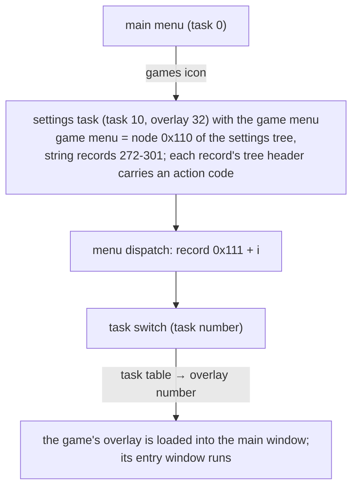

# Built-in games

Status: draft, 2026-11

V1.7.8 contains **33 complete games**: 29 reachable from the game menu and **4 hidden ones** whose code and entry
windows are intact but which have no menu entry. Each game is an overlay (81-111) that runs in the main overlay
window as its own task (14-46). Games are written to one common plan (an entry window with tick, key and paint
callbacks, a level number, a simple pseudo-random generator and shared drawing helpers). They are **silent**: no game
calls any audio code, and music started before keeps playing in the background. The game menu is part of the settings
task. The factory firmware had 11 games, the oldest image almost none [AP30, WEB]. All facts are from V1.7.8 [AP30]
unless tagged otherwise.

## Contents

- [The game list](#the-game-list)
- [Hidden games](#hidden-games)
- [How a game is launched](#how-a-game-is-launched)
- [How a game is built](#how-a-game-is-built)
- [Resources available to a game](#resources-available-to-a-game)
- [Differences between releases](#differences-between-releases)
- [Known game bugs](#known-game-bugs)
- [Community use of the game slots](#community-use-of-the-game-slots)
- [Open questions](#open-questions)
- [Sources](#sources)

## The game list

"Menu record" is the string-table record of the menu entry; "levels" is the range the game's level-start code
accepts (values outside fall back to level 0), where it was traced [AP30].

| Menu record | Game | Task | Overlay | Levels | Notes |
|---|---|---|---|---|---|
| 273 | Retro Block Puzzle | 15 | 82 | | falling-block puzzle; handles a microSD change itself (forces a library rebuild) |
| 274 | Snake | 14 | 81 | speed level = score / 100 (max 9) | score capped at 99,999 |
| 275 | Box Pusher | 16 | 83 | 50 | push boxes onto targets |
| 276 | Brick Breaker | 17 | 84 | 20 | paddle and ball |
| 277 | Block Shooter | 18 | 85 | 30 | invaders-style; a boss every 5th level; 3 lives |
| 278 | Tank Battle | 19 | 86 | 30 | maze of walls generated from the level number (the same map every time), base to defend; the largest game overlay (0x35e8 bytes of code) |
| 279 | Gomoku | 22 | 89 | 20 | five in a row against the AI |
| 280 | Minesweeper | 21 | 88 | 99 | |
| 281 | Maze | 20 | 87 | 20 | maze generated from the level number, time limit |
| 282 | Sudoku | 23 | 90 | 50 | puzzle generated at random |
| 283 | Make 24 | 24 | 91 | 50 | combine four numbers to 24; number range widens with the level; undo |
| 284 | Number Merge (2048) | 25 | 92 | 50 | |
| 285 | Number Slide | 26 | 93 | 50 | 15-puzzle style |
| 286 | Match 3 | 27 | 94 | 50 | |
| 287 | Pair Link | 28 | 95 | 50 | connect matching tiles |
| 288 | Reversi | 29 | 96 | 50 | against the AI |
| 289 | Jigsaw Puzzle | 31 | 98 | 30 | grid size grows with the level |
| 290 | Memory Match | 32 | 99 | 30 | 4 × 4 up to 5 × 6 cards |
| 291 | Fruit Catch | 34 | 101 | 30 | |
| 292 | Car Racing | 35 | 102 | 30 | |
| 293 | Gold Catch | 36 | 103 | 30 | claw game, 10 tries |
| 294 | Sky Shooter | 37 | 104 | 30 | vertical shooter, a boss every 5th level, 3 lives |
| 295 | Bubble Pop | 38 | 105 | 30 | bubble shooter |
| 296 | Chinese Checkers | 30 | 97 | 30 | its entry callbacks live in section 0 (0x03054f00-0x0305523c), not in the overlay |
| 297 | Frog Crossing | 39 | 106 | 30 | 3 lives |
| 298 | Block Puzzle+ | 40 | 107 | | a second falling-block game with a piece bag |
| 299 | Space Battle | 41 | 108 | | shooter |
| 300 | Chinese Chess | 43 | 109 | | xiangqi against the AI; shares overlay 109 with Mole Hunt |
| 301 | Mole Hunt | 42 | 109 | | whack-a-mole with bombs |

[AP30, analysis of firmware V1.7.8: the game menu dispatch in overlay 32 and the task table.] English names are the
English menu strings. Menu record numbers and task numbers follow different orders (e.g. Snake is task 14 but record 274)
[AP30]. Overlay 100 holds two hidden games and overlay 109 two menu games,
which is why 33 games fit in 31 overlays.

## Hidden games

Four games are complete but unreachable: their task entry windows are still in the task table, only the menu
entry is missing. None has a title string; the names below describe the code [AP30]:

| Task | Overlay | Game (descriptive name) | What it is |
|---|---|---|---|
| 33 | 100 | "Flappy" | fly a bird through the gaps of pipe pairs (seed constant 0xf1a99b); 30 levels |
| 44 | 100 | "Bomber" | bomb-laying maze game: steel pillars, bricks, pickups, up to 8 enemies, a hidden exit; 30 stages |
| 45 | 110 | "Maze Chase" | eat every dot in a maze while 4 chasers hunt you; power pellets turn them blue |
| 46 | 111 | "Dig Runner" | collect the gold on platforms with ladders and bars, dig holes in bricks to trap 3 chasers |

Reaching them needs a menu entry (a string-table record with an action code that the menu dispatch maps to the task)
or a patched task switch to tasks 33, 44, 45 or 46: a change to the firmware, not a setting [AP30]. A slot launcher
like the community emulator's (below) could also start them.

## How a game is launched

[AP30.] The main menu opens the settings task with argument 7 for its second item, which is the games icon by the
reviews' description of the home screen [AP30 + WEB; mapping of icon to item inferred]. The settings tree format and
the string table are described in [ui_and_settings.md](ui_and_settings.md) and
[../formats/resources.md](../formats/resources.md).

Leaving a game: in Snake the Back key (key code 0x002) leaves the game, and a long press of Back returns to the main
menu [WEB nkahoang, tested on a device]. Retro Block Puzzle handles Back in its idle key handler [AP30]. Per-game
key maps are not documented here yet.

## How a game is built

Every game overlay follows one plan [AP30]:

- **Entry window** (the task's descriptor): `service` = a timer tick, `key`, `paint`, `init`, `deinit`, the same
  seven-word window struct as every screen ([architecture.md](architecture.md#os-layer-main-loop-tasks-windows-services)).
- **Painting by message**: 0x186 = full redraw, 0x189 = partial redraw, 0x18b = status-bar redraw.
- **Level start**: a "new game (level)" or "start level (level)" routine clamps the level (most games 30 or 50
  levels) and sets up the board; action games show a "Level N" / "STAGE N" banner for 25 frames.
- **Randomness**: a linear congruential generator, `x = x × 0x41c64e6d + 0x3039`, seeded from the system tick XOR
  `level × 0x9e3779b1` XOR a per-game constant, often ASCII: 0x534c4944 "SLID", 0x4d417443 "MAtC", 0x4c696e6b "Link",
  0x20482048 "2048", 0xf1a99b ("flappy"). Tank Battle seeds from the level only, so its maps are the same every time.
- **Drawing**: a handful of helpers copied into each overlay that needs them (horizontal and vertical lines, rectangle
  outlines, filled circles and ellipses, pixels, an integer square root), on top of the section 0 drawing and text
  routines.
- **State**: level-scoped data (boards, pieces, positions) lives in the main data window from 0x03023b48.
- **Backlight**: most games disable the backlight auto-off timer in their init; Bomber and Chinese Chess leave it
  active ([known_bugs.md](known_bugs.md)).

## Resources available to a game

| Resource | Amount | Note |
|---|---|---|
| Code | ~13.5 KiB (main window 0x030815c4-0x03084bac) | the largest game, Tank Battle, sets the size |
| Data + bss | ~5.4 KiB (from 0x03023b48) | |
| Calls into section 0 | drawing, text, keys, messages, timers, backlight, random numbers, files | no audio |
| Screen | 296 × 240, RGB565 | |

[AP30.] Games make **no audio calls** at all: there are no sound effects and no game audio interface. The player
service keeps running while a game is open, so **background music continues** with core B decoding [AP30; a device
check is still to be done]. The only game code that stops music is Retro Block Puzzle's microSD handling, which forces
a library rebuild (its window overlaps the playback window) [AP30].

A community project reports that more RAM is usable while a game runs (data up to 0x0302fd98 and 28 KiB of code
window at 0x03084c00-0x0308bc00) without trouble [WEB nkahoang]. Memory map: [architecture.md](architecture.md#ram-use).

## Differences between releases

| Image | Games | Tag |
|---|---|---|
| `HIFIYF26.IMG` (2026-07-23, 0.0.0) | almost none: the image has 83 section slots (V1.7.8: 113) and 277 string records (V1.7.8: 307). A reviewer who started on the first build wrote that the later update "added 10 games" to reach 11, which suggests one game before [WEB, ?] | [AP30], [WEB] |
| `HIFIYF05.IMG` (2026-08-19, 5.0.0, "11-Game Firmware") | 11: Retro Block Puzzle, Snake, Box Pusher, Brick Breaker, Block Shooter, Tank Battle, Gomoku, Minesweeper, Maze, Sudoku, Make 24 (the list a reviewer gave after the update; "production units will have all 11 games built in") | [WEB], [AP30] (string records: 289) |
| `HIFIYF18.IMG` (2026-10-19, V1.7.8) | 29 in the menu + 4 hidden | [AP30] |

The 11 games of the factory release are exactly V1.7.8's tasks 14-24 (overlays 81-91) [WEB list vs AP30 task table].
Whether the four hidden games already exist in 5.0.0 has not been checked [?]. Games are absent from every Echo Mini
release: they are Hidizs' addition [EM]. Release history: [../overview/firmware_releases.md](../overview/firmware_releases.md).

## Known game bugs

Analysis found many small defects in the games, mostly harmless: win states never set (so "YOU WIN!" screens never
show in several games), a tie in Reversi counted as a loss, Gomoku's AI score overflowing a 16-bit value, Box Pusher
levels whose start cell hides a target, Minesweeper never restarting from "Over", Bubble Pop showing only three score
digits, and the backlight timer left active in two games [AP30]. Full list with addresses:
[known_bugs.md](known_bugs.md).

Owners mostly complain about the controls (small, stiff buttons; slow response) and the small screen
([../community/user_feedback.md](../community/user_feedback.md)).

## Community use of the game slots

The open project [nkahoang/hidizs-ap30-game-emu](https://github.com/nkahoang/hidizs-ap30-game-emu) runs a Game Boy
emulator inside a stock game slot, using the window callbacks and section 0 routines described above (several checked
in an emulator and on a device) [WEB]. See [../related/community_projects.md](../related/community_projects.md).

## Open questions

- Do the four hidden games exist in the 5.0.0 image (and the games in 0.0.0 at all)? [?]
- The level ranges of Retro Block Puzzle, Block Puzzle+, Space Battle, Mole Hunt, Chinese Chess and the two maze-chase
  games [?].
- Background music during a game: the code says it keeps playing; to confirm on a device.
- Which main-menu item index belongs to which icon (the games icon is inferred to be item 1) [?].

## Sources

- [AP30] analysis of firmware V1.7.8: overlays 81-112, the game menu dispatch in overlay 32, the task table.
- [WEB] reviews describing the game list before and after the 11-game update (mobileaudiophile, Head-Fi), collected in
  [../community/user_feedback.md](../community/user_feedback.md):
  [QuietlyAmused, mobileaudiophile](https://mobileaudiophile.com/daps/hidizs-ap30-musicboy-review-you-win-little-you-lose-some-more/),
  [Ichos, Head-Fi](https://www.head-fi.org/showcase/hidizs-ap30-music-boy.29215/review/44646/).
- [WEB] [nkahoang/hidizs-ap30-game-emu](https://github.com/nkahoang/hidizs-ap30-game-emu) `docs/FINDINGS.md`
  (window API, free RAM, Back key).
- [WEB] [Hidizs Download Center](https://www.hidizs.net/pages/download-center) ("11-Game Firmware").
- [EM] official Echo Mini images (no game overlays in any release).
