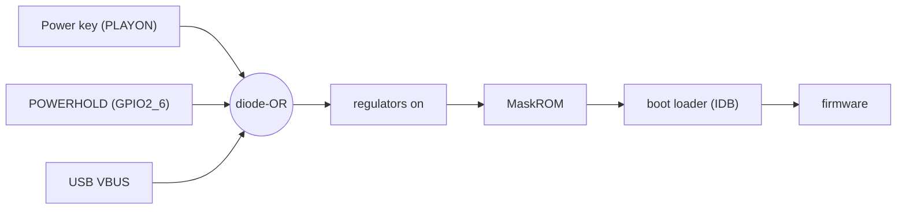
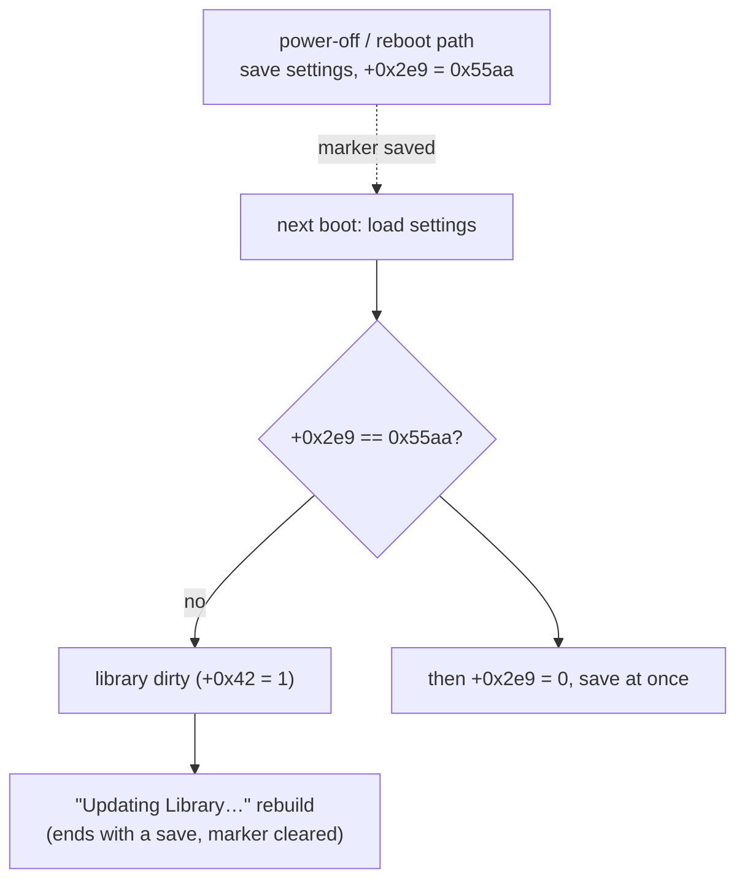

# Power management (firmware side)

Status: draft, 2026-11

What the stock firmware does about power: how it keeps the player switched on, how it switches off and marks a
clean shutdown, how it measures the battery and decides "low", how charging is reported, when the backlight and the
whole player time out, how it uses the watchdog, and how it scales clocks. The AP30 has no PMIC: power is held by a
GPIO latch, the Power key and USB power, and an external circuit resets the player after an 8 s Power press. The
stock firmware never uses the SoC's low-power mode; "sleep" means backlight off plus lower clocks while the main
loop keeps running. The board-level side (power tree, charger, battery, 8 s reset circuit) is on
[hardware/power.md](../hardware/power.md).

## Contents

- [Power-on](#power-on)
- [Power-off and the clean-shutdown marker](#power-off-and-the-clean-shutdown-marker)
- [Reboot paths](#reboot-paths)
- [Battery measurement](#battery-measurement)
- [Low battery](#low-battery)
- [Charging state](#charging-state)
- [Backlight timeout](#backlight-timeout)
- [Idle power-off and sleep timer](#idle-power-off-and-sleep-timer)
- [Watchdog](#watchdog)
- [Clock policy](#clock-policy)
- [No PMU sleep](#no-pmu-sleep)
- [Bugs in this area](#bugs-in-this-area)
- [Open questions](#open-questions)
- [Sources](#sources)

## Power-on

[AP30 unless tagged; the diode-OR is from Rockchip's reference design and matches the AP30's behaviour, [?] for the
exact circuit]

1. The Power key or USB power switches the regulators on. The boot loader raises **POWERHOLD (GPIO2_6)** at the very
   start, so the key can be released ([boot_loader.md](boot_loader.md)).
2. The firmware's pin setup raises POWERHOLD again, drives the Bluetooth module's pins low and the backlight pin low,
   and points the USB data switch at the SoC.
3. **Boot battery check** (overlay 1): 18 ADC samples on channel 0, the first 10 discarded, the rest averaged. If USB
   power is absent and the result is **≤ 3299 mV**, the firmware waits 200 ms and drops POWERHOLD (off).
4. **Boot target**: USB power present at boot → the **charge screen** (task 12) instead of the main menu. The charge
   screen shows one of five battery images by level.
5. The watchdog is started ([Watchdog](#watchdog)), and the clock manager starts with the "base system" and "UI"
   profiles ([Clock policy](#clock-policy)).

An unused check in overlay 1 would power off when booted without USB power, Power read as pressed, and no reboot
marker in RAM (the string `NanoCRebootFlag` at 0x0309fff0, top of the PMU SRAM, written by the reboot path). Nothing
calls it in V1.7.8 [AP30].

## Power-off and the clean-shutdown marker

### Triggers [AP30]

| Trigger | Path |
|---|---|
| Power held > 200 key steps (~2 s) | key scan → message 0x1a |
| Low battery | low-battery popup, power-off 3 s later (message 0x1a) |
| Auto Off (idle) timer | off / 1 / 5 / 10 min of no activity, held during playback → message 0x1a |
| Sleep timer | off / 10 / 15 / 30 / 60 / 120 min → message 0x1a |
| other UI paths | message 0x1a6 |

### Sequence [AP30]

1. Stop the background services.
2. Power the Bluetooth module down and drive its UART pins low.
3. **If USB power is present, do not switch off**: go to the charge screen instead (with VBUS in the diode-OR,
   dropping POWERHOLD would not cut power anyway).
4. Save the settings with the **clean-shutdown marker** set (configuration block +0x2e9 = 0x55aa).
5. Mute the DAC (GPIO2_1 high), show the goodbye image for about 0.5 s (10 × 50 ms, watchdog kicked). In USB DAC mode
   the goodbye image is skipped.
6. Backlight off, panel standby, ADC stop, watchdog interrupt off and watchdog stop, storage drivers shut down.
7. Wait 1 s, then POWERHOLD = 0.
8. If code still runs, something else holds power (Power still pressed, or USB power). Wait until Power is released;
   if Power is then pressed again for more than about 10 polls of 10 ms, reboot.

Device behaviour that fits this [AP30, measured on a device; the exact sequence of events is not traced, [?]]:
holding Power while on gives the goodbye screen, then a new boot (step 8). Holding Power *through* that restart ends
in the external ~8 s reset, without a goodbye screen.

### Clean-shutdown marker and the library rebuild [AP30]

* Any stop that skips the power-off path (the 8 s hardware reset, a battery pull, a crash plus watchdog reset)
  leaves the marker cleared, so the next boot rebuilds the media library. On a device the rebuild screen lasted about
  480 ms (measured from a phone video) and does not appear after a normal boot [AP30, measured on a device].
* Other "library dirty" sources: a disk format, a USB File Transfer session in which the host wrote, file deletion in
  the browser, the update flow, some Library-menu paths [AP30]. See
  [storage_and_filesystems.md](storage_and_filesystems.md).
* Configuration block layout: [ui_and_settings.md](ui_and_settings.md#the-configuration-block).

## Reboot paths

The firmware has one reboot routine (section 0, 0x03053d9e) with an address argument and flags [AP30]:

| Request | What it does |
|---|---|
| plain reboot (message 0x183) | save settings (clean marker), stop the watchdog, shut the drivers down, reset (AIRCR = 0x05FA0007) |
| reboot into **loader USB mode** (message 0xb8) | same, plus `PMU_SYS_REG3` (0x5002004c) = 0xFFFF18AF before the reset |
| jump to **MaskROM USB** (message 0xb9) | save settings, then call the boot ROM's USB entry (pointer at ROM address 0x8c) |

Before the reset the routine also writes the `NanoCRebootFlag` RAM marker, ungates every clock, releases every
soft reset, returns pins to their defaults and selects ROM-at-0 [AP30]. The loader-mode and MaskROM requests come
from the USB vendor commands ([usb_modes.md](usb_modes.md)). After a successful firmware update the firmware instead
sets the watchdog timeout to its minimum and spins, so the **watchdog** reboots the player
([update_process.md](update_process.md)).

`PMU_SYS_REG3` survives a soft reset but not the external 8 s reset, and the firmware never reads it [AP30];
whether a watchdog reset keeps it is not measured [?]. Marker meanings: [boot_loader.md](boot_loader.md).

## Battery measurement

[AP30 unless tagged]

* ADC channel 0, 10 bit. **mV = raw × 5000 / 1024** (2.5 V reference behind a 2:1 divider; the divider value is
  from the reference design [?]).
* The ADC runs round-robin from the 10 ms key tick (key channel three times, battery once), so the battery service
  gets a fresh sample every 40 ms.
* **Level 0-4** from the thresholds **3450 / 3540 / 3666 / 3774 / 3964 mV**: level = (number of thresholds ≤ mV) − 1,
  clamped at 0; above 3964 mV → 4. Table at 0x03005758.

| mV | < 3540 | 3540-3665 | 3666-3773 | 3774-3963 | ≥ 3964 |
|---|---|---|---|---|---|
| level | 0 | 1 | 2 | 3 | 4 |

* A level change raises message 0x1e (status bar redraw).
* **While charging** the reading is inflated by the charge current, so the UI animates the battery icon (every
  0.5 s) instead of showing the level. When the charger goes away the firmware re-averages 10 fresh samples and
  recomputes the level at once.
* The battery's NTC wire is not read by any firmware ADC channel (only channels 0 and 1 are used), so temperature
  protection is presumably done by the charger hardware [AP30 + board photos, ?].
* [EM] the Echo Mini community firmware EchoPod also shuts down below 3450 mV.

## Low battery

Below **3450 mV for 21 consecutive samples** → message 0x1b, the low-battery popup ("Low battery!"), keys ignored,
power-off request 3 s later [AP30]. At boot, ≤ 3299 mV without USB power switches off at once
([Power-on](#power-on)).

## Charging state

States: 0 not charging, 1 charging, 2 full [AP30].

* **Charger present** = USB power seen and stable for 0.5 s, and then either the USB detection timed out after 3 s
  (a charger, no host) or a USB session is active (message 0x21) [AP30]. See [usb_modes.md](usb_modes.md).
* On charger attach the firmware drives **GPIO1_0** high (its role as a charge control line is a guess [?]) and resets
  the "full" counter; in USB DAC mode charging is deliberately suppressed [AP30].
* **Full**: GPIO2_3 sampled every 5 s; more than 20 consecutive high samples (about 100 s) → state 2, "Fully
  charged" [AP30].
* No charge-current or termination control in firmware: the charge-current setter only stores a value and the two
  charge hooks are empty [AP30].
* Charging behaviour per USB mode: [usb_modes.md](usb_modes.md#charging-in-each-mode).

## Backlight timeout

[AP30]

* Timeouts (configuration byte +0x18): **15 / 30 / 60 / 180 / 300 / 1800 s**, table at 0x03005746; a 0 entry means
  never (the menu offers the first six).
* Any key or UI activity restarts the idle timer (67 places in the code); a wheel step does too.
* When idle longer than the timeout, or on a short Power press (message 0x16): backlight off, message 0x15, key lock
  on (see [display_and_input.md](display_and_input.md#screen-off-wake-and-standby)).
* Suspended while message 0x1c ("hold") is set: games, the BT Music screen and the picture slideshow use it, and so
  does the key lock itself.
* Brightness levels: [display_and_input.md](display_and_input.md#backlight-and-brightness-levels).

## Idle power-off and sleep timer

Two software timers on the 10 ms tick, both ending in message 0x1a (power-off) [AP30]:

| Timer | Setting (configuration byte) | Values | Notes |
|---|---|---|---|
| Auto Off (idle) | +0x1b | off / 1 / 5 / 10 min | restarted by activity (45 places); held during playback |
| Sleep Timer | +0x1a | off / 10 / 15 / 30 / 60 / 120 min | started from the setting, independent of activity |

A sleep-timer value out of range in the saved block survives the load check and indexes past the 6-entry table
([known_bugs.md](known_bugs.md)).

## Watchdog

[AP30 unless tagged]

* The SoC's watchdog (base 0x40120000, IRQ 8) is started at boot: control = 0x16 (enable, interrupt on the first
  timeout and reset on the second, 64-cycle reset pulse), timeout range 13 = 2^29 APB clock cycles. At the boot APB
  clock of 50 MHz that is about 10.7 s to the interrupt and ~21 s to the reset; the real period changes with the clock
  profile [AP30 values; the periods are computed, ?].
* Kicked (write 0x76 to the restart register) from 60 places, including long file-system loops, the UART receive loop
  and the update writer.
* Its interrupt handler does **not** clear the interrupt: it changes one GRF setting and spins until the second
  timeout resets the chip. A debug message for this case is compiled out.
* The reboot and power-off paths stop the watchdog first. After a successful update the firmware sets the timeout
  register to 0 and spins: a deliberate watchdog reboot.
* A watchdog reset keeps `PMU_SYS_REG3`, so the boot loader's markers still apply [TRM + boot loader code; not
  measured, [?]].
* The crash handler (every unregistered exception) prints PC, LR, MSP and PSP to UART1, which on the AP30 is the
  Bluetooth link, then hangs until the watchdog or the 8 s reset [AP30].

## Clock policy

The firmware's clock manager (section 0; requirement table at 0x0307DF10) works with numbered "modules" [AP30]:

* 36 module ids, each with requirements for six clock targets: PLL, system core, system bus, APB, core B, core-B bus.
* Each subsystem enters or leaves its module; the requirements of all active modules are **added** per target.
* Floors: 96 MHz on the first four targets unless only the idle module is active. Caps: PLL 450 MHz, system core
  200 MHz, system bus 200 MHz, APB 75 MHz, core B 450 MHz.
* Then the smallest PLL frequency that both cores' targets divide is chosen (dividers 1-8), APB = bus / 2^n. With
  only the boot modules active: PLL 200 MHz, system core 200 MHz, APB 50 MHz (the same values the Echo Mini
  community firmware RECHO reads back [EM]). At or below 24 MHz the code runs from the crystal through a divider,
  down to 375 kHz.

| Module (examples) | PLL / sys / bus / APB / core B / core-B bus (MHz) |
|---|---|
| base system (on from boot) | 96 / 96 / 96 / 96 / 0 / 0 |
| UI / display (on from boot) | 200 / 200 / 200 / 75 / 0 / 0 |
| pictures, e-book, cover art | 450 / 200 / 200 / 75 / 0 / 0 |
| library rebuild, favourites | 400 / 200 / 200 / 75 / 0 / 0 |
| file-system work (remount, delete, background scan) | 450 / 200 / 200 / 75 / 450 / 450 |
| USB VBUS service | 400 / 200 / 200 / 75 / 400 / 400 |
| USB audio (unused class) | 48 flat |
| decoding profiles (18 entries) | core B 300-480, chosen per format and sample rate ([audio_playback.md](audio_playback.md)) |

**Change protocol** (order matters) [AP30]: mask the deferred audio service, tell core B a change is coming (mailbox
channel 0, command 2; wait up to ~50 ms for its answer), suspend DMA channels 0-4 (channel 5, the I2S feed, keeps
running: audio clocks come from the audio PLL); reprogram PLL and dividers; resume DMA, notify core B (command 4),
unmask; re-time SysTick to stay at 10 ms; recompute the SD/eMMC card clocks and the LCD bus timing. Core B's copy of
the clock information is only given when core B starts, so it can go stale after later changes [EM, see
[dual_core.md](../hardware/dual_core.md)].

## No PMU sleep

* The firmware never writes the PMU's power-mode or wake-up registers: its only PMU accesses are the power-down
  control of the high-performance domain (core B + its RAM) and the `PMU_SYS_REG3` marker write [AP30, from the list
  of every register access in the image].
* Idle = backlight off and key lock while the main loop keeps running (waiting with WFI); core B and its RAM are
  powered down whenever no decoder runs [AP30].
* The PMU SRAM (64 KiB, survives soft resets) is used as ordinary memory: overlay code windows reach 0x0309f7cc and
  the reboot marker sits at 0x0309fff0 [AP30].
* The vendor's "60 days standby" claim cannot be reached with the CPU running, so it probably means "switched off"
  [WEB + ?].
* A real standby would be possible in principle: the SoC's low-power mode wakes on GPIO bank 2, which carries the
  Power key and the wheel phases (the ladder keys are ADC-only and cannot wake it) [TRM ch5, ?]. See
  [hardware/soc_rknanod.md](../hardware/soc_rknanod.md).

## Bugs in this area

Full entries in [known_bugs.md](known_bugs.md#power-battery-and-clocks):

* Power key held: the power-off request repeats every 120 ms [AP30].
* Out-of-range sleep-timer index survives the load check [AP30].
* The VDD-core adjust function returns without switching anything; charge hooks stubbed [AP30, ?].
* The USB attach detector can return a garbage status when USB power appears while the player runs [AP30].
* A word in the charge-full check is cleared on every check and never read [AP30, ?].

## Open questions

* Which part makes the 8 s reset, and whether it cuts power or pulls reset.
* Charger part, its current, and whether GPIO1_0 is its enable.
* Real APB clock in normal use (watchdog period).
* Standby and off currents.
* What the decoding profiles' exact table values are per format (partly decoded).

## Sources

* [AP30] analysis of firmware V1.7.8: section 0 (battery, backlight, timers, reboot, power-off, clock manager,
  watchdog), overlay 1 (boot checks, settings load), overlay 6 (charge screen), overlay 9 (USB); measurements on a
  device (library screen ~480 ms, 8 s reset repeating every ~10.5 s).
* [TRM] RKNanoD TRM V1.0, chapters 5 (PMU), 12 (SRAM), 17 (SAR-ADC), 20 (watchdog).
* [EM] [iamcheyan/echo-mini-newfw](https://github.com/iamcheyan/echo-mini-newfw) `ETUDE.md` (clock values read back by
  RECHO); [BasilSkyWalk/echopod](https://github.com/BasilSkyWalk/echopod) documentation (3450 mV shutdown).
* [WEB] Hidizs product page (standby claim).
