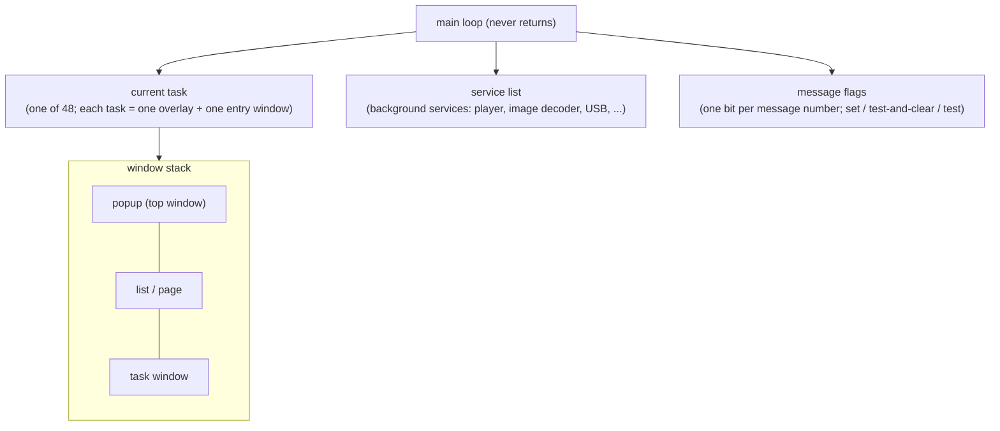

# UI, menus and settings

Status: draft, 2026-11

The stock AP30 firmware ("HidizsOS", built on the Rockchip RKnano SDK) draws its whole user interface itself: a
stack of windows per task, a few shared popups, a bitmap text renderer with 21 languages, and one big menu tree that
lives in the firmware's string table. Settings are kept in a 0x2f5-byte configuration block in RAM, saved with a
CRC-8 to a hidden reserved partition of the internal storage. This page describes the window system, the full
Settings tree of V1.7.8, the configuration block fields we know, languages and text rendering, and the special
pages (About, date and time, custom EQ, factory reset). Everything is from V1.7.8 unless another version is named.

## Contents

- [How the UI is built](#how-the-ui-is-built)
- [Main menu and the top-level screens](#main-menu-and-the-top-level-screens)
- [The menu tree in the string table](#the-menu-tree-in-the-string-table)
- [The Settings tree (V1.7.8)](#the-settings-tree-v178)
- [Special settings pages](#special-settings-pages)
- [The configuration block](#the-configuration-block)
- [Languages and text rendering](#languages-and-text-rendering)
- [Popups and messages](#popups-and-messages)
- [UI bugs](#ui-bugs)
- [Open questions](#open-questions)
- [Sources](#sources)

## How the UI is built

The OS layer, tasks and messages are described in [architecture.md](architecture.md). The short version for the UI:



* The **key handler** runs for the top window only.
* The **service handler** runs for EVERY window, top down.
* **Paint** runs after that (skipped while the key lock is on).

* **Window record** [AP30]: seven words: child, parent, service handler (+8), key handler (+0xc), paint handler
  (+0x10), init (+0x14), deinit (+0x18). Opening a popup pushes a window on top; closing a stack runs every
  deinit from the top down.
* **Task switch** [AP30]: a window asks for another task by number and passes an argument (for example a start node
  in the Settings tree). The new task's overlay is loaded into the shared code window and its entry window opened.
* **Message flags** [AP30]: a bitmap at 0x03023280. UI and drivers talk through numbered flags (for example 0x17
  "backlight is off", 0x1e "battery level changed", 0x192 "update file found"). The full list is in
  [architecture.md](architecture.md).
* **Software timers** [AP30]: 10 ms ticks; popups close themselves with them (1 s message box, 3 s key-lock popup).
* **Frame buffer and drawing**: see [display_and_input.md](display_and_input.md).

## Main menu and the top-level screens

The main menu (task 0, overlay 21) is a 2 × 3 icon grid [AP30]. Reviewers list the six icons as Music, Games,
E-book, Files, Bluetooth, Settings [WEB, reviews]. What each icon starts [AP30; the reading of the arguments as
1-based start nodes of the Settings tree is an inference, [?]]:

| Grid item | Starts | Argument | Screen |
|---|---|---|---|
| 0 | task 1 (overlay 22) | – | Library menu |
| 1 | task 10 (overlay 32) | 7 | Settings tree at its 7th top-level node = **Game** menu [?] |
| 2 | task 9 (overlay 31) | 3 | file browser filtered to TXT = **E-book** |
| 3 | task 9 (overlay 31) | 5 | file browser = **Files** |
| 4 | task 10 (overlay 32) | 3 | Settings tree at node 3 = **Bluetooth** [?] |
| 5 | task 10 (overlay 32) | 4 | Settings tree at node 4 = **System** settings [?] |

The main menu task also runs the firmware update when the boot scan found an update file (message 0x192, see
[update_process.md](update_process.md)), and it starts the library rebuild task when the library is marked dirty.

Other top-level screens [AP30]:

| Task | Overlay | Screen | More |
|---|---|---|---|
| 1 | 22 | Library menu: Now playing, All Music, Artist, Album, Genre, Directory List, Favorites | [storage_and_filesystems.md](storage_and_filesystems.md) |
| 2 | 23 | library list browser (category → sub-list → songs) | same |
| 3 | 27 | now playing + lyrics | [audio_playback.md](audio_playback.md) |
| 6 | 17 | picture viewer | |
| 8 | 30 | E-book (TXT reader) with bookmarks | |
| 9 | 31 | folder browser ("Internal" / "SD Card"), type filters, Delete file | |
| 10 | 32 | Settings (also the game menu, see below) | this page |
| 11 | 9 | USB mode menu | [usb_modes.md](usb_modes.md) |
| 12 | 6 | charge screen (boot task when USB power is present) | [power_management.md](power_management.md) |
| 13 | 5 | library rebuild ("Updating Library…") | [storage_and_filesystems.md](storage_and_filesystems.md) |
| 14-46 | 81-111 | games, 4 of them hidden | [games.md](games.md) |
| 47 | 112 | BT Music (Bluetooth screen) | [bluetooth.md](bluetooth.md) |

Tasks 4, 5 and 7 (video, radio, record in the SDK numbering) have empty overlays: those features were dropped
[AP30].

## The menu tree in the string table

All menu text, in all 21 languages, sits in the firmware's string table (format:
[formats/resources.md](../formats/resources.md)). V1.7.8 has 307 records per language [AP30]:

* **Records 0-123** are plain UI strings (labels, dialog texts, status texts).
* **Records 124-306** form the **menu tree**. Each record carries a tree header (id, parent, position in parent,
  first child, previous, next, a leaf number, child count, up to 29 child ids) plus the text [AP30]. The headers are
  identical in all languages; only the text changes.
* The **leaf number** numbers every leaf of the tree 0, 1, 2 … in table order: V1.7.8 has 155 leaves (0-154) with no
  gap [AP30]. This is the field Rockchip's menu-resource generator calls the "function index" [?: SDK tool
  convention]. The Settings code maps each leaf to an action (set a value, open a page, start a task).
* The tree is used for more than Settings: the E-book bookmark popup and the **game menu** are sub-trees of it
  [AP30]. Game *i* in the game menu (record 273 + *i*) is mapped to a task number by the Settings code; see
  [games.md](games.md).

The layout changes between releases: the factory 5.0.0 image has 289 records of 0x102 bytes (21 child slots, 100
text units), V1.7.8 has 307 records of 0x112 bytes (29 child slots, 99 text units) [AP30]. The oldest image we
have (0.0.0, 2026-07-23) has 277 records [AP30].

## The Settings tree (V1.7.8)

The English labels below are the UI labels of the V1.7.8 English block (language slot 2), shown as a tree. Numbers
in brackets are string-record numbers [AP30]. Leaves set a value unless noted.

```
Settings [124]
├── Music [125]
│   ├── Play Order [126] ............ Order · Shuffle
│   ├── Repeat [129] ................ Folder Once · Folder Repeat · Repeat One · All Once · Repeat All
│   ├── Equalizer (EQ) [135] ........ Normal · Bass · Metal · Pop · Jazz · Unique · Custom EQ (opens the EQ editor)
│   ├── Repeats [143] ............... ∞ · 1 … 10 Times          (A-B repeat count)
│   ├── Repeat Interval [155] ....... 1 … 7 Sec.                (pause between A-B repeats)
│   └── Scan Mode [163] ............. Accelerating Mode · Constant Speed Mode   (fast forward / rewind)
├── Recording Settings [166] ........ Recording Quality: High · Normal          (left over: no recorder)
├── Bluetooth [170]
│   ├── Bluetooth [171] ............. On · Off
│   ├── Search [174] ................ (starts a scan)
│   └── Paired [175] ................ (list of paired devices)
├── System [176]
│   ├── Date/Time [177] ............. (opens the clock editor)
│   ├── Display [178]
│   │   ├── Screen Off [179] ........ 15 sec · 30 sec · 1 min · 3 min · 5 min · 30 min
│   │   └── Brightness [186] ........ 1 · 2 · 3 · 4 · 5
│   ├── Power Timer [192]
│   │   ├── Sleep Timer [193] ....... Off · 10 · 15 · 30 · 60 · 120 min
│   │   └── Auto Off [200] .......... Off · 1 · 5 · 10 min      (idle power-off, held during playback)
│   ├── Filter [205] ................ Fast Roll-Off Minimum Phase · Fast Roll-Off Linear Phase ·
│   │                                 Slow Roll-Off Minimum Phase · Slow Roll-Off Linear Phase · Non-Oversampling (NOS)
│   ├── Gain Adjustment [211] ....... Low gain · High gain
│   ├── Screen-Off Button Settings [214]
│   │                                 Prev/Next Enabled · Volume Keys Enabled · All Buttons Disabled · All Buttons Enabled
│   ├── About [219] ................. (opens the About page)
│   ├── Language [220] .............. 21 languages
│   └── Reset [242] ................. Factory Reset · Format · Format SD   (each asks Yes/No)
├── Language [246] .................. 21 languages (second copy of the language list)
├── E-book [268] .................... Save bookmark · Load bookmark · Delete bookmark   (popup in the reader)
├── Game [272] ...................... 29 games (records 273-301)
└── Radio [302] ..................... China · Europe · Japan · United States        (left over: no FM tuner)
```

Notes [AP30 unless tagged]:

* **Recording Settings** and **Radio** come from the SDK's menu sheet. The AP30 has no recorder and no FM tuner
  (their task slots are empty), so these nodes are not reachable from the normal UI [AP30 task table; reachability
  from the Settings root not traced, [?]].
* The **Filter** values go to the CS43198's filter register (0x090000); **Gain Adjustment** goes to register
  0x080000 (see [hardware/audio_dac_cs43198.md](../hardware/audio_dac_cs43198.md)). The low-gain value is one the
  DAC data sheet marks reserved (see [known_bugs.md](known_bugs.md)).
* **Screen Off** is the backlight timeout ([power_management.md](power_management.md)); the table behind it also has
  a "never" entry that the menu does not offer [AP30].
* **Brightness** shows 5 levels, while the firmware's duty table has 6 entries; the mapping of UI level to table
  index is not checked ([display_and_input.md](display_and_input.md)) [?].
* **Screen-Off Button Settings**: which keys still work with the screen off. Full table in
  [display_and_input.md](display_and_input.md#screen-off-button-settings-key-lock-filter). The setting first
  appeared in the update described by the HIFIYF26 changelog [WEB, reviewers quoting the changelog].
* **Equalizer**: the menu has 7 entries, but the preset numbering in the EQ code does not match the SDK's gain
  table, so Metal, Pop, Jazz and Unique get the wrong curves (see [known_bugs.md](known_bugs.md)). Custom EQ has 5
  bands at 60 / 300 / 1000 / 3000 / 6000 Hz [WEB, review listing of firmware 1.3.5].
* A full listing of the firmware 1.3.5 tree in a public review matches this V1.7.8 tree
  ([ChifiLab on Head-Fi](https://www.head-fi.org/showcase/hidizs-ap30-music-boy.29215/review/44230/)) [WEB].

### Keys in the Settings list [AP30]

Up / Down move; A enters a node or applies a value; Back goes up one level and restores any previewed value (for
example brightness while browsing levels); leaving the root returns to the task that opened Settings (main menu,
now playing or the e-book reader, by entry point). The volume wheel opens a volume popup from inside Settings.

## Special settings pages

The Settings overlay (32) has four windows besides the list: a detail page (About, date and time), the custom EQ
editor, a backlight popup and the Yes/No dialogs [AP30].

| Page | Behaviour [AP30 unless tagged] |
|---|---|
| **About** | Shows the software version line, the header date of the installed image (month-day, read from the firmware header: a custom image with another header date shows that date) [AP30, device-verified], and internal / microSD storage total and free. The version text itself is hard-coded ("HDS_YXJ / Ver: 1.7.8") although the code reads the real version (see [known_bugs.md](known_bugs.md)). No licence or open-source line ([third_party_components.md](third_party_components.md)). |
| **Date/Time** | Clock editor; writes the RTC (PCF8563-compatible chip on I2C0, see [hardware/rtc.md](../hardware/rtc.md)). |
| **Custom EQ** | Band-gain editor feeding the EQ engine of overlay 36 ([audio_playback.md](audio_playback.md)). |
| **Factory Reset** | Asks "Restore Defaults?". Loads defaults from a descriptor block inside the firmware image (stage3 descriptor +0x154: language, volume, backlight, timeouts and more), clears both favourites lists, sets the RTC to **2026-08-19 09:00:00** (the factory firmware's build date), marks the library dirty and starts a rebuild. The weekday written to the RTC is garbage (uninitialised counter, see [known_bugs.md](known_bugs.md)). |
| **Format / Format SD** | Asks "Format Storage?", formats the internal user volume or the microSD card (MBR + one partition at sector 0x40), marks the library dirty. |

## The configuration block

The settings live in RAM at **0x03022894**, 0x2f5 bytes [AP30]. Known fields:

| Offset | Size | Meaning | Source |
|---|---|---|---|
| +0x08 / +0x0a / +0x0c | u16 ×3 | installed firmware version major / minor / revision = the update image's header version (5.0.0 factory, 8.0.0 after V1.7.8); returned by the USB vendor "info" command | [AP30, device-verified] |
| +0x10 | u8 | language slot (order below; 0x0c = Thai, 0x13 = Hebrew) | [AP30] |
| +0x12 | u8 | volume 0..100, default 30, clamped at load | [AP30] |
| +0x16 | u8 | a 0/1 setting; indexes a table {80, 100} that gates the screen-off key filter; meaning unknown | [AP30, ?] |
| +0x17 | u8 | brightness index (backlight duty table) | [AP30] |
| +0x18 | u8 | screen-off (backlight) timeout index | [AP30] |
| +0x1a | u8 | sleep timer index (off / 10 / 15 / 30 / 60 / 120 min) | [AP30] |
| +0x1b | u8 | auto-off (idle power-off) index (off / 1 / 5 / 10 min) | [AP30] |
| +0x1c | u8 | Screen-Off Button mode 0-3 | [AP30] |
| +0x2a | u8 | set to 2 at the start of an update | [AP30, meaning ?] |
| +0x2c | u8 | flag: media shortcuts with the key lock off; also blocks fast forward / rewind in the start-volume-limit editor | [AP30, ?] |
| +0x2e | u16 | library: total entries (non-zero = library usable) | [AP30] |
| +0x30 / +0x32 / +0x34 / +0x36 | u16 | library counts: All Music, Artist, Album, Genre | [AP30] |
| +0x38 | u16 | favourites count | [AP30] |
| +0x3a | u16 | a library counter decremented when a record is deleted | [AP30, ?] |
| +0x42 | u8 | **library dirty**: 1 = rebuild the media library | [AP30] |
| +0x4a … +0x5a | | browse position (list type, record, file number) for "Now playing" | [AP30] |
| +0x89 / +0x8b | | resume information: list type, file name | [AP30] |
| +0x19a | | A-B repeat count ("Repeats") | [AP30] |
| +0x1b2 | u8 | picture viewer slideshow on/off | [AP30] |
| +0x1cc … +0x2d9 | | Bluetooth: last device address, paired list, names, flags (see [bluetooth.md](bluetooth.md)) | [AP30] |
| +0x2de | u8 | update file number of the previous update | [AP30] |
| +0x2df | u8 | update file number set by the boot scan: *nn* of `HIFIYFnn.IMG`, or 0xF5 for `ECHOMINI.IMG` | [AP30] |
| +0x2e7 | u8 | DAC option byte written to CS43198 register 0x080000 (gain) | [AP30] |
| +0x2e8 | u8 | USB class selector (0 = mass storage, 1 = the SoC's own USB audio); only ever 0 on the AP30 | [AP30] |
| +0x2e9 | u32 | **clean-shutdown marker**: 0x55aa after a clean power-off, cleared at every boot | [AP30] |
| +0x2f1 | u32 | checksum: CRC-8, polynomial 0x1d, initial value 0x0f, over the first 0x2f1 bytes (0x1788 bits) | [AP30] |

The EQ preset, play order, repeat mode, scan mode, filter and gain values are also in the block (the Settings code
writes them), but their offsets are not mapped yet [?].

### Where and when it is stored

[AP30 unless tagged]

| Physical sector | Area | Content |
|---|---|---|
| 0x0000_0000 | IDB / loader | hidden from the loader's LBA space |
| 0x0000_2000 | FW1, FW2 | part 0 "system zone" |
| 0x0002_0000 | part 1, the reserved / config partition (200 MiB) | block 0: **settings record (this page)** · block 1: e-book bookmarks · block 2, 3: favourites (internal, microSD) · ...: media library database |
| 0x0008_4000 | user volume | FAT32, USB LUN 0 |

* Block 0 of part 1 (loader LBA 0x1E000, physical 0x20000) holds the settings, written through a 0x800-byte buffer
  that also carries "SAVE" and "INFO" magic words [AP30]. A device dump shows a "SAVE" header with the firmware date
  and version at the start of that area and a settings record a few sectors in, whose defaults equal the image's
  0x224-byte descriptor block [AP30, device dump]. Full layout:
  [formats/idb_and_flash_layout.md](../formats/idb_and_flash_layout.md).
* **Load at boot** (overlay 1, 0x03082090): read the block, check the CRC-8 and the magics. On failure every field
  is set to 0xFF and message 400 is raised, which makes the boot code probe the user disk and format it if the probe
  fails. Every field is then range-checked. If the clean-shutdown marker is not 0x55aa, "library dirty" is set. The
  marker is then cleared and the block written back at once, so the next boot notices any unclean stop.
* **Save**: on settings changes, at the end of a library rebuild (marker cleared) and in the power-off and reboot
  paths (marker set to 0x55aa). See [power_management.md](power_management.md).
* **`FWUP` tag** [AP30]: before reading the block, the loader code reads sectors 1-2 of the first boot-loader copy
  in the hidden boot area. If it finds the bytes `FWUP` there (sector 2, offset 0x1fc), it overwrites them with 0xFF,
  writes the two sectors back (only those 4 bytes change) and then parses that buffer as settings, which fails the
  CRC: the result is **factory defaults** and the user-disk probe. Who sets `FWUP` is unknown (a PC upgrade tool is
  a guess [?]); it was not set on the unit examined.

> **Warning:** the settings block and the boot-area sectors sit in hidden areas that the boot loader's USB mode does
> not expose as normal LBAs. Do not write them by hand. The IDB area (physical sectors 0..0x1FFF) holds the boot
> loader copies and is the recovery path; never write it, never run `rkdeveloptool ef`, never download random
> loaders. Recovery: [guides/recovery.md](../guides/recovery.md).

## Languages and text rendering

### The 21 languages

[AP30]

| Slot | Language | Slot | Language | Slot | Language |
|---|---|---|---|---|---|
| 0 | Chinese (Simplified) | 7 | German | 14 | Danish |
| 1 | Chinese (Traditional) | 8 | Italian | 15 | Dutch |
| 2 | English | 9 | Portuguese | 16 | Greek |
| 3 | Korean | 10 | Russian | 17 | Czech |
| 4 | Japanese | 11 | Swedish | 18 | Turkish |
| 5 | Spanish | 12 | Thai | 19 | Hebrew |
| 6 | French | 13 | Polish | 20 | Arabic |

This is the column order of Rockchip's 21-language menu sheets [?: SDK tool sheets seen in public SDK copies].
The language list appears twice in the tree (under System and as a top-level node); the Settings code picks the
language through a table of available languages [AP30]. The 5.0.0 image used Simplified characters in the
Traditional Chinese "Games" label; V1.7.8 fixed it [AP30].

### Text rendering

[AP30]

* Two bitmap fonts indexed directly by Unicode code point (BMP only): 12 px and 16 px, 1 bit per pixel, the glyph's
  advance in its last byte. Format: [formats/resources.md](../formats/resources.md).
* A text renderer state at 0x03022e00 holds position, gaps, mode, alignment, font choice and a clip rectangle.
  Strings from the string table are drawn in the current language.
* Script handling: **Thai** combining marks are joined to the previous glyph, **Hebrew** runs are reordered right
  to left, **Hangul** jamo are drawn full width. Arabic shaping is not mentioned in the code we read [?].
* Long titles scroll as a marquee.
* **Legacy encodings** for tags, lyrics, TXT files and file names: sections 63-69 of the firmware are code-page →
  Unicode tables (single-byte, CP932 Shift-JIS, CP950 Big5, CP949 Korean); GBK uses a separate table blob. The
  converter is chosen by the UI language (Japanese → Shift-JIS, Korean → CP949, Traditional Chinese → Big5, Simplified
  Chinese → GBK, others single-byte) [AP30].

## Popups and messages

Shared popups live in the resident section 0 [AP30]:

| Popup | Behaviour |
|---|---|
| Yes/No dialog | "Warning!" box with Yes / No buttons; A confirms, B cancels; result through messages 0xd7-0xdb |
| key-lock popup | shown when the screen is locked or unlocked; closes after 3 s |
| message box | one line of text; closes after a fixed 1 s (the requested hold time is ignored) |
| low-battery popup | "Low battery!", keys ignored, power-off 3 s later |
| volume popup | volume picture by level 0..100; opened by the wheel in most screens |

The status bar shows the Bluetooth state (off, on, connected), the clock and the battery level [AP30]. Popups are
drawn over a dimmed copy of the screen (meant as 80 %; the colour maths is wrong, see
[display_and_input.md](display_and_input.md)).

## UI bugs

Only the UI-level bugs are listed here; full descriptions with triggers and workarounds are in
[known_bugs.md](known_bugs.md#settings-browser-e-book-and-other-ui):

* About page shows a hard-coded version text [AP30].
* Factory reset and the first-boot RTC reset write a garbage weekday [AP30].
* A saved sleep-timer value out of range survives the load check [AP30].
* The message box ignores its hold time [AP30].
* The popup backdrop dimming comes out dark and greenish instead of 80 % brightness [AP30, ?].
* EQ presets Metal, Pop, Jazz, Unique use the wrong curves [AP30].

## Open questions

* Offsets of the EQ, play order, repeat, scan, filter and gain fields in the configuration block.
* Meaning of +0x16 (the {80, 100} gate), +0x2a and +0x2c.
* Whether the Recording Settings and Radio nodes can be reached at all.
* Why the language list appears twice (first-boot language picker? [?]).
* Mapping of the 5 brightness levels to the 6-entry duty table.
* Who writes the `FWUP` tag.
* Whether the "SAVE" header at the start of part 1 and the 0x800-byte settings record are one structure or two
  (the code view and the dump view do not line up exactly yet).

## Sources

* [AP30] analysis of firmware V1.7.8 (overlays 1, 21, 22, 32, section 0; string table English block), compared with
  5.0.0 and 0.0.0 where stated; device observations (About date, dump of the reserved area).
* [WEB] reviews: [ChifiLab, Head-Fi](https://www.head-fi.org/showcase/hidizs-ap30-music-boy.29215/review/44230/)
  (settings tree of firmware 1.3.5), [Ichos Reviews](https://ichos-reviews.com/hidizs-ap30-review/),
  [mobileaudiophile](https://mobileaudiophile.com/daps/hidizs-ap30-music-boy-review/) (main menu icons),
  [Austin Brooks, Head-Fi](https://www.head-fi.org/showcase/hidizs-ap30-music-boy.29215/review/44196/) (changelog with
  the Screen-Off Button setting).
