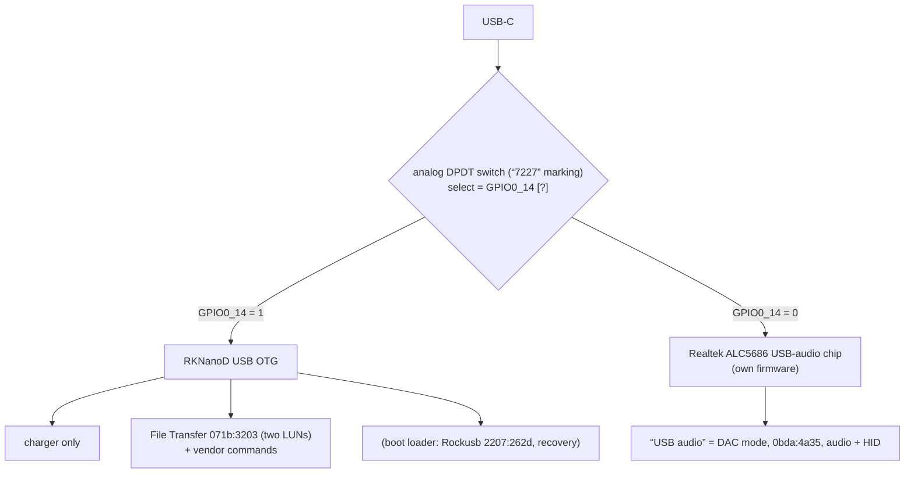

# USB modes (firmware side)

Status: draft, 2026-11

The AP30's USB-C port serves four purposes, and the stock firmware decides between them: **charging only**,
**File Transfer** (a two-LUN USB mass-storage device run by the RKNanoD), **USB audio** (DAC mode, which is not the
RKNanoD at all but a separate Realtek ALC5686 chip that the firmware switches onto the USB lines), and the hidden
**Rockchip vendor commands** inside File Transfer that reboot the player into the boot loader's USB mode or the
SoC's MaskROM USB mode. This page describes how the firmware detects a host, the mode menu, the mass-storage
device, every vendor command, the boot markers it leaves for the loader, the hand-over to the Realtek chip and
charging in each mode. The USB hardware (controller, switch, Realtek chip) is on [hardware/usb.md](../hardware/usb.md);
using the loader mode for recovery is on [guides/recovery.md](../guides/recovery.md).

## Contents

- [Overview](#overview)
- [Attach detection](#attach-detection)
- [The USB mode menu](#the-usb-mode-menu)
- [File Transfer (mass storage)](#file-transfer-mass-storage)
- [Rockchip vendor commands](#rockchip-vendor-commands)
- [Boot markers in PMU_SYS_REG3](#boot-markers-in-pmu_sys_reg3)
- [USB audio: hand-over to the Realtek chip](#usb-audio-hand-over-to-the-realtek-chip)
- [The unused built-in USB audio class](#the-unused-built-in-usb-audio-class)
- [Charging in each mode](#charging-in-each-mode)
- [Bugs in this area](#bugs-in-this-area)
- [Open questions](#open-questions)
- [Sources](#sources)

## Overview

| Mode | USB identity | Who serves it | Source |
|---|---|---|---|
| charging only | none (no host seen) | – | [AP30] |
| File Transfer | `071b:3203` ("Rockchip Media Player"), high-speed; INQUIRY vendor `HIFI MP3`, product `USB MP3` (LUN 0, internal) / `SD` (LUN 1), revision `1.00` | RKNanoD, overlays 10 + 12 | [AP30, measured on a device] |
| USB audio (DAC mode) | `0bda:4a35`, high-speed, bcdDevice 0.02, Manufacturer "Realtek", Product "AP30", a serial string built from VID, PID and a date; audio interfaces + a HID interface (HID 1.11) | Realtek ALC5686 | [AP30, measured on a device] |
| boot loader USB mode | `2207:262d`, high-speed, Rockusb | the boot loader in the IDB area | [AP30, measured on a device]; see [boot_loader.md](boot_loader.md) |
| MaskROM USB mode | Rockchip MaskROM Rockusb | the SoC's boot ROM | [AP30 code; not tried] |

That serial is probably the same on every unit [?]; it is not reproduced here.

## Attach detection

[AP30]

1. USB power (VBUS, a GRF status bit) is polled from the main loop and must be stable for 0.5 s (50 ticks).
2. The firmware powers the USB PHY, resets the controller and waits up to **3 s** for host activity.
3. **Host seen** → task 11 (overlay 9), the USB mode menu.
4. **Timeout** → charger only: charging starts, no USB function.
5. USB power removed → the session ends (message 0x0a), the idle power-off timer restarts, the charger flags clear.

A player that is switched off and gets USB power boots (USB power is part of the power-on circuit) into the
**charge screen** (task 12) [AP30]. From there the same detection runs.

## The USB mode menu

[AP30 unless tagged]

* Title "USB Mode", two options: **File Transfer** (option 0, default) and **USB audio** (option 1, DAC mode).
* Up / Down toggle, A picks, B picks File Transfer.
* **Timeout**: in V1.7.8 the menu waits 20 × 300 ticks = **60 s**, then takes the current choice. Reviewers saw the
  prompt disappear after about **3 s** on earlier builds (one with a photo of HIFIYF26) [WEB]; whether the timeout
  changed between builds is not checked in code [?].
* USB power removed while the menu is open → abort, back to option 0.
* A "resume DAC mode" flag lets the firmware skip the menu and go straight to DAC mode [AP30; who sets it ?].
* Task argument 0x10 makes the USB task reboot into MaskROM at once [AP30; caller not identified].

Leaving File Transfer: **B** leaves at once; the left pill (code 0x002) **twice within 1 s** also leaves; both mark
the library dirty and return to the main menu [AP30].

## File Transfer (mass storage)

[AP30]

* Overlay 10 = the USB device driver for the SoC's DesignWare-type USB 2.0 OTG controller (base 0x60080000,
  IRQ 5): standard requests and endpoint helpers. Overlay 12 = mass storage: bulk-only transport, SCSI commands, two
  LUNs (internal user volume, microSD).
* Sector jobs are queued by the interrupt handler and run from the main loop.
* After setting up the class the driver waits up to 10 s for the host to configure it.
* **Any host write marks the library dirty**: after the session the player rebuilds its media library.
* At session end the firmware switches to the microSD disk if a card is present (else the internal disk) and remounts.
* USB-IF mass-storage compliance checks (CBW / data-length cases) are compiled out.

## Rockchip vendor commands

Inside File Transfer the SCSI dispatcher (overlay 12, 0x030837ee) accepts Rockchip vendor commands [AP30]:

| CDB byte | 0 | 1 | 2-5 | 6-7 | 8-9 |
|---|---|---|---|---|---|
| Value | `FF` | `E0` | `c3 c2 c1 c0` | `p1 p0` | `00 00` |
| Meaning | opcode 0xFF | 0xE0 = Rockchip vendor command | code = CDB[2..5], big-endian | param = CDB[6..7], big-endian | |

| code | param | Data | Effect | Tested on a device |
|---|---|---|---|---|
| `FFFFFFFF` | `000C` | in, 12 bytes | **info**: u16 boot-loader version (0x0416 on the unit tested = loader 4.16), u32 firmware version (major << 24 \| minor << 16 \| revision; the installed image's header version, 5.0.0 factory, 8.0.0 after V1.7.8) | yes |
| `FFFFFFFC` | `0010` | in, 16 bytes | a constant block (read-only) | – |
| `FFFFFFFD` | – | – | ignored | – |
| `FFFFFFFE` | ≠ 0 | – | status, USB detach, message 0xb8 → **reboot into loader USB mode** (`PMU_SYS_REG3` = 0x18af, then reset) | sent: the screen went black (loader running), but the loader's high-speed device did not appear in those attempts |
| `FFFFFFFE` | 0 | – | status, USB detach, message 0xb9 → **MaskROM USB mode** (jump to the boot ROM's USB entry at ROM address 0x8c; text "Firmware Upgrade...") | no |
| `FFFFFFF6` | – | – | status, USB detach, no reboot | – |

An **id** query answers `RKNANOC` [AP30, measured on a device] (the chip is an RKNanoD; the string is a leftover,
see [hardware/soc_rknanod.md](../hardware/soc_rknanod.md)).

So the two reboot CDBs are:

| Target | CDB |
|---|---|
| loader USB mode | `FF E0 FF FF FF FE 00 01 00 00` |
| MaskROM USB mode | `FF E0 FF FF FF FE 00 00 00 00` |

Path inside the firmware [AP30]: the vendor handler (overlay 12, 0x0308363c) raises message 0xb8 or 0xb9 → the USB
task's service (overlay 9, 0x03084abe) sees it → the reboot routine (section 0, 0x03053d9e) saves the settings with
the clean marker and either writes `PMU_SYS_REG3` = 0xFFFF18AF and resets (AIRCR = 0x05FA0007), or selects ROM-at-0
and jumps to the ROM's USB entry. Message 0x183 = plain reboot through the same routine.

> **Warning:** the MaskROM path leaves the player in the SoC's ROM, where the internal storage is not reachable until
> a matching RKNanoD loader is downloaded into RAM. Do not use it unless the boot loader path has failed. Never run
> `rkdeveloptool ef`, never download (`db`/`ul`) random loaders, and never write the IDB area (physical sectors
> 0..0x1FFF). The proven recovery path is the boot loader's USB mode entered with **D-pad Right + Power** with the
> cable connected: [guides/recovery.md](../guides/recovery.md).

## Boot markers in PMU_SYS_REG3

`PMU_SYS_REG3` (0x5002004c) is a PMU scratch register that survives a soft reset. Its low 16 bits carry a boot marker
between the firmware, the boot loader and the ROM ([boot_loader.md](boot_loader.md)) [AP30 unless tagged]:

| Low 16 bits | Written by | Meaning at the next boot |
|---|---|---|
| `0x18af` | firmware (loader-mode reboot) | loader USB mode; the loader rewrites it to 0x18ef |
| `0x18ef` | loader | one more loader-mode boot, then 0 (this is why repeated loader resets alternate between loader and firmware) |
| `0x18bf` | (not used by the stock firmware) | jump to the ROM's USB code (MaskROM) |
| `0x18df` | loader | firmware booted from FW1 |
| `0x18cf` | loader | firmware booted from FW2; makes FW2 sticky across soft resets |

* The firmware **never reads** the register; its only access is the 0x18af write [AP30].
* The external 8 s Power reset clears it (power-on-class reset) [AP30, measured on a device].
* The write uses the PMU's write-mask convention (upper half = mask), hence 0xFFFF18AF [AP30].

## USB audio: hand-over to the Realtek chip

When the user picks **USB audio**, the RKNanoD does not start its own USB stack. It moves the USB data lines to the
Realtek ALC5686 and gets out of the audio path [AP30; pin roles from code only, no board check]:

**Enter** (overlay 9, in this order):

| Step | Pin / action | Value | Role |
|---|---|---|---|
| 1 | DAC-mode flag | set | |
| 2 | GPIO1_4 | 1 | audio-path enable [?] (it also goes high when local playback starts, so DAC/amp power is more likely than a USB switch) |
| 3 | **GPIO0_14** | **0** | USB data switch → Realtek [?] |
| 4 | GPIO2_1 | 0 | CS43198 mute line released |
| 5 | GPIO1_0 | held low, "suppress charging" flag set | charge control [?] (also the I2S1A clock pin) |
| 6 | RKNanoD USB stack | **not started** | |
| 7 | GPIO0_12 | 1, 0.5 s later | Realtek enable / reset [?] |

**Exit** reverses it: GPIO1_4 = 0, GPIO0_14 = 1, GPIO2_1 = 1, GPIO0_12 = 0; then GPIO1_0 = 1 if USB power is still
present (charging back on), and the key timer interrupt is re-registered [AP30].

While the Realtek chip is active the RKNanoD keeps its UI running (DAC-mode screen, clock, battery icon, a volume
picture from the stored volume), and still handles the backlight, the Power key and the key lock [AP30]. It is
**not** in the audio data path: the Realtek chip presumably feeds the CS43198 over I2S [?]. Who configures the
CS43198 in this mode is not traced; the enter path does not run the DAC init [AP30, ?].

User-visible consequences, explained by the code:

* **The wheel does nothing in DAC mode** [WEB, reviews]: key events are only forwarded to a USB-audio handler when the
  SoC's own USB audio class is selected, which never happens on the AP30. The image contains no Realtek string,
  address or command, so there is no control channel to the ALC5686 [AP30].
* **DAC mode does not charge** [WEB, Hidizs support quoted by a reviewer]: the firmware deliberately keeps the charge
  line low in DAC mode [AP30]. Why is unknown [?].
* **24-bit / 48 kHz limit** [WEB, reviews]: set by the ALC5686 and its own firmware; the RKNanoD image cannot change
  it [AP30: no Realtek code in the image].

The ALC5686's firmware lives in the chip (its data sheet describes embedded flash; no external flash is visible next
to it on the board) [WEB data sheet + board photos, ?]. See [hardware/usb.md](../hardware/usb.md).

## The unused built-in USB audio class

Overlay 11 contains the SDK's own USB audio class 1 device with a HID interface (48 kHz, 16-bit; host audio → ring
buffer → DMA channel 5 → I2S1 → CS43198; HID keys for next / previous / play) [AP30]. It is **never selected** on the
AP30: the class selector (configuration block +0x2e8) is only ever written with 0 [AP30]. The Snowsky Echo Mini added
USB DAC mode through this class in its V2.4.0 firmware (48 kHz) [EM, see
[related/snowsky_echo_mini.md](../related/snowsky_echo_mini.md)]. A custom firmware could use it instead of the Realtek
chip; limits are three device endpoints besides EP0 and CPU FIFO copies [TRM ch14, ?].

## Charging in each mode

| Mode | Charging | Source |
|---|---|---|
| player off, USB power plugged | boots into the charge screen, charging | [AP30] |
| charger only (no host within 3 s) | charging; "full" after ~100 s of the full signal | [AP30] |
| USB mode menu / File Transfer | charging is started when the USB class starts (even if the host never configures the device) | [AP30] |
| USB audio (DAC mode) | **suppressed**: charge line held low, "full" never reported | [AP30]; confirmed by user reports [WEB] |
| boot loader USB mode | not managed by the firmware; whether the charger runs on its own there is not known | [?] |

Power-off with USB power present turns into the charge screen instead of switching off ([power_management.md](power_management.md)).

## Bugs in this area

Full entries in [known_bugs.md](known_bugs.md#usb):

* Charging and "resume" are started even when the host never connects [AP30].
* The USB attach detector returns a garbage status when USB power appears while the player runs [AP30].
* The USB task can switch to the charge screen with an uninitialised task argument [AP30].
* The mode menu's paint leaves text mode, font and colours changed after an abort [AP30].
* Unused USB audio class: host mute ignored, volume always reported as 0x8080, host volume scale 0..60 vs 0..100
  [AP30].
* Mass-storage compliance checks compiled out [AP30].

## Open questions

* Is GPIO0_14 really the select line of the `7227` switch; what do GPIO1_4 and GPIO0_12 enable?
* Who configures the CS43198 in DAC mode, and how does the ALC5686 reach it?
* ALC5686 capabilities (rates, HID usages, volume control).
* Why charging is off in DAC mode.
* Why the loader-mode vendor command produced a black screen but no loader device on the host in the attempts made.
* Did the mode-menu timeout change between builds (3 s seen on early builds, 60 s in V1.7.8)?

## Sources

* [AP30] analysis of firmware V1.7.8: overlays 9 (USB task), 10 (USB device driver), 11 (unused USB audio), 12 (mass
  storage, vendor commands); section 0 (reboot routine, VBUS service); device tests (USB identities, info / id
  commands, loader-mode command, Realtek enumeration).
* [WEB] reviews: [mobileaudiophile (Pietro)](https://mobileaudiophile.com/daps/hidizs-ap30-high-res-music-player-review-pietros-take/)
  and [jreqtech, Head-Fi](https://www.head-fi.org/showcase/hidizs-ap30-music-boy.29215/review/44027/) (mode prompt
  timeout); other reviews for DAC-mode wheel, charging and 24/48 limits (see
  [community/user_feedback.md](../community/user_feedback.md)); [rkdeveloptool](https://github.com/rockchip-linux/rkdeveloptool).
* [TRM] RKNanoD TRM V1.0, chapter 14 (USB OTG) and chapter 4 (GRF USB status).
