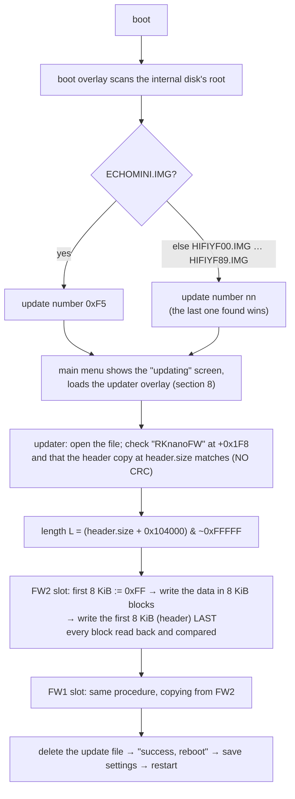

# Installing firmware

Status: draft, 2026-11

The AP30 updates itself from a file: copy an update image (`HIFIYFnn.IMG`) to the root of the **internal** storage,
eject, restart, and the stock firmware installs it into both firmware slots and deletes the file. The updater checks
only the image magic and the header copy: no version check, no date check, no CRC, no signature. So downgrades work,
and a correctly built custom image installs the same way. This page covers the official update, going back to an older
version, installing a custom image, and what the date field in the header does and does not do.

## Contents
- [Official update](#official-update)
- [What the updater does](#what-the-updater-does)
- [Accepted file names](#accepted-file-names)
- [Downgrade](#downgrade)
- [Installing a custom image](#installing-a-custom-image)
- [The header date and version](#the-header-date-and-version)
- [If an update does not take](#if-an-update-does-not-take)
- [Open questions](#open-questions)
- [Sources](#sources)

## Official update

> **Warning**
> * The update rewrites both firmware slots. An official image is safe; a broken custom image would leave the player
>   unable to boot until recovered.
> * Charge the battery first and do not power off during the update.
> * Recovery path if the player does not boot afterwards: loader USB mode with D-pad Right + Power and USB connected,
>   then restore FW1 ([recovery.md](recovery.md)). Make a [backup](backup.md) first if you have not.
> * The updater never touches the boot loader (the hidden IDB area), so loader USB mode stays available whatever the
>   image contains.

1. Download the official file from Hidizs (<https://www.hidizs.net/pages/download-center>). Known releases, dates and
   hashes: [../overview/firmware_releases.md](../overview/firmware_releases.md). Check the SHA-256 if one is published.
2. Connect the player, choose **File Transfer** on the "USB Mode" screen. The internal storage appears as a USB disk
   ("HIFI MP3 USB MP3"); a microSD card, if inserted, appears as a second disk ("SD").
3. Copy the `.IMG` file to the **root of the internal disk**, not to the microSD card. Keep the file name as published.
4. Eject the disk properly, unplug, restart the player.
5. At boot the player finds the file, shows an "updating" screen, installs, deletes the file and restarts [AP30].
6. Check Settings → About: the version and the header date (month-day) of the new image [AP30, device].

Done on a device: the factory firmware was updated to V1.7.8 this way; afterwards both slots held the V1.7.8 header
(2026-10-19 / 8.0.0) and the vendor "info" command reported firmware 8.0.0, loader still 4.16 [AP30].
V1.8.3 (`HIFIYF23.IMG`) was installed the same way on 2026-11-25; About then shows "Ver 1.8.3" [AP30, device].

An iPhone with a USB-C port can do step 3 too: the Files app sees the internal disk (named "NO NAME", because its FAT
volume label is empty) and can copy the `.IMG` file onto it [AP30, device]. iOS leaves `.Spotlight-V100` and
`.Trashes` folders on the disk and Windows leaves `System Volume Information`; the updater ignores all of them
[AP30].

## What the updater does

[AP30, firmware analysis of V1.7.8; device observations agree]

* A power cut during the update leaves at most one slot without a valid header (the header is written last), and the
  loader falls back to FW2 if FW1 is invalid [AP30]. Not tested by pulling power [?].
* If the header check fails, or a file read fails, the updater aborts and deletes the file either way [AP30].
* **No fallback copy survives an install:** both slots get the new image [AP30].
* A date-comparing routine (newer header wins) and a slot-sync routine exist in the code, but **nothing calls them** in
  V1.7.8 [AP30]. Details: [../firmware/update_process.md](../firmware/update_process.md).

## Accepted file names

| Name | Accepted? | Notes |
|---|---|---|
| `HIFIYF00.IMG` … `HIFIYF89.IMG` | yes, any two digits 00-89 | official files use this pattern (e.g. `HIFIYF05.IMG`, `HIFIYF18.IMG`, `HIFIYF26.IMG`); the digits are not checked against the content |
| `ECHOMINI.IMG` | yes, checked first | a leftover of the code base shared with the Snowsky Echo Mini; device-proven on the AP30 |
| `RKNANOFW.IMG` (the SDK's original name) | no | not in the AP30's scan [AP30] |
| anything else | no | |

All [AP30]. If several are present, `ECHOMINI.IMG` wins; among `HIFIYFnn.IMG` the highest number found wins (the scan
keeps the last match) [AP30]. Put only one update file on the disk to avoid surprises.

## Downgrade

There is no version or date check, so an older official image installs like a newer one [AP30].

Done on a device: a custom image dated 2026-11-17 was replaced by the official V1.7.8 (`HIFIYF18.IMG`, dated 2026-10-19)
simply by copying it; the normal boot screen and the original About date came back [AP30].

The same warning box as for the official update applies. Note that firmware versions differ in their string-table
layout and settings; a downgrade may reset some settings [?].

## Installing a custom image

> **Warning**
> * A custom image that crashes at boot will be installed into **both** slots; the player then needs the loader-mode
>   recovery ([recovery.md](recovery.md)). Practise that entry first on a working player and keep a [backup](backup.md).
> * Keep the USB cable at hand: the button recovery needs USB power.
> * Never alter anything that would make the updater or a tool write outside the firmware slots; the update path itself
>   cannot reach the IDB area.

1. Build the image correctly: header with correct blob offsets and sizes, padding to 8 KiB, an **exact header copy at
   `header.size`**, zero padding to `(size + 0x104000) & ~0xFFFFF`, and the RKCRC32 (unchecked, but keep it correct)
   ([../formats/rknanofw_container.md](../formats/rknanofw_container.md)).
2. Name it `ECHOMINI.IMG` or `HIFIYFnn.IMG`. `ECHOMINI.IMG` is convenient for test images: it is scanned first and is
   easy to tell apart from official files [AP30].
3. Copy it to the root of the internal disk, eject, restart: the stock updater installs it like an official one.
4. To go back, copy an official `HIFIYFnn.IMG` the same way.

Done on a device: V1.7.8 with the boot screen colour-inverted, installed as `ECHOMINI.IMG`, booted and showed the
change; Settings → About showed the custom header date [AP30]. How that image was made:
[modifying_resources.md](modifying_resources.md).

**Alternative: writing the slot directly** through loader USB mode (no updater involved). Write the image's first `L`
bytes to loader LBA 0 (FW1). This also works when the firmware no longer boots. See
[recovery.md](recovery.md#restore-fw1). Note that the stock firmware reads its overlays and resources from FW1, so FW1 is
the slot that matters [AP30].

## The header date and version

| Field | Effect in V1.7.8 | Tag |
|---|---|---|
| Date (BCD, header +0x00..+0x03) | **shown in Settings → About** (month-day, under the software version) | [AP30, device] |
| Date | **not** used to accept or refuse an update; not used to choose a slot | [AP30] |
| Version (BCD, +0x04..+0x09) | reported by the vendor "info" command; whether the About screen's version text is read from it is not traced | [AP30; ?] |
| Version | not checked by the updater or the loader | [AP30] |

The date-comparing routine that exists in the code would prefer the slot with the newer date, but it is never called in
V1.7.8 [AP30]. Giving a custom image a newer date than the official one is harmless and makes it recognisable in About,
and it would matter if another build ever enabled that routine [AP30 advice]. Both the header and the header copy must
carry the same date, and the CRC must be recomputed [AP30].

## If an update does not take

* The file stays on the disk and nothing happens: check the name (exact, upper case is how official files are named;
  whether the scan is case-sensitive is not tested [?]) and that it is in the root of the **internal** disk.
* The "updating" screen flashes briefly and the file disappears, but the firmware is unchanged: the header check or a
  file read failed. A community project reported that its updates only took after formatting the internal storage right
  before copying ([WEB] <https://github.com/nkahoang/hidizs-ap30-game-emu/blob/main/docs/FINDINGS.md>); on the device tested
  here no format was needed. The likely cause is a file-read failure on that volume (fragmentation, cluster size or a
  PC-side format issue) [?]. Re-copy the file to a freshly formatted volume and retry.
* The player does not boot after an update: [recovery.md](recovery.md).

## Open questions

* Is the file-name scan case-sensitive?
* Does a downgrade across string-table layouts reset settings?
* Behaviour on a real power cut in the middle of an update (expected: FW2 or FW1 left invalid, the other one boots).
* Whether the About screen's version text comes from the header.

## Sources

* [AP30] analysis of firmware V1.7.8 (boot scan, updater, unused date check); installs done on a device (official
  V1.7.8 over the factory firmware, a custom image, a downgrade).
* [WEB] Hidizs download center, <https://www.hidizs.net/pages/download-center>;
  <https://github.com/nkahoang/hidizs-ap30-game-emu/blob/main/docs/FINDINGS.md>.
* Related: [../firmware/update_process.md](../firmware/update_process.md),
  [../formats/rknanofw_container.md](../formats/rknanofw_container.md).
