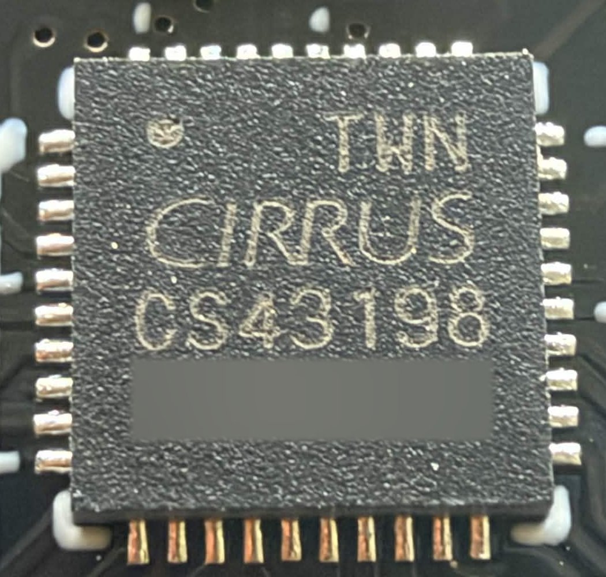
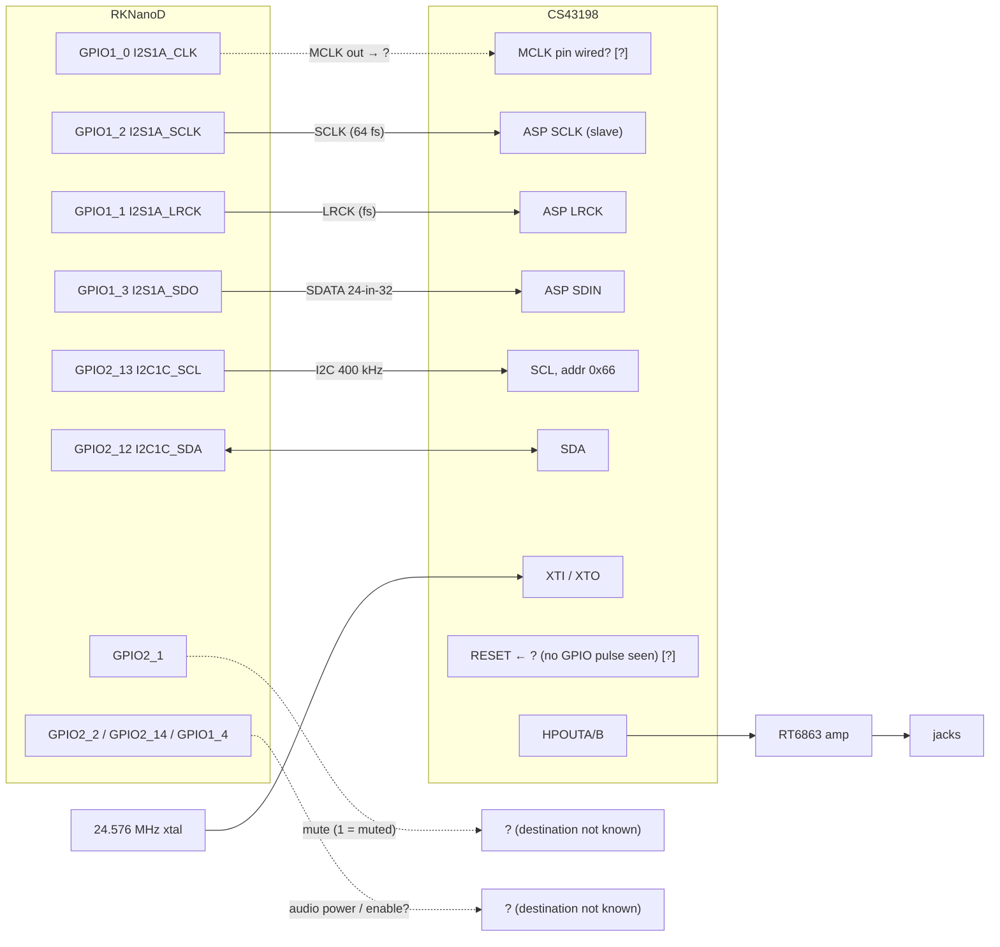
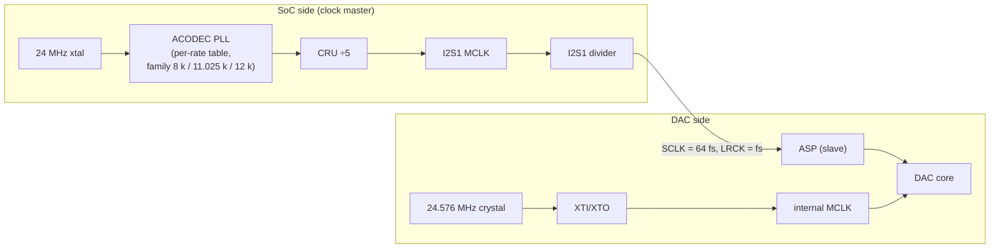

# Audio DAC: Cirrus Logic CS43198

Status: draft, 2026-11

The AP30's DAC is a single **Cirrus Logic CS43198** (stereo DAC with an integrated headphone output stage [DS]). It sits in the centre of board side A next to a **24.576 MHz crystal** that clocks it. The SoC controls it
over **I2C1 pin group C at 8-bit address 0x66** and feeds it **I2S from I2S1 port A, with the SoC as clock master**,
32-bit slots, 24 significant bits. Digital filters (five, including NOS), output full scale ("gain") and the digital
volume are DAC registers. DSD is converted to PCM on the SoC; the DAC's own DSD / DoP inputs are not used. This page
gives the wiring, the full stock init sequence as a data table, every register the firmware touches and how the
firmware maps its settings onto them.

Tags: **[AP30]** firmware V1.7.8 or the device · **[DS]** CS43198 datasheet DS1156F2 · **[TRM]** RKNanoD TRM V1.0 ·
**[EM]** Echo Mini · **[WEB]** public source · **[?]** guess.

*Cirrus Logic CS43198 DAC (QFN-40), side A, centre. [AP30]*

More photos: [photos.md](photos.md).

## Contents

- [Summary table](#summary-table)
- [Wiring](#wiring)
- [Control port (I2C)](#control-port-i2c)
- [Clocking](#clocking)
- [Init sequence (stock)](#init-sequence-stock)
- [Registers used](#registers-used)
- [Sample-rate handling](#sample-rate-handling)
- [Digital filters](#digital-filters)
- [Gain (output full scale)](#gain-output-full-scale)
- [Volume](#volume)
- [Power-down](#power-down)
- [DSD](#dsd)
- [Unused DAC features](#unused-dac-features)
- [Echo Mini differences](#echo-mini-differences)
- [Open questions](#open-questions)
- [Sources](#sources)

## Summary table

| Item | Value | Tag |
|---|---|---|
| Part | Cirrus Logic CS43198, QFN-40 | [AP30] marking |
| Control | I2C1, pin group C: SCL GPIO2_13 (ball C1), SDA GPIO2_12 (ball C2); 400 kHz | [AP30] |
| Address | 8-bit **0x66** = 7-bit 0x33 (ADR strap gives the low address bits 11) | [AP30] + [DS] |
| Register addressing | 24-bit register numbers (3 MAP bytes) + control byte | [DS] |
| Audio input | ASP (serial port) as **I2S slave**: SCLK = 64 fs, LRCK = fs, 32-bit slots, 24-bit data, I2S framing | [AP30] |
| SoC side | I2S1 port A (GPIO1_0 MCLK, GPIO1_1 LRCK, GPIO1_2 SCLK, GPIO1_3 SDO), SoC = master | [AP30] |
| DAC master clock | its own crystal on XTI/XTO, **24.576 MHz** part on the board; firmware selects direct-XTAL mode | [AP30] + [DS] |
| SoC audio clock | RKNanoD ACODEC PLL → CRU divider → I2S1 (unrelated to the DAC crystal) | [AP30] |
| DMA | DMAC1 channel 5, hardware request 2 (I2S1 TX), 32-bit items into the I2S1 TX FIFO | [AP30] |
| Rates sent | 8 k-192 kHz (three families); the DAC's documented range is 32-384 kHz | [AP30] + [DS] |
| Filters | 5 (fast / slow roll-off × low-latency / phase-compensated, NOS emulation) | [AP30] + [DS] |
| Gain | high = 2 Vrms full scale; low = a register value the datasheet calls reserved | [AP30] + [DS] |
| Volume | digital, 0.5 dB steps, 0xFF = mute; user volume 0-100 maps to ~0.6 dB per step | [AP30] + [DS] |
| Mute line | GPIO2_1, 1 = muted (which chip it acts on is unknown) | [AP30], role [?] |
| DAC headphone detect | **disabled**; the jacks are detected by two SoC GPIOs instead | [AP30] |

## Wiring

- **I2C1C is also UART0A and JTAG1** (core-B debug). While the DAC is in use neither is available [AP30].
- **MCLK:** the SoC drives an MCLK on GPIO1_0, but whether that pin is wired to the DAC is unknown; the DAC runs
  from its own crystal [AP30, ?]. In USB DAC mode the firmware turns GPIO1_0 into a GPIO driven low.
- **Reset:** no GPIO pulse on a dedicated reset line happens before the first init. The firmware raises GPIO2_14,
  GPIO2_2 and GPIO1_4 and waits 2 + 1 + 8 ms: the same waits as the Echo Mini, whose middle 1 ms is a reset pulse on
  GPIO2_1 that the AP30 dropped [AP30 vs EM]. How RESET is driven on the AP30 is open [?]. Datasheet rule: VP first,
  release RESET last, at least 1.5 ms before the first I2C access [DS 5.2, 5.12.1].
- Other control pins and their (inferred) roles: [board_ap30.md](board_ap30.md#pin-assignment-table).

## Control port (I2C)

| Item | Value | Tag |
|---|---|---|
| Write frame | START, chip address 0x66, MAP byte high, MAP mid, MAP low, **control byte**, data, STOP | [DS 4.12] |
| Control byte | bit 0 = auto-increment, bits 2:1 = access size (0 = 8-bit) | [DS Table 4-13] |
| Stock frame | control byte **0x01**, one data byte per transaction | [AP30] |
| Read | the 4 header bytes (3 MAP + control), then a 1-byte read | [AP30] |
| Bus handling | each register access opens and closes the I2C controller (~0.15 ms on the wire at 400 kHz plus driver overhead) | [AP30] |
| Error handling | the driver stops talking to the DAC after 2 failed writes | [AP30] |
| Strap | 8-bit 0x66 = 7-bit 0x33: ADR tied to VL through 0 Ω | [DS Table 4-12] |

## Clocking

- **SoC:** the audio clock comes from the RKNanoD's internal audio-codec (ACODEC) PLL, not from the system PLL,
  so CPU frequency changes do not disturb the audio clock [AP30]. The internal ACODEC itself (DAC, headphone
  driver) is unused. I2S1 runs as master, I2S (Philips) format, 32-bit slots, 64 SCLK per frame [AP30]. Register
  level: [soc_peripherals.md](soc_peripherals.md).
- **DAC:** the firmware writes register `0x010006` = 0x04, i.e. `MCLK_SRC_SEL` = 00 (direct XTAL) and `MCLK_INT`
  = 1, which the datasheet defines as "internal MCLK is 22.5792 MHz", with crystal bias `0x020052` = 0x02 (15 µA)
  [AP30 + DS 7.1.6, 7.1.11]. The crystal on the board is marked **24.576 MHz**, for which the datasheet expects
  `MCLK_INT` = 0 and bias 0x06 [DS Table 5-1]. **This is a mismatch; its effect is unknown** [AP30 + DS].
- **Who uses the 24.576 MHz crystal:** the CS43198 (XTI/XTO, direct XTAL mode). The SoC, the ALC5686 and the JieLi
  each have their own 24.000 MHz part [AP30 + DS 5.3].
- **CS43198 PLL** (registers `0x03xxxx`): never used; the firmware's PLL setup routine has no caller [AP30].
- The DAC is an ASP slave on SCLK / LRCK from the SoC's PLL while its internal clock comes from its own crystal: two
  unrelated clock domains [AP30 + ?]. How the CS43198 handles this (it has no documented ASRC) is an open question.

### SoC clock per sample rate

The stock firmware keeps a five-entry PLL table per rate family (base, ×2, ×4, ×8, ×16 of 8 k / 11.025 k / 12 k)
and reprograms the PLL only when family or index change, then waits 5 ms (the TRM asks for ≥ 200 µs of lock time)
[AP30 + TRM]. MCLK = PLL ÷ 5 in the CRU; the I2S divider gives SCLK = 64 fs. Values below are our arithmetic from
the table [AP30]:

| Rate (Hz) | PLL out (MHz) | MCLK (MHz) | MCLK / fs | I2S divider | Note |
|---|---|---|---|---|---|
| 8 000 / 16 000 | 20.48 | 4.096 | 512 / 256 | ÷8 / ÷4 | |
| 32 000 | 40.96 | 8.192 | 256 | ÷4 | |
| 64 000 | 81.92 | 16.384 | 256 | **÷2** | the divider gives a 128 kHz LRCK on paper [?]; the Echo Mini measured this PLL entry far off [EM] |
| 128 000 | 81.92 | 16.384 | 128 | ÷2 | |
| 11 025 / 22 050 | 28.224 | 5.6448 | 512 / 256 | ÷8 / ÷4 | Echo Mini: PLL does not lock (VCO 141 MHz) [EM] |
| 44 100 | 56.448 | 11.2896 | 256 | ÷4 | |
| 88 200 | 56.448 | 11.2896 | 128 | ÷2 | |
| 176 400 | 112.896 | 22.5792 | 128 | ÷2 | Echo Mini: −0.28 % [EM] |
| 12 000 / 24 000 | 30.72 | 6.144 | 512 / 256 | ÷8 / ÷4 | |
| 48 000 | 61.44 | 12.288 | 256 | ÷4 | |
| 96 000 | 122.88 | 24.576 | 256 | ÷4 | divider inconsistent with 88.2 k (a firmware bug, see [../firmware/known_bugs.md](../firmware/known_bugs.md)) |
| 192 000 | 122.88 | 24.576 | 128 | ÷2 | |

The AP30's PLL table equals the Echo Mini's, so the Echo Mini's device measurements (usable VCO range about
184-369 MHz) very likely apply [AP30 vs EM, ?].

### DMA

I2S1 is fed by **DMAC1 channel 5, hardware request 2** (I2S1 TX), destination the fixed I2S1 TX data register,
32-bit items. A PCM block of up to 9216 words exceeds the DMAC's 4095-item block limit, so the transfer is chained
with linked-list descriptors. The stock firmware starts one DMA transfer per PCM block and re-arms it from the DMA
completion interrupt [AP30 + TRM]. The pipeline: [../firmware/audio_playback.md](../firmware/audio_playback.md).

## Init sequence (stock)

Written on the first music start (and by an unused USB-audio overlay). Meanings from the datasheet chapter 7
[AP30 + DS]. Steps 1-16 follow the datasheet example "Power-up sequence to I2S playback" with these AP30 choices:
ASP slave, 32-bit slots, crystal bias 0x02, headphone detect off, no wait for the XTAL-ready flag [DS 5.12.1, 5.6.1].

| Step | Register = value | Meaning |
|---|---|---|
| 0 | GPIO2_14 = 1, GPIO2_2 = 1, GPIO1_4 = 1; waits 2 + 1 + 8 ms | audio power / enable lines up (roles [?]) |
| 1 | `0x0B0000` = 0x1E | Class H: adaptive supply (`ADPT_PWR` = 111), `HV_EN` = 1 (VP_LDO 3.0 V) |
| 2 | `0x020052` = 0x02 | crystal bias 15 µA |
| 3 | read `0x0F0000`; `0x0F0010` = 0xE7 | clear sticky interrupts; mask all except XTAL ready / error |
| 4 | `0x020000` = 0xF6 | start the crystal (`PDN_XTAL` = 0); everything else stays powered down |
| 5 | `0x01000C` = 0x04 | ASP slot size 32 bit (XSP 24 bit) |
| 6 | `0x040010..0x040017` = 01 00 08 00 1F 00 3F 00 | ASP fractional N/M = 1/8, LRCK high time = 32 SCLK, period = 64 SCLK |
| 7 | `0x040018` = 0x0C, `0x040019` = 0x0A | ASP **slave**, SCLK polarity inverted (in and out); 50/50 LRCK, 1-SCLK frame delay (I2S) |
| 8 | `0x050000` = 0, `0x050001` = 0; `0x05000A` = 0x07, `0x05000B` = 0x0F | channels at slot 0; channel 1 24-bit enabled, active LRCK low; channel 2 24-bit enabled, active LRCK high (the write routine forces these two values whatever the caller passes) |
| 9 | `0x090000` = filter code | from the "Filter" setting (see [Digital filters](#digital-filters)) |
| 10 | `0x090001` = 0, `0x090002` = 0, `0x090003` = 0xEC, `0x090004` = 0 | volume 0 dB; ramp-down on filter change, B = A, soft ramp, auto-mute on; no invert / swap |
| 11 | `0x0B0000` = 0x1E again, **wait 80 ms** | the wait also covers crystal start-up (XTAL-ready is not polled) |
| 12 | `0x080000` = 0x10 (low gain) or 0x31 (high gain) | from the "Gain" setting |
| 13 | `0x0D0000` = 0x04, `0x0D0001` = 0 | **DAC headphone detect disabled**; the second register is read-only per the datasheet |
| 14 | read `0x0F0000`, `0x0F0001`; `0x0F0010` = 0x87, `0x0F0011` = 0x07 | interrupt masks as in the datasheet example |
| 15 | `0x010006` = 0x04 | switch internal MCLK from the RC oscillator to the crystal |
| 16 | `0x01000D` = 0x02 | ASP clocks out of tri-state |
| 17 | `0x010010` = 0x99, `0x180000` = 0x45, `0x010010` = 0 | undocumented test-register write behind the 0x99 unlock key (as used in the datasheet's pop-free sequences) |
| 18 | read-modify-write `0x020000` &= ~0x40 (200 µs between read and write) | power up the ASP |
| 19 | `0x010010` = 0x99, `0x080032` = 0x20; `0x020000` &= ~0x10; wait 10 ms; `0x080032` = 0, `0x010010` = 0 | datasheet "PCM power-up sequence": pop-free headphone-stage power-up (the datasheet asks for 12 ms) |
| 20 | I2S1 runs at 48 kHz for 100 ms, then is stopped and reset | clock warm-up for the DAC [?] |

A 73-entry register table is also present in the image but **has no caller** in V1.7.8 [AP30].

## Registers used

Every CS43198 register the stock firmware writes or reads, with the datasheet name [DS ch. 7] and the values seen
[AP30].

| Register | Datasheet name (field) | Values written | When |
|---|---|---|---|
| `0x010006` | clocking: `MCLK_SRC_SEL`, `MCLK_INT` | 0x04 | init step 15 |
| `0x01000B` | `ASP_SPRATE` | 0-6 (see sample rates) | before each track |
| `0x01000C` | ASP / XSP sample size | 0x04 | init |
| `0x01000D` | ASP clock tri-state control | 0x02 | init |
| `0x010010` | test key (undocumented) | 0x99, 0 | init, pop-free sequence |
| `0x020000` | power-down control (`PDN_XTAL`, `PDN_ASP` bit 6, `PDN_HP` bit 4, …) | 0xF6, then bits cleared; set again at power-down | init, power-down |
| `0x020052` | crystal bias | 0x02 | init |
| `0x040010..17` | ASP numerator / denominator, LRCK high time, LRCK period | 01 00 08 00 1F 00 3F 00 | init |
| `0x040018` | ASP clock config (master / slave, SCLK polarity) | 0x0C | init |
| `0x040019` | ASP frame config | 0x0A | init |
| `0x050000`, `0x050001` | ASP channel 1 / 2 location | 0, 0 | init |
| `0x05000A`, `0x05000B` | ASP channel 1 / 2 size and enable (`ASP_CHx_SZ_EN`) | 0x07, 0x0F | init, before each track |
| `0x080000` | headphone output control (`OUT_FS`, `+1dB_EN`) | 0x10 / 0x31 | init, Gain setting |
| `0x080032` | undocumented (pop-free sequence) | 0x20, 0 | init |
| `0x090000` | PCM filter option | 0x02 / 0x42 / 0x82 / 0xC2 / 0x22 | init, Filter setting |
| `0x090001`, `0x090002` | `PCM_VOLUME_B`, `PCM_VOLUME_A` | 0x00-0xFF | volume changes |
| `0x090003` | PCM path signal control 1 (`PCM_RAMP_DOWN`, `PCM_SZC`, `PCM_AMUTE`, B = A) | 0xEC | init |
| `0x090004` | PCM path signal control 2 (invert / swap) | 0 | init |
| `0x0B0000` | Class H control (`ADPT_PWR`, `HV_EN`) | 0x1E | init (twice) |
| `0x0D0000`, `0x0D0001` | headphone detect | 0x04, 0 | init |
| `0x0F0000`, `0x0F0001` | interrupt status (sticky) | read; `0x0F0000` is also written 0xFF at power-down although read-only | init, power-down |
| `0x0F0010`, `0x0F0011` | interrupt masks | 0xE7 → 0x87, 0x07; all masked at power-down | init, power-down |
| `0x180000` | undocumented | 0x45 | init |

## Sample-rate handling

Before each track the firmware writes `0x05000A` = 0x07, `0x05000B` = 0x0F and `ASP_SPRATE` (`0x01000B`) [AP30;
codes DS 7.1.7]:

| Track rate | `ASP_SPRATE` code | DAC rate meaning |
|---|---|---|
| 44.1 k, 22.05 k, 11.025 k | 1 | 44.1 kHz |
| 48 k, 24 k, 12 k | 2 | 48 kHz |
| 88.2 k | 3 | 88.2 kHz |
| 96 k | 4 | 96 kHz |
| 176.4 k | 5 | 176.4 kHz |
| 192 k | 6 | 192 kHz |
| 8 k, 16 k, 32 k, 64 k, 128 k | 0 | 32 kHz |

- The datasheet lists only 32-384 kHz, so rates below 32 kHz and 64 / 128 kHz are outside the DAC's documented
  range [DS].
- The datasheet wants the rate set **before** the port is enabled [DS 4.8.1]; the firmware rewrites it with the ASP
  powered [AP30].
- A rate change happens only at a track start; the SoC side reprograms the ACODEC PLL only when the rate family or
  multiple changes (+5 ms) [AP30].
- The DAC stays powered and configured across tracks: no re-init, no GPIO power cycling between tracks [AP30].

## Digital filters

Register `0x090000` (`PCM_FILTER_OPT`, high-pass filter on in all five) [AP30 + DS 7.5.2]:

| Setting | Value | Filter |
|---|---|---|
| 0 | 0x02 | fast roll-off, low latency |
| 1 | 0x42 | fast roll-off, phase-compensated |
| 2 | 0x82 | slow roll-off, low latency |
| 3 | 0xC2 | slow roll-off, phase-compensated |
| 4 | 0x22 | **NOS** (non-oversampling) emulation |

This matches the five filter names in reviews ("fast / slow roll-off, minimum / linear phase, NOS") [WEB]. The
datasheet enables or disables NOS with an extra calibration sequence (DS 5.8); the firmware writes the bit only
[AP30]. The setting is stored at offset +0x2E6 of the persistent settings block [AP30].

## Gain (output full scale)

Register `0x080000` [AP30 + DS 7.5.1]; setting stored at settings-block offset +0x2E7 [AP30].

| Setting | Value | Meaning |
|---|---|---|
| High | 0x31 | `OUT_FS` = 1.73 V plus `+1dB_EN` → **2 Vrms full scale** (valid with `HV_EN` = 1) |
| Low | 0x10 | `OUT_FS` = 01, which the datasheet marks **reserved**; the documented low option would be 0x20 = 1.41 V |

- The datasheet allows `OUT_FS` changes only while the headphone stage is powered down (`PDN_HP` = 1); the settings
  menu writes the register directly [AP30].
- Whether the RT6863 has a gain pin of its own is unknown [?].
- Vendor output figures (61 mW SE / 137 mW BAL at 32 Ω) are on [audio_amp_rt6863.md](audio_amp_rt6863.md).

## Volume

Digital, `PCM_VOLUME_A` / `PCM_VOLUME_B` (`0x090002` / `0x090001`), 0.5 dB per code, 0xFF = mute [DS 7.5.3].
The user volume runs 0-100 (default 30, 100 steps on the wheel) [AP30 + WEB]. Mapping [AP30]:

| Step | Rule |
|---|---|
| v = volume × 6 / 5 | integer scaling of the 0-100 volume |
| v = 0 | both registers 0xFF (mute) and GPIO2_1 = 1 |
| v = 1, 2, 3, 4 | codes 200, 177, 157, 137 (−100, −88.5, −78.5, −68.5 dB) |
| v ≥ 5 | code = 122 − v; volume 100 → code 2 = −1 dB |
| one user step | ≈ 0.6 dB |
| Bluetooth receiver connected | the code is reduced by 15 / 10 / 5 (up to 7.5 dB louder) for codes ≥ 71 / 41-70 / 21-40 |

Two further volume curves exist behind flags that are never set [AP30]. A non-zero volume while the player runs
clears GPIO2_1 (unmute) [AP30]. The Bluetooth boost is one of the reasons to think the JieLi chip samples the
analog output; see [bluetooth.md](bluetooth.md).

## Power-down

On player exit [AP30]: mask all interrupts; power down the headphone stage (`PDN_HP`) only; then everything (on the
way `0x0F0000`, a read-only status register, is written 0xFF); then the ASP only. The datasheet sequence waits for
`PDN_DONE` between headphone-stage and port power-down [DS 5.5.1]; the firmware does not. The surrounding GPIO
order: GPIO1_4 = 0, GPIO2_1 = 1, DAC power-down, GPIO2_14 = 1, GPIO2_2 = 0 [AP30].

The DAC stays powered while the music task is alive, also when paused; it is powered down only when the player
exits [AP30]. Pop avoidance at start / stop (mute line, 80 ms wait, fades) is firmware behaviour:
[../firmware/audio_playback.md](../firmware/audio_playback.md). The CS43198's own soft ramp and auto-mute (after
8192 static samples) are enabled by the init values [DS].

## DSD

- The CS43198 supports native DSD and DoP on its serial port (DoP inside 24-bit PCM frames, DSD64 at 176.4 kHz)
  [DS 4.8.11].
- The RKNanoD has **no DSD interface**; its I2S tops out at 192 kHz, so DoP could carry at most DSD64 [TRM 13.1].
- **The stock firmware converts every DSD rate (DSF and DSDIFF, DSD64 / 128 / 256) to 44.1 kHz PCM on core B**
  and sends PCM to the DAC; there is no DoP and no native DSD output [AP30]. V1.7.8 refuses DSD above about DSD256
  (DSF) [AP30]. The vendor spec's "S/PDIF DoP" claim has no counterpart in the hardware or firmware (no S/PDIF
  path exists) [AP30 + WEB].
- Details of the conversion: [../firmware/audio_playback.md](../firmware/audio_playback.md),
  [../firmware/core_b_codecs.md](../firmware/core_b_codecs.md).

## Unused DAC features

| Feature | State on the AP30 |
|---|---|
| CS43198 PLL | never configured (routine without caller) [AP30] |
| Headphone / plug detect | disabled (`0x0D0000` = 0x04) [AP30] |
| DSD / DoP input | unused [AP30] |
| CLKOUT | no write enables it; the power-down register keeps its other bits set [AP30, ?] |
| Interrupt pin | XTAL interrupts unmasked at init, but no SoC GPIO is read for them [AP30, wiring ?] |

## Echo Mini differences

[EM, from the Echo Mini study]: two **CS43131** in dual mono on **I2C0** (GPIO2_10/11) at 8-bit 0x60 and 0x66; the
write routine sends every register to both and forces `ASP_CHx_SZ_EN` 0x07 (left chip) / 0x0F (right chip). The
AP30 kept the routine, with one CS43198 on I2C1C at 0x66, so the forced values now simply enable both channels of
the single chip [AP30 vs EM]. The Echo Mini pulses GPIO2_1 low for 1 ms as the DACs' reset; the AP30 uses GPIO2_1
as a mute line and keeps only the waits. The Echo Mini writes a four-group undocumented `0x18xxxx` block and Class H
= 0x1F; the AP30 writes a single `0x180000` = 0x45 and Class H = 0x1E. Same I2S1 setup and identical ACODEC PLL
tables. On the AP30 the I2C0A pins carry the RTC instead.

## Open questions

| # | Question | How it could be answered |
|---|---|---|
| 1 | Which GPIO drives the CS43198 RESET? Roles of GPIO2_2, GPIO2_14, GPIO1_4, GPIO2_1 | continuity on the open board, or toggle one line at a time from a test image while watching I2C ACKs |
| 2 | `MCLK_INT` = 22.5792 MHz setting with a 24.576 MHz crystal: misconfiguration, or a different part? | enable CLKOUT (MCLK_INT / 2 on the CLKOUT pin) and measure; compare with `MCLK_INT` = 0 |
| 3 | Is the SoC's I2S1A MCLK pin (GPIO1_0) wired to the DAC at all? | continuity GPIO1_0 → DAC pins |
| 4 | How does the DAC cope with SCLK / LRCK from an unrelated clock domain (slips, ASRC)? | long-run sine test with an analyser; watch the ASP early / late interrupt bits in `0x0F0001` |
| 5 | What level does the reserved "low gain" value 0x10 produce? | measure full-scale output at both gains; compare with 0x20 |
| 6 | Do 11.025 / 22.05 / 64 / 128 / 176.4 kHz files play at the right speed? (Echo Mini measured failures) | 1 kHz test tones, measure the output frequency |
| 7 | Is 64 kHz additionally mis-clocked by the ÷2 I2S divider? | same test; read I2S1's clock register while playing |
| 8 | Is the DAC's interrupt pin wired to the SoC? | continuity |

## Sources

- [AP30] analysis of firmware V1.7.8: DAC driver (init, filter, gain, sample rate, volume, power-down), I2S and
  ACODEC PLL setup, player start / stop pin sequences; board inspection (CS43198 and 24.576 MHz markings).
- [DS] [Cirrus Logic CS43198 datasheet DS1156F2](https://statics.cirrus.com/pubs/proDatasheet/CS43198_DS1156F2.pdf)
  (ch. 4.8, 4.12, 5, 7).
- [TRM] [RKNanoD TRM V1.0](https://rockchip.fr/Rockchip%20RKNanoD%20TRM%20V1.0.pdf) ch. 3 (CRU), 8 (DMAC), 9
  (ACODEC PLL), 13 (I2S).
- [EM] [iamcheyan/echo-mini-newfw](https://github.com/iamcheyan/echo-mini-newfw) `ETUDE.md` §3.5, §4.1 (DAC init, PLL
  measurements).
- [WEB] filter names and gain settings from reviews, e.g. the
  [Head-Fi AP30 showcase](https://www.head-fi.org/showcase/hidizs-ap30-music-boy.29215/); see
  [../community/user_feedback.md](../community/user_feedback.md).
