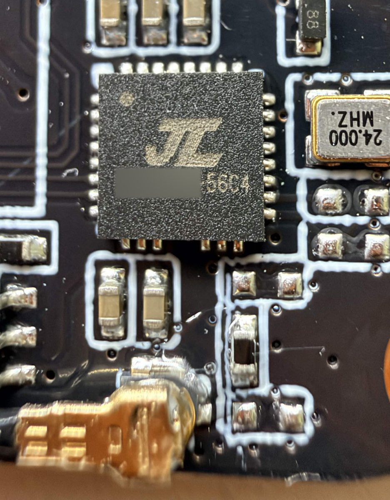
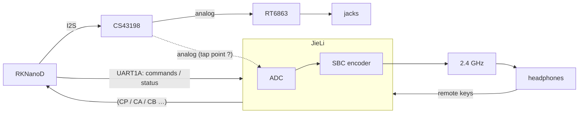

# Bluetooth: JieLi chip and its UART protocol

Status: draft, 2026-11

Bluetooth on the AP30 is a separate **JieLi** SoC (QFN-32, marking ending in `-56C4`, probably an AC6956C4 [?]) with its own Bluetooth stack and
firmware, soldered directly on the board (not a certified module). The RKNanoD switches it on with **GPIO2_7** and
talks to it over **UART1A at 115200 8N1** with a short **ASCII protocol whose frames start with `C`**: scan,
connect, disconnect, status poll, stream start / stop; the chip answers with readiness, scan results, link state and
remote-control keys. **No audio travels over the UART** and no digital audio interface is wired to it, so the JieLi
almost certainly samples the analog output and encodes **SBC** itself. Codec support (SBC only) and the missing
receive (sink) mode are therefore properties of the JieLi chip and its firmware, not of the RKNanoD. This page covers
the hardware and the wire protocol; the firmware's Bluetooth logic is in
[../firmware/bluetooth.md](../firmware/bluetooth.md).

Tags: **[AP30]** firmware V1.7.8 or the device · **[TRM]** RKNanoD TRM V1.0 · **[DS]** a datasheet · **[EM]** Echo
Mini (EchoPod notes) · **[WEB]** public source · **[?]** guess.

*JieLi Bluetooth SoC (QFN-32, JL logo, marking ends in -56C4: by JieLi's marking convention probably an AC6956C4 [?]) with its 24.000 MHz crystal and the coax pigtail's crimp tab, side B, top-left corner (jacks-at-bottom view). [AP30]*

More photos: [photos.md](photos.md).

## Contents

- [Summary](#summary)
- [Hardware](#hardware)
- [UART link](#uart-link)
- [Power-up handshake](#power-up-handshake)
- [Protocol: host to module](#protocol-host-to-module)
- [Protocol: module to host](#protocol-module-to-host)
- [Audio path](#audio-path)
- [Codec and role limits](#codec-and-role-limits)
- [Stored pairing data](#stored-pairing-data)
- [Open questions](#open-questions)
- [Sources](#sources)

## Summary

| Item | Value | Tag |
|---|---|---|
| Chip | JieLi (JL logo), QFN-32, marking `…-56C4` (serial number before the dash). JieLi [puts the chip name after the dash](https://kagaimiq.github.io/jielie/chips/chip-marks.html): `56C4` → **AC6956C4** (AC695N family) is the likely reading | [AP30] marking, [WEB, ?] name |
| Crystal | own 24.000 MHz | [AP30] |
| Antenna | FPC sticker `B_1597-2.4G_A1` on the back cover, coax pigtail with its crimp tab soldered to a board pad (no U.FL socket) | [AP30] |
| Position | board side B, top edge (opposite the jacks) | [AP30] |
| Power / enable | **GPIO2_7** (ball C3), output, 1 = powered | [AP30] |
| Link | **UART1A**: RKNanoD TX GPIO2_16 (ball D2) → module RX; module TX → GPIO2_17 (ball D3) = RKNanoD RX; no flow control | [AP30] |
| Format | 115200 baud, 8 data bits, no parity, 1 stop | [AP30] |
| Protocol | ASCII frames `C` + letter (+ length + payload), delimited by idle time | [AP30], meanings partly [?] |
| Spec | Bluetooth 5.3, SBC only, transmit only | [WEB] vendor spec + reviews |
| Audio | analog: the JieLi samples the DAC / amp output [?] | [?] (strong inference) |

## Hardware

- The chip is chip-down with a crystal and a soldered coax to an FPC antenna; no RF shield [AP30].
- Its update / programming path on this board (USB pins, UART boot, test pads) is unknown; no pads labelled for it
  were found [AP30, ?].
- JieLi publishes SDKs for some of its Bluetooth chips (for example the
  [AC63 SDK on Gitee](https://gitee.com/Jieli-Tech/fw-AC63_BT_SDK)); which family the AP30 part belongs to is unknown
  [WEB, ?].
- The Rockchip reference board uses a Realtek RTL8761AT on the same UART1A [WEB] EVK; Hidizs replaced it with the
  JieLi chip.

## UART link

| Item | Value | Tag |
|---|---|---|
| UART | UART1 (base 0x400B0000), route A: TX GPIO2_16, RX GPIO2_17 (route B would be GPIO1_2 / GPIO1_1, the I2S1A pins) | [AP30 + TRM] |
| Clock | UART clock 24 MHz, divisor 13 → 115 384 baud (+0.16 %) | [AP30] |
| Interrupt | RX only | [AP30] |
| Flow control | none; the RTS/CTS pins (GPIO2_14 / GPIO2_15) are used for other things | [AP30] |
| Pins while the module is off | GPIO2_7, GPIO2_16 and GPIO2_17 are all GPIO outputs **driven low** (presumably to avoid back-powering the chip [?]) | [AP30] |
| Shared use of GPIO2_16 | the boot loader's console banner and the firmware's crash dumps also go out on this TX line; the chip sees them only if it is powered at that moment (the firmware powers it on demand) | [AP30] |
| Receive framing | RX interrupt drains the FIFO into a 128-byte buffer until it has been empty for about 1 ms; the parser looks for the first `C` in the first 100 bytes. No terminator, no checksum | [AP30] |
| Transmit | one pending frame of up to 10 bytes, sent byte by byte | [AP30] |
| Reliability | no acknowledgement or retransmission; the status poll recovers state | [AP30] |
| Capacity | 115 200 baud ≈ 11.5 kB/s, far below 16-bit / 44.1 kHz stereo PCM (176 kB/s); the RKNanoD UART can reach 1.5 Mbaud from 24 MHz | arithmetic |

## Power-up handshake

[AP30]

1. Drive GPIO2_7, GPIO2_16, GPIO2_17 low and wait 100 ms (power-cycle reset of the chip).
2. Mux GPIO2_16 to UART1A TX and GPIO2_17 to RX, 115200 8N1, enable the RX interrupt.
3. GPIO2_7 high, wait 100 ms.
4. Wait up to **6 s** for the ready frame **`CV1`**.
5. No `CV1`: power off again (pins low) and report failure.
6. After `CV1`: reconnect to the remembered device (`CL06` + address) if there is one, otherwise clear the scan list
   and start a scan (`CS00`).

## Protocol: host to module

Frame = ASCII `C`, a command letter, two ASCII decimal digits giving the payload length, then the payload. The stock
sender pads payload-less frames with a NUL (5 bytes on the wire). Meanings are inferred from when the firmware sends
each frame [AP30] and agree with the EchoPod reading of the same protocol on the Echo Mini [EM].

| Frame | Bytes | When the stock firmware sends it | Meaning |
|---|---|---|---|
| `CS00` | 5 | Bluetooth screen opened with no remembered device; "Search"; after a disconnect | start inquiry (scan) |
| `CP00` | 5 | user cancels a scan; scan running longer than 30 s | stop scan |
| `CL06` + 6-byte address | 10 | user picks a device; reconnect to the last device | connect (pair) |
| `CH06` + 6-byte address | 10 | 5 s into a connect attempt (retry) | connect / reconnect to a known device [?: difference from `CL`] |
| `CT00` | 5 | user cancels a connect; connect longer than 30 s; "Disconnect / Unpair?" confirmed; certain `CQL` states | disconnect / cancel |
| `CQ00` | 5 | every 3 s on the Bluetooth screen, every 5 s elsewhere while the module is on | status poll |
| `CC00` | 5 | long press of A while connected | unknown [?] |
| `CY0` + 1 binary byte | 5 | 0x00 when a link comes up and when playback pauses or stops; **0x14** when playback starts or resumes | stream stop / start; the Echo Mini sends 0x1E to start [EM]; the byte's meaning is unknown [?] |
| `55 01 02 01 00 02 AA 00` | 8 | never (unreferenced data) | leftover of another module protocol [?] |

## Protocol: module to host

Frame = `C`, a letter, then fields [AP30]:

| Frame | Meaning (as the firmware reacts) |
|---|---|
| `CV1` | module ready (checked only during power-up) |
| `CKKK` | keep-alive / acknowledgement [?]; clears the "waiting" flag |
| `CS` nn addr[6] name | one scan result; nn = 6 + name length (decimal, ≤ 37 accepted), name UTF-8, ≤ 31 bytes. The firmware keeps at most 6 results and drops repeats by comparing the byte sum of the address (a weak test) |
| `CSEN` | scan finished |
| `CSER`, `CLER`, `CHER` | error for scan / connect / reconnect |
| `CLOK` | connect succeeded; the device is added to the paired list |
| `CHOK` | reconnect succeeded |
| `CTOK` | disconnected |
| `CQO` nn addr[6] name | status: connected to this device |
| `CQS` | status: scanning |
| `CQL` | status: linking |
| `CQI` | status: idle / not connected |
| `CH` | link up ("Connected") |
| `CL` | link attempt over, back to idle |
| `CP`, `CC` | remote play / pause from the headphones (AVRCP) [?] |
| `CA`, `CB` | remote next / previous track [?] |
| `CD`, `CU`, `CM` | ignored by the firmware (remote volume down / up / mute? [?]) |

The protocol carries no codec, bitpool, sample-rate or role command in either direction [AP30; EM agrees].

## Audio path

Evidence [AP30 unless tagged]:

1. While a link is up, the firmware **raises the DAC output level**: the CS43198 attenuation is reduced by 5-15
   steps of 0.5 dB depending on the volume; it re-applies the volume whenever the link state changes.
2. A reviewer reports that Bluetooth loudness follows the analog **gain** setting [WEB].
3. No I2S or other digital audio interface is configured for the module, and the UART is far too slow for PCM.
4. On the Echo Mini, same protocol: the module takes the DAC's analog output, with two GPIOs routing the signal
   [EM]. On the AP30 no GPIO changes when a link comes up.

**Conclusion:** the JieLi digitises the DAC (or amplifier) output with its own ADC and encodes SBC [?, strong
inference, not traced]. The tap is probably permanent; whether the wired outputs stay live while streaming has not
been checked. The player volume (0-100) sets the level the chip samples; the Bluetooth screen's volume keys change
the same setting [AP30]. The analog hand-off also caps quality at the JieLi's ADC [?].

## Codec and role limits

- **SBC only** (17 reviewer complaints) [WEB]: entirely inside the JieLi (silicon, firmware, licences). The
  RKNanoD cannot add AAC, aptX or LDAC [AP30 + ?].
- **No receive / sink mode** (14 complaints) [WEB]. It would need (1) JieLi firmware with an A2DP sink role and a
  command to switch roles: not present (no sink strings or frames on the AP30 or in any Echo Mini release) [AP30 +
  EM]; (2) an audio path from the JieLi to the headphones: no JieLi output wired to the amplifier or the DAC is known
  [?]; compressed audio over a faster UART to the RKNanoD would be possible in principle (SBC ≈ 41 kB/s vs ~150 kB/s
  at 1.5 Mbaud) but needs custom JieLi firmware [?]; (3) a way to reprogram the JieLi on this board: unknown [?].
- Vendor Bluetooth battery life 6-8 h; one reviewer measured 7+ h [WEB].
- Transmit power and antenna gain of the AP30 are not documented; the only regulatory filing that lists the AP30
  tests a different player (see [board_ap30.md](board_ap30.md#regulatory-filings)) [WEB].

## Stored pairing data

Inside the persistent settings block [AP30; persistence of every field ?]: last device address (6 bytes) at +0x1CC;
a paired-device list of 0x26-byte entries (6-byte address + 32-byte UTF-8 name) from +0x1D2; current device name at
+0x2B6; paired count at +0x2D7; "connected" flag at +0x2D8; "Bluetooth on" at +0x2D9. Settings layout:
[../firmware/ui_and_settings.md](../firmware/ui_and_settings.md).

## Open questions

| Question | How it could be answered |
|---|---|
| JieLi part number and capabilities (sink, AAC) | confirm AC6956C4 (`-56C4`); read the chip ID over its programming interface if found |
| Where the JieLi takes its audio (DAC out, amp out, before or after volume); does it have an output wired anywhere | continuity from its analog pins to the CS43198 / RT6863 / jacks |
| Meaning of the `CY0` byte (0x14 here, 0x1E on the Echo Mini), `CC00`, `CH06` vs `CL06`, `CKKK`, `CD` / `CU` / `CM` | capture both UART lines at 115200 while scanning, pairing, playing, pausing and using headphone buttons |
| PIN / passkey pairing support | same capture with a device that asks for a PIN |
| JieLi update path on the board | look for its USB / UART boot pins; JieLi documentation |
| Are the wired outputs muted during Bluetooth playback | listen on a wired headphone while streaming |

## Sources

- [AP30] analysis of firmware V1.7.8 (BT Music overlay 112, UART driver, settings and power-off code, volume
  routine); board inspection (JieLi marking, crystal, antenna); the English string table ("Scanning…", "Connect",
  "Connected", "Disconnect", "Paired", "Unpair?").
- [TRM] [RKNanoD TRM V1.0](https://rockchip.fr/Rockchip%20RKNanoD%20TRM%20V1.0.pdf) ch. 23 (UART).
- [EM] EchoPod ([BasilSkyWalk/echopod](https://github.com/BasilSkyWalk/echopod)) hardware and research notes on the
  Echo Mini's module protocol.
- [WEB] vendor spec and reviews (SBC only, no sink, BT level follows gain, battery life):
  [Head-Fi AP30 showcase](https://www.head-fi.org/showcase/hidizs-ap30-music-boy.29215/),
  [../community/user_feedback.md](../community/user_feedback.md);
  [JieLi AC63 SDK](https://gitee.com/Jieli-Tech/fw-AC63_BT_SDK) (example of a public JieLi SDK).
