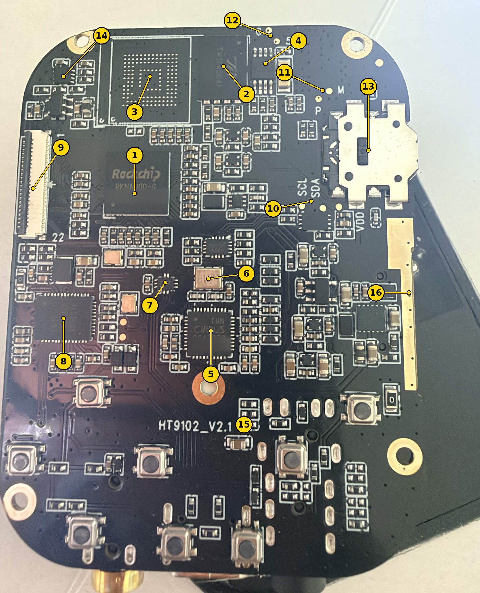
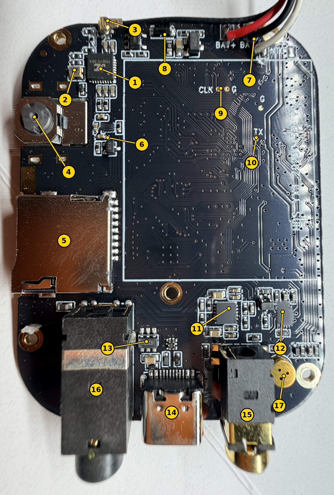
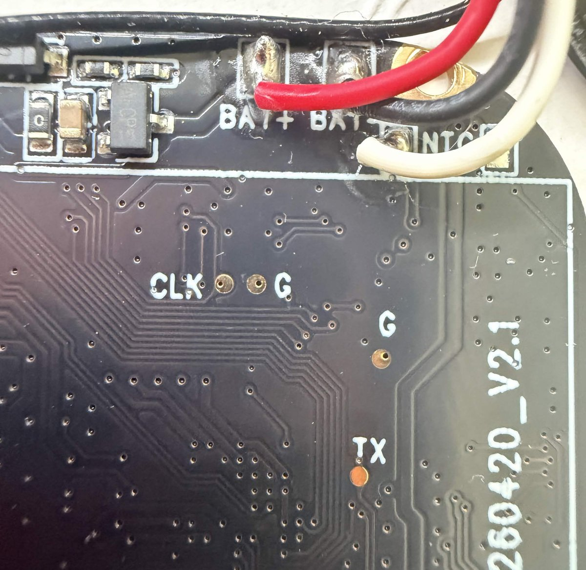
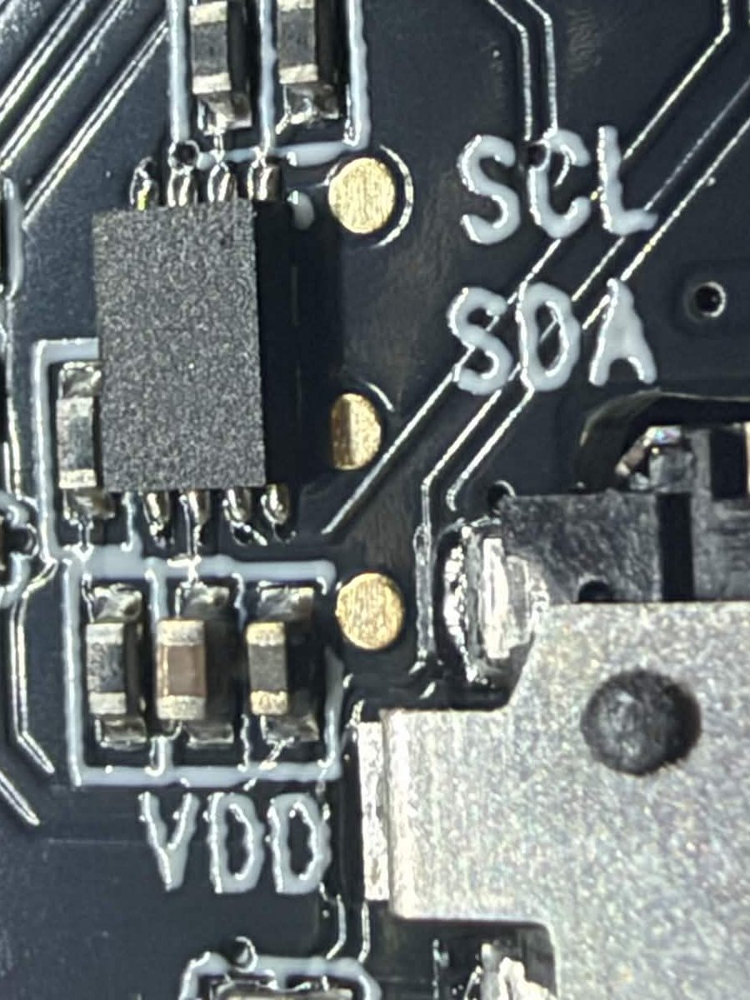

# The AP30 board

Status: draft, 2026-11

The AP30 has one main board with parts on both sides, a soldered-on battery and a 22-pin display FPC; there are no
daughter boards and no button flex. This page is the board reference: the complete list of SoC pins the stock
firmware uses and what each one does, the power tree as far as it is known, the test pads, the chip markings and
the open questions. The chips themselves have their own pages (linked in each section).

Tags: **[AP30]** firmware V1.7.8 or the device (board inspection of an opened retail unit, measurements) ·
**[TRM]** RKNanoD TRM V1.0 · **[DS]** a datasheet · **[EM]** Echo Mini · **[WEB]** public web source (Rockchip
reference-board documents from public SDK copies are cited as "[WEB] EVK") · **[?]** guess.

## Contents

- [Board overview](#board-overview)
- [Pin assignment table](#pin-assignment-table)
- [Pins by subsystem (quick view)](#pins-by-subsystem-quick-view)
- [Debug access: JTAG, UART, shared pins](#debug-access-jtag-uart-shared-pins)
- [Power tree](#power-tree)
- [Test pads](#test-pads)
- [Chips and markings](#chips-and-markings)
- [Connectors, buttons, wheel, other parts](#connectors-buttons-wheel-other-parts)
- [Reference-design lineage](#reference-design-lineage)
- [Regulatory filings](#regulatory-filings)
- [Open questions](#open-questions)
- [Sources](#sources)

## Board overview

| Item | Value | Tag |
|---|---|---|
| Board silk, side A (faces screen and buttons) | `HT9102_V2.1` | [AP30] |
| Board silk, side B (faces the battery) | `HDS_YXJ_20260420_V2.1` (inside a large outlined area that holds only test pads and traces; "HDS" is probably Hidizs, 20260420 a design date [?]) | [AP30] |
| Side A carries | SoC, storage chip, empty eMMC BGA footprint, RTC, DAC, 24.576 MHz crystal, Realtek ALC5686, `7227` switch, 8 tact switches, 22-pin display connector | [AP30] |
| Side B carries | both headphone jacks, USB-C, microSD slot, ALPS volume wheel, JieLi Bluetooth chip + coax to the antenna, RT6863 amplifier, battery pads | [AP30] |
| Orientation | side B is side A mirrored left-right, the jack edge at the bottom on both sides (fixed by the five through-holes) | [AP30] |
| No "Hidizs" / "AP30" silk on the PCB; the back cover carries a laser-etched "AP30 Music Boy" / "High Resolution Portable Music Player" | | [AP30] |
| Same electronics in both editions (plastic ~56 g, aluminium ~80 g with glass back) | | [WEB] reviews |

The Snowsky Echo Mini runs on the same SoC and a shared firmware code base, but its board differs (two CS43131 DACs,
a 320×170 panel) [EM]; see [../related/snowsky_echo_mini.md](../related/snowsky_echo_mini.md).



*Side A (screen side), jacks at the bottom [AP30]. Callout legend: [photos.md § Side A](photos.md#side-a-screen-side).*



*Side B (battery side), jacks at the bottom [AP30]. Callout legend: [photos.md § Side B](photos.md#side-b-battery-side).
Close-ups of every part: [photos.md](photos.md).*

## Pin assignment table

Every SoC pin the stock firmware configures, with its role on the AP30. Ball numbers are for the LFBGA121 package
(RKNanoD-G); the mux functions are the same on the LQFP128 part [DS]. "GPIOx_n" is the firmware's flat numbering;
"GPIOx_Ay" is the datasheet's (A0-A7 = 0-7, B0-B7 = 8-15, C0-C7 = 16-23, D0-D7 = 24-31).

**Confidence column:** *wiring* = the role is clear from what the firmware does with the pin and from the attached
chip; *role ?* = the firmware drives the pin but what it switches on the board is inferred.

| Pin | Datasheet name | Ball | Mux function used | Direction / level | Role on the AP30 | Confidence |
|---|---|---|---|---|---|---|
| GPIO2_5 | GPIO2_A5 | A2 | PLAYON (dedicated power-on input) | input, no pull, **high = pressed** | **Power key**; also drives the regulator enable directly and triggers the external ~8 s reset | wiring [AP30]; key location (wheel push switch) [?] |
| GPIO2_6 | GPIO2_A6 | A1 | POWERHOLD | output, **1 = stay on**, 0 = release | **power latch**; set by the boot loader first, re-asserted by the firmware's pin setup | [AP30] |
| GPIO2_4 | GPIO2_A4 | A3 | PWM0 (PWMB0 channel 0) | output; GPIO low when off | **backlight**, 15 kHz | [AP30] |
| GPIO2_15 | GPIO2_B7 | A4 | GPIO | output, active-low reset | **LCD panel reset** (also JTAG0 TCK) | [AP30] |
| GPIO0_16..23 | GPIO0_C0..C7 | A11, A10, B11, C11, A9, B10, C9, A8 | LCD_D0..D7 | output | **panel data bus** (8-bit i8080) | [AP30] |
| GPIO0_15 | GPIO0_B7 | B8 | LCD_CSN | output | panel chip select | [AP30] |
| GPIO0_24 | GPIO0_D0 | B9 | LCD_WRN | output | panel write strobe | [AP30] |
| GPIO0_25 | GPIO0_D1 | C8 | LCD_RS | output | panel command / data select | [AP30] |
| GPIO1_0 | GPIO1_A0 | G1 | I2S1A_CLK (MCLK out) during playback; GPIO otherwise | output | **I2S1 master clock pin**; additionally driven as a GPIO: high when a charger/host is attached, low in USB DAC mode | MCLK [AP30]; GPIO role (charge control?) [?] |
| GPIO1_1 | GPIO1_A1 | J3 | I2S1A_LRCK | output | **I2S word clock** to the CS43198 | [AP30] |
| GPIO1_2 | GPIO1_A2 | H1 | I2S1A_SCLK | output | **I2S bit clock** (64 fs) | [AP30] |
| GPIO1_3 | GPIO1_A3 | J2 | I2S1A_SDO | output | **I2S data** to the CS43198 | [AP30] |
| GPIO2_13 | GPIO2_B5 | C1 | I2C1C_SCL | open-drain | **CS43198 control clock** (address 0x66, 400 kHz) | [AP30] |
| GPIO2_12 | GPIO2_B4 | C2 | I2C1C_SDA | open-drain | **CS43198 control data** | [AP30] |
| GPIO2_1 | GPIO2_A1 | A5 | GPIO | output, **1 = muted** | **audio mute line**: 1 on volume 0, before a stop, on USB-DAC exit; 0 shortly after playback starts and in USB DAC mode | behaviour [AP30]; which chip it mutes (DAC, amp, mute FET) [?] |
| GPIO2_2 | GPIO2_A2 | B4 | GPIO | output | **audio power A**: 1 before the first DAC init, 0 when the player exits | role (power-rail enable) [?] |
| GPIO2_14 | GPIO2_B6 | B3 | GPIO | output | **audio line B**: high when idle, driven low ~0.5 s after each track start, high again on player exit (also JTAG0 TMS) | role (amp enable / shutdown, active low?) [?] |
| GPIO1_4 | GPIO1_A4 | J1 | GPIO | output | **audio-path enable**: 1 at the first music start and in USB DAC mode, 0 on player exit and in File Transfer | role [?]: amp / analog enable (it follows both audio users) or part of the USB switch |
| GPIO0_12 | GPIO0_B4 | C6 | GPIO | output | 0 for local playback (set again ~0.5 s after each start), 1 ~0.5 s after entering USB DAC mode | role [?]: output source select, Realtek enable/reset, or a charge-current select (its role on the Rockchip reference board) |
| GPIO0_14 | GPIO0_B6 | A7 | GPIO | output | **USB data switch select**: 1 = USB to the RKNanoD (boot default), 0 = USB to the Realtek ALC5686 | role [?] (consistent with every use) |
| GPIO2_8 | GPIO2_B0 | A6 | GPIO | input, pull-up | **headphone detect** (one jack) | [AP30]; which jack (4.4 mm on the Echo Mini [EM]) [?] |
| GPIO0_13 | GPIO0_B5 | B7 | GPIO | input, pull-up | **headphone detect** (other jack) | [AP30]; 3.5 mm on the Echo Mini [EM] [?] |
| GPIO2_0 | GPIO2_A0 | B5 | GPIO | input, SoC pull disabled | **volume wheel phase A** | [AP30] |
| GPIO2_9 | GPIO2_B1 | C5 | GPIO | input, SoC pull disabled | **volume wheel phase B** | [AP30] |
| SARADC ch1 | (analog) | — | ADC | 10-bit | **key ladder**, 8 face buttons | [AP30] |
| SARADC ch0 | (analog) | — | ADC | 10-bit | **battery voltage** through a 2:1 divider | [AP30]; divider value from the reference board [WEB] EVK |
| GPIO2_3 | GPIO2_A3 | B1 | GPIO | input with pull, **high = full** | **charger "full" status** | [AP30] |
| GPIO2_10 | GPIO2_B2 | D5 | I2C0A_SCL | open-drain | **RTC** clock (address 0xA2) | [AP30] |
| GPIO2_11 | GPIO2_B3 | E5 | I2C0A_SDA | open-drain | **RTC** data | [AP30] |
| GPIO2_7 | GPIO2_A7 | C3 | GPIO | output, **1 = module powered** | **Bluetooth chip power / enable** | [AP30] |
| GPIO2_16 | GPIO2_C0 | D2 | UART1A_TX | output | **to the JieLi RX**, 115200 8N1; also the boot loader's console and the crash-dump output | [AP30] |
| GPIO2_17 | GPIO2_C1 | D3 | UART1A_RX | input | **from the JieLi TX** | [AP30] |
| GPIO1_5 | GPIO1_A5 | E4 | SDMMC_CMD | | microSD command | [AP30] |
| GPIO1_6 | GPIO1_A6 | F4 | SDMMC_CLK | | microSD clock | [AP30] |
| GPIO1_7..10 | GPIO1_A7, B0..B2 | G3, F2, F3, G2 | SDMMC_D0..D3 | | microSD data, 4-bit | [AP30] |
| GPIO0_11 | GPIO0_B3 | B6 | GPIO | input, **active low** | **microSD card detect** (polled; the controller's own detect pin is not used) | [AP30] |
| GPIO0_0 | GPIO0_A0 | H10 | EMMC_PWREN | | internal storage power enable | muxed [AP30]; used by the chip [?] |
| GPIO0_1 | GPIO0_A1 | G11 | EMMC_CLK | | internal storage clock | [AP30] |
| GPIO0_2 | GPIO0_A2 | G10 | EMMC_CMD | | internal storage command | [AP30] |
| GPIO0_3..7 | GPIO0_A3..A7 | F10, F11, D9, E10, C10 | EMMC_D0..D4 | | storage data (D0-D3 used by an SD-NAND) | muxed [AP30]; D4 unused by SD [?] |
| GPIO0_8..10 | GPIO0_B0..B2 | D10, D11, E11 | EMMC_D5..D7 | | storage data 5-7 (eMMC only) | muxed by generic code [AP30]; unconnected on an SD-NAND build [?] |
| GPIO1_11 | GPIO1_B3 | H11 | EMMC_RSTN | | eMMC reset | muxed [AP30]; meaningful only for the empty eMMC footprint [?] |
| USB D+ / D- | (dedicated) | — | USB OTG PHY | | to the `7227` switch [?] | [AP30] |
| VBUS | (PHY) | — | USB PHY status, read from a GRF bit | | **USB power present** | [AP30] |

Pins the firmware never touches are not listed; nothing else in the image drives a GPIO [AP30]. The pull-ups for
the wheel phases are external or inside the encoder, since the SoC pulls are disabled [?].

### Pins with two lives

- **GPIO1_0** is the I2S1 MCLK pin while music plays and a plain GPIO for the charge / USB-DAC logic otherwise
  [AP30]. Whether its MCLK even reaches the CS43198 is open (the DAC clocks from its own crystal).
- **GPIO2_14 / GPIO2_15** are the JTAG0 (system core) SWD pins; the firmware uses them as an audio line and the LCD
  reset, and clears the SoC's "force JTAG" bit at boot [AP30].
- **GPIO2_12 / GPIO2_13** are UART0A and JTAG1 (core B) as well as I2C1C; on the AP30 they carry the DAC's I2C, so
  neither UART0A nor JTAG1 is usable while the DAC is in use [AP30].
- **GPIO2_16** carries both the Bluetooth link and the loader banner / crash dumps [AP30].

## Pins by subsystem (quick view)

```
 Power        GPIO2_5 PLAYON (key in)   GPIO2_6 POWERHOLD (out)   VBUS (GRF)   GPIO2_3 charge full   GPIO1_0 charge ctl? 
 Display      GPIO0_15..25 VOP i8080    GPIO2_15 reset            GPIO2_4 PWM0 backlight
 Audio        GPIO1_0..3 I2S1A          GPIO2_12/13 I2C1C (DAC)   GPIO2_1 mute  GPIO2_2 / GPIO2_14 / GPIO1_4 / GPIO0_12 [roles ?]
 Jacks        GPIO2_8 + GPIO0_13 headphone detect
 Input        SARADC ch1 ladder         GPIO2_0 / GPIO2_9 wheel
 Storage      EMMC GPIO0_0..10 + GPIO1_11   SDMMC GPIO1_5..10   GPIO0_11 card detect
 USB          GPIO0_14 switch select    D+/D- via "7227" [?]
 Bluetooth    GPIO2_7 power             GPIO2_16/17 UART1A
 RTC          GPIO2_10/11 I2C0A
 Battery      SARADC ch0
```

## Debug access: JTAG, UART, shared pins

| Interface | Pins | State on the AP30 |
|---|---|---|
| JTAG0 / SWD (system core) | TMS = GPIO2_14 (B3), TCK = GPIO2_15 (A4) | repurposed (audio line B, LCD reset); no labelled pads [AP30] |
| JTAG1 / SWD (core B) | TMS = GPIO2_12, TCK = GPIO2_13 | carries the DAC I2C bus [AP30] |
| UART1A | TX GPIO2_16, RX GPIO2_17 | Bluetooth link; the loader banner (115200 8N1) and crash dumps go out on TX [AP30]. The `TX` test pad is the best candidate for this line [?] |
| UART0A | GPIO2_13 / GPIO2_12 | shared with the DAC I2C [AP30] |
| UART0B | USB D- / D+ through the PHY's UART bypass | possible without soldering if the USB switch points at the RKNanoD; untested [TRM, ?] |

On Rockchip's reference board JTAG0 debugs the system core and JTAG1 core B, each on a 4-pin SWD header [WEB] EVK.
The stock firmware prints nothing in normal operation; details in
[../firmware/architecture.md](../firmware/architecture.md).

## Power tree

No PMIC is fitted [AP30]. The structure below combines the reference-board pattern [WEB] EVK, the firmware's
behaviour [AP30] and the parts seen on the board; the identities of the regulators are guesses.

```
  USB-C VBUS (5 V) ─┬───────────────────────────────► charger IC [not identified; candidates: DP1 165 + inductor]
   "5V" test pad    │                                   │  "full" status ──► GPIO2_3 (high = full)
                    │                                   │  control? ◄──────── GPIO1_0 [?]
                    │                                   │  NTC input? ◄────── battery NTC wire [?]
                    │                                   ▼
                    │                          ┌──────────────────────┐
                    │                          │ 1200 mAh Li-po        │ 3.8 V nominal, 4.56 Wh, cell "923033"
                    │                          │ + protection PCB      │ wires to pads BAT+ (red), BAT- (black),
                    │                          └──────────┬───────────┘  NTC (white)
                    │                                     │
                    │                       battery path: "AFCP" SOT-23 (AO3415-type P-MOSFET [?]),
                    │                       "SL" SOD-123 Schottky diodes [?]
                    │                                     │
                    ▼                                     ▼
        ┌──────────────────────────────────────────────────────────────┐
        │ system regulators (discrete): "06T2" SOT-23-6 + inductor     │
        │ (buck [?]), "D00HAV" SOT-23-5 ×2 (LDO [?]), "S2ZQ" SOT-23-5,  │
        │ "705628" 8-lead [?]                                            │
        │ enable = PLAYON  OR  POWERHOLD  OR  VBUS   (diode-OR)          │
        └───────┬──────────────────┬───────────────────┬────────────────┘
                │                  │                   │
          SoC rails, storage,   CS43198 (VA/VP; its own Class H     panel, backlight,
          RTC? (supply when     VP_LDO at 3.0 V with HV_EN = 1)     RT6863, JieLi,
          off not traced)       [DS + AP30 register value]           ALC5686 [?]

  Power key ──► PLAYON (GPIO2_5) ──► also into the diode-OR, and into the external long-press timer
                                     (~8 s → power-on-class reset, repeats ~10.5 s while held) [AP30 measured]
```

Facts:

- The board stays on while PLAYON, POWERHOLD or VBUS is high. With USB power present the player cannot switch
  itself off; the firmware shows the charge screen instead [AP30]. The reference board uses exactly this diode-OR
  [WEB] EVK.
- USB power alone boots a switched-off player (into the charge screen) [AP30].
- The ~8 s long-press reset is external hardware; the part that makes it is not identified [AP30, part ?].
- The battery is measured on SARADC ch0 behind a 2:1 divider: mV = raw × 5000 / 1024 [AP30].
- Vendor rating: 5 V / 2 A input [WEB spec list].

Details, thresholds and behaviour: [power.md](power.md).

## Test pads

All labelled pads found on the board [AP30]. None is labelled `RX`, `SWDIO`/`SWCLK`, `RST`, `D+`/`D-` or `TPxx`;
there is no pin-header footprint and no pad on any board edge.

| Silk | Side | Where | Kind | Likely function |
|---|---|---|---|---|
| `TX` | B | inside the outlined area, below the single `G`; mirrored onto side A it sits over the SoC's display-connector edge | **solid, undrilled pad, bare copper**, with a via above it and a surface trace leaving it towards the jack edge | **debug UART transmit [?]**, most likely UART1A TX = GPIO2_16 (ball D2): the only line on which both the boot loader (banner at 115200 8N1) and the crash handlers print. Bluetooth shares the line, which would explain the missing RX pad [?] |
| `CLK` + `G` | B | side-by-side pair just inside the outlined area, directly below the `BAT+` pad; mirrored: the lower edge of the empty eMMC BGA footprint, between storage and SoC | round gold pads, drilled via in the middle; no thin trace visibly leaves CLK | **storage clock test point [?]** (EMMC_CLK, ball G11). A clock pad next to a ground pad fits the Rockchip "hold the boot-medium clock low at power-on → MaskROM" trick [WEB] EVK |
| `G` | B | single pad below and right of the CLK pair | round gold, drilled | ground |
| `G`, `5V` | A | top edge, above the RTC | | ground; VBUS test point [?] |
| `P`, `M` | A | next to the ALPS encoder | | encoder phases (plus / minus) [?] |
| `SCL`, `SDA`, `VDD` | A | below the encoder; SDA and SCL in a column left of an unmarked 8-lead part | round gold, undrilled | an I2C bus, perhaps to that 8-lead part (EEPROM?) [?]; no visible trace joins the pads to its pins |
| (unlabelled) | A | a pair of round pads next to the ALC5686; oval solder-coated pads, single and in rows of three, near the tact switches | | unknown [?] |



*Test pads on side B, jacks-at-bottom view: CLK and G pair below the BAT+ pad, a single G, and the solid copper TX pad with a surface trace; battery wires BAT+/BAT-/NTC at the top. [AP30]*



*SCL, SDA and VDD pads on side A, below the encoder, next to the unmarked 8-lead part. [AP30]*

Cheapest checks (power off unless stated): continuity `TX` → SoC ball D2 / the JieLi's RX pin, `CLK` → the CLK ball
of the empty BGA footprint; or, with power, a 3.3 V USB-UART receiving on `TX` + `G` at 115200 during a boot (a
banner confirms the loader console). The loader banner contains lines such as "Boot Release Time", `BootDevType=`
and `IDBAddr=` [AP30]; see [../firmware/boot_loader.md](../firmware/boot_loader.md).

> **Warning:** do not short `CLK` to ground on a working player "to see what happens". The MaskROM trick is a last
> resort for a player whose boot loader area is already destroyed, it is untested on the AP30, and a slip with a
> probe can damage the SoC or the storage chip. A working player is always recoverable through loader USB mode
> (D-pad Right + Power with USB connected), see [../guides/recovery.md](../guides/recovery.md). Never write the
> boot-loader area (physical sectors 0x0000-0x1FFF), never run `rkdeveloptool ef`, never download a foreign loader
> (`db` / `ul`).

## Chips and markings

Read from the packages of an opened retail unit [AP30]; photos of each part in [photos.md](photos.md). Lot and date codes are omitted. Positions use the
"jacks at the bottom" view.

| Part | Side, position | Marking (part code) | Package | Identification |
|---|---|---|---|---|
| SoC | A, upper left of centre | `Rockchip` / `RKNANOD-G` | LFBGA121 | Rockchip RKNanoD-G [AP30]; see [soc_rknanod.md](soc_rknanod.md) |
| Storage | A, top edge | logo "TM" / `TM3F4GUAI` | 8-pad LGA, ~6×8 mm, 4 pads per long side | SD-NAND [?]; Titan Micro TM3F family by part-number match [WEB, ?]; "4G" = 4 Gbit [?]. See [storage.md](storage.md) |
| (empty footprint) | A, top left | — | ~150-ball BGA site in rings (eMMC BGA-153 pattern [?]) | alternate eMMC fit, not populated |
| RTC | A, right of the storage chip | `AnalogTek` / `AT85163S` | 8-pin MSOP | AnalogTek RTC, PCF85163-style [?]; see [rtc.md](rtc.md) |
| RTC crystal | A, next to the RTC | `AQQT` (second line: lot/date code) | 2-pad SMD | 32.768 kHz by its position [?] |
| DAC | A, centre | `CIRRUS` / `CS43198` | QFN-40 | Cirrus Logic CS43198 [AP30]; see [audio_dac_cs43198.md](audio_dac_cs43198.md) |
| DAC crystal | A, above the DAC | `24.576` / `MHZ` | 4-pad SMD | 24.576 MHz (512 × 48 kHz), the CS43198's crystal [AP30 + DS] |
| USB-audio chip | A, lower left | `ALC5686` | QFN-48 | Realtek ALC5686 [AP30]; see [usb.md](usb.md) |
| ALC5686 crystal | A, beside it | `24.000 MHZ` | 4-pad | 24.000 MHz |
| SoC crystal | A, below the SoC | `24.000` / `MHZ` | 4-pad | 24 MHz SoC oscillator (the only crystal next to the SoC) [?] |
| Switch | A, between the 24.576 MHz part and the SoC | `7227` | 10-lead leadless (3+2+3+2), ~1.4×1.8 mm | 7227 family of DPDT analog / USB 2.0 switches (WillSemi WAS7227Q, Full-Way FSW7227) [?]; fits the USB mux selected by GPIO0_14, or an I2S / clock switch between the RKNanoD and the ALC5686 [?] |
| Unknown | A, below the 24.576 MHz part | `4576` | QFN-16 | not identified; "4576" is a part code, not a frequency [?] |
| Power | A, right edge | `DP1` / `165` | leadless, 6 pads visible on one long side, molded power inductor beside it | DC-DC converter or charger [?] |
| Power | A, right of the SoC | `06T2` | SOT-23-6, inductor below it | buck converter [?] |
| Power | A, top left corner | `705628` (last character 8 or B; the second line is taken as a lot code [?]) | 8 gull-wing leads | power part [?]; no part found for this code yet |
| Power | A, top left corner | arc logo + `S2ZQ` | SOT-23-5 | power part [?] |
| Power | B by the coax tab, and A right edge | `D00HAV` (O vs 0 unclear) | SOT-23-5, two instances | LDO [?] |
| Battery path | B, top edge next to `BAT+` | `AFCP` (plus a small lot code on the side) | 3-lead SOT-23 | **AO3415-type 20 V P-channel MOSFET** [WEB, ?]: in Alpha & Omega's [SOT-23 marking scheme for the AO3415](https://www.aosmd.com/sites/default/files/res/markings/AO3415.pdf) `AF` is the product code, the third character a year/week code, the fourth the assembly site, and the code on the side the assembly lot. Second-source AO3415 parts may reuse `AF`, so the maker is open. Fits a battery load switch or reverse-current protection [?] |
| Diodes | B (between `AFCP` and `D00HAV`), A (next to the ALC5686, two) | `SL` | SOD-123 | Schottky diodes [?] |
| Amplifier | B, between the left jack and USB-C | `6863D` | QFN, 12-16 leads; no inductor nearby | Richtek RT6863 [AP30 + vendor spec]; see [audio_amp_rt6863.md](audio_amp_rt6863.md) |
| Unknown | B, left of the RT6863 by the gold jack | `A80Q` (second line: lot/date code [?]) | 16-lead leadless (4 per side) | candidate: Will Semiconductor [WSP6580Q](https://www.lcsc.com/product-detail/Analog-Switches-Multiplexers_WILLSEMI-Will-Semicon-WSP6580Q-16-TR_C2941901.html), a hi-fi stereo SPDT audio switch in a 16-lead QFN1826 package [WEB]; name and pin count fit, the maker's marking table has not been checked [?]. If so it switches a stereo signal pair near the jacks (amplifier vs. USB-DAC path, or one jack vs. the other) [?] |
| Unknown | B, next to USB-C | `mBJ3H` | SOT-23-6 | ESD array or USB switch [?] |
| Unknown | B, below the encoder frame | `L2AOU` | DFN | not identified |
| Unknown | A, below the encoder | unmarked | 8 gull-wing leads, thick body | not identified (I2C device? only because of the pad silk next to it) [?] |
| Small parts | both | `K2N`, `3T` (SOT-23), `4J` (SC-70), many `88` (SOD-523) | | small transistors / ESD diodes [?] |
| Bluetooth | B, top edge (top-left in the jacks-at-bottom view) | JL logo / `…-56C4` (the part before the dash is a serial number) | QFN-32 (one side has a gap of about two leads) | JieLi Bluetooth SoC [AP30]; JieLi [hides the chip name after the dash](https://kagaimiq.github.io/jielie/chips/chip-marks.html), so probably an **AC6956C4** (AC695N family, QFN-32) [WEB, ?]; see [bluetooth.md](bluetooth.md) |
| BT crystal | B, beside the JieLi | `24.000 MHZ` | 4-pad | 24 MHz |
| Antenna | back cover | FPC sticker `B_1597-2.4G_A1`, reached by a coax pigtail whose crimp tab is soldered to a board pad (no U.FL socket) | | [AP30] |
| Panel FPC | display flex | `FDT0201B015-V02` | 22 pins | display panel flex; no controller marking visible [AP30]; see [display.md](display.md) |
| Battery | — | `923033` `3.8V 1200mAh` `4.56Wh` | Li-po pouch | matches the vendor spec [AP30] |
| Battery protection | green strip PCB on the cell's short edge, under kapton | resistors `101`, `102`, `201`, silk `R7` | | protection IC and MOSFETs not readable through the kapton [AP30] |

Crystal count: three 4-pad crystals on side A (24.576, 24.000 by the SoC, 24.000 by the ALC5686) plus the 2-pad RTC
crystal; one more 24.000 MHz on side B (JieLi) [AP30].

**Not on the board:** no dedicated PMIC, no FM tuner, no FSUSB30-style switch marking (the `7227` may play that
role) [AP30]. The firmware still contains a dead driver for an ALC5633 codec at I2C1A address 0x38, a leftover from
an early Rockchip reference board; nothing calls it and those pins have other uses [AP30].

## Connectors, buttons, wheel, other parts

| Item | What is there | Tag |
|---|---|---|
| Display connector | 22-pin FPC connector on side A, left edge (silk `1`, `22`); 8 data + WR + RS + CS + reset + backlight + supplies + ground fits 22 pins [?]; pinout unknown | [AP30] |
| Battery | no connector: three wires soldered to `BAT+`, `BAT-`, `NTC` on side B, on the edge opposite the jacks | [AP30] |
| USB-C | 16-pin SMD receptacle on side B, between the two jacks | [AP30] |
| Headphone jacks | two jacks on the USB edge: left gold-plated with a smaller barrel, right larger. Vendor spec: 3.5 mm single-ended + 4.4 mm balanced. Which is which is not readable on the board [?] | [AP30] + [WEB] |
| microSD | metal slot on side B, on the wheel edge | [AP30] |
| Volume wheel | ALPS encoder in a board-edge notch, visible from both sides; orange knurled metal knob on side B; its rotor sits in a stamped metal frame marked `6M1`; a black housing with a small square window sticks out at the board edge; four slotted gold pads around it are mounting lugs [?] | [AP30] |
| Face buttons | **8 SMD tact switches** directly on side A, matching the 8 ladder keys; the shell's D-pad, round A/B and two pill caps press on them; no button flex | [AP30] |
| Power key | **no tact switch of its own** anywhere on the board, and nothing on any edge. Reviewers describe a press-and-hold of the volume wheel as power on/off and a short press as screen on/off, which matches the firmware's PLAYON behaviour: the ALPS encoder almost certainly contains a push switch wired to PLAYON [?] | [AP30] + [WEB] |
| Small cylinder | ~4 mm brass-topped cylinder with three holes, next to the gold jack on side B | electret microphone or buzzer [?]; the vendor spec mentions headset-mic compatibility [WEB] |
| Gold edge strip | exposed gold strip with a via row along side A's wheel / microSD edge | shell ground contact [?] |

## Reference-design lineage

The AP30 follows Rockchip's RKNanoD reference board (EVK) in many places [WEB] EVK + [AP30]:

| Function | Reference board | AP30 |
|---|---|---|
| Battery voltage | ADC0 through 200k/200k (2:1) | ADC ch0, 2.5 V full scale × 2 [AP30] |
| Key ladder | ADC1, 51k pull-up; the 0 V slot is the upgrade key | ADC ch1 ladder; D-pad Right sits on the 0 V slot and is the loader key [AP30] |
| microSD detect | GPIO0_B3 | GPIO0_11 (= GPIO0_B3), active low [AP30] |
| LCD | 8-bit i8080 on GPIO0_C0-C7, CSN GPIO0_B7, WRN GPIO0_D0, RS GPIO0_D1 | same pins [AP30]; panel reset on GPIO2_15 instead of an RC network |
| Backlight | PWM0 | PWM0 ch0 on GPIO2_4 [AP30] |
| Power latch | PLAYON active high; regulator enable = diode-OR of PLAYON, POWERHOLD, VBUS | same signals [AP30]; the reference board has no long-press timer, so it does not explain the 8 s reset |
| RTC | (early V0.1 board) HYM8563 on I2C0A, 7-bit 0x51 | AT85163S on I2C0A at 8-bit 0xA2 (= 7-bit 0x51) [AP30] |
| Codec | (V0.1 board) ALC5633 on I2C1A, 0x38 | dead ALC5633 driver left in the firmware [AP30] |
| Bluetooth | RTL8761AT on UART1A | JieLi chip on UART1A [AP30] |
| USB | FSUSB30 analog switch between device and host port | GPIO0_14 drives a switch between RKNanoD and ALC5686 [AP30, ?] |
| Charge current | GPIO0_B4 (= GPIO0_12) charge-current select (transistor not fitted) | GPIO0_12 driven in USB DAC mode [AP30]; same role possible [?] |
| Charger status | `CHG_OK` on GPIO2_A1 | GPIO2_A1 (= GPIO2_1) is the mute line; "full" moved to GPIO2_3 [AP30] |
| Crystal | 24 MHz | 24 MHz [AP30] |

## Regulatory filings

The AP30 has **no regulatory filing of its own** [WEB]. The retail box carries the CCC, CE, FCC, Japanese Giteki,
IC and RoHS marks but no FCC ID, IC number or Giteki number. "AP30" appears only as a listed model in Hidizs'
**AP80 PRO MAX** certifications: [FCC ID 2A7ZP-AP80PROMAX](https://fccid.io/2A7ZP-AP80PROMAX) (granted 2025-12-23),
ISED 35096-AP80PROMAX, and [Giteki 222-260312](https://fccid.io/giteki/222-260312). The FCC exhibits show an
Android-class AP80 PRO MAX (AzureWave Wi-Fi/BT module, X-Powers-style PMIC, 1300 mAh), not the AP30 board, so the
filing's "same PCB, only model number differs" statement does not hold for the shipped AP30 [WEB + AP30]. Hidizs'
grantee codes are [2A7ZP](https://fccid.io/2A7ZP) and [2ANW4](https://fccid.io/2ANW4). Details:
[../overview/device.md](../overview/device.md).

## Open questions

| Question | How it could be answered |
|---|---|
| What GPIO2_2, GPIO2_14, GPIO1_4 and GPIO0_12 switch, and which GPIO (if any) drives the CS43198 RESET | continuity to the DAC / amp / ALC5686 enable pins; or toggle one line at a time from a test image |
| Is GPIO0_14 the `7227`'s select pin; what does the `7227` switch (USB pair or I2S / clock lines) | continuity, power off |
| Charger IC; is GPIO1_0 its enable or a current select; where the NTC wire goes | continuity from balls G1 / B1 and the `NTC` pad to the `DP1 165` and SOT-23 parts |
| Which part makes the ~8 s reset; does it cut power or pull the SoC reset | scope POWERHOLD and the reset ball during a long press |
| `TX` pad = GPIO2_16? `CLK` pad = EMMC_CLK? | see [Test pads](#test-pads) |
| Is the wheel push switch on PLAYON (ball A2) | continuity, or log GPIO2_5 while pressing the wheel |
| Which headphone-detect pin belongs to which jack, and the polarity | read both pins with each plug inserted |
| Identity of `A80Q` (WSP6580Q?), `705628`, `4576`, `L2AOU`, `mBJ3H`, the unmarked 8-lead part, the battery protection IC | better photos / markings lookup |
| Display FPC pinout; are RD and TE wired | continuity with the panel unplugged |
| Is the empty BGA footprint wired in parallel with the SD-NAND | continuity from its CLK ball to the LGA pads |

## Sources

- [AP30] analysis of firmware V1.7.8 (pin setup at boot, drivers for display, audio, keys, wheel, storage, USB,
  Bluetooth, RTC, power); board inspection of an opened retail unit (markings, positions, pads); measurements on a
  device (long-press reset).
- [DS] [RKNanoD datasheet V1.8](https://rockchip.fr/RKNanoD%20datasheet%20V1.8.pdf) (pin table, packages);
  [TRM] [RKNanoD TRM V1.0](https://rockchip.fr/Rockchip%20RKNanoD%20TRM%20V1.0.pdf).
- [WEB] EVK: Rockchip RKNanoD EVK Hardware User's Guide V2.2 and main-board schematics V0.1 / V2.2, as found in
  public SDK copies such as
  [brian0218/RKNanoD_Wireless_Audio_SDK_V1.5](https://gitlab.com/brian0218/RKNanoD_Wireless_Audio_SDK_V1.5) and
  [xinghuaman/RKNanoD_MP3_V1.3_20161102](https://github.com/xinghuaman/RKNanoD_MP3_V1.3_20161102).
- [WEB] [Head-Fi AP30 showcase](https://www.head-fi.org/showcase/hidizs-ap30-music-boy.29215/) (vendor spec text);
  reviews in [../community/user_feedback.md](../community/user_feedback.md); fccid.io records linked above.
- [EM] [iamcheyan/echo-mini-newfw](https://github.com/iamcheyan/echo-mini-newfw) `ETUDE.md`.
- [WEB] Marking lookups: Alpha & Omega
  [AO3415 marking description PD-00120](https://www.aosmd.com/sites/default/files/res/markings/AO3415.pdf) and
  [AO3415 datasheet](https://www.aosmd.com/sites/default/files/res/datasheets/AO3415.pdf);
  [WSP6580Q-16/TR at LCSC](https://www.lcsc.com/product-detail/Analog-Switches-Multiplexers_WILLSEMI-Will-Semicon-WSP6580Q-16-TR_C2941901.html);
  JieLi chip markings: [kagaimiq/jielie, "chip marks"](https://kagaimiq.github.io/jielie/chips/chip-marks.html),
  [AC6956C4 at LCSC](https://www.lcsc.com/product-detail/Microcontroller-Units-MCUs-MPUs-SOCs_JieLi-Tech-AC6956C4_C5339900.html).
