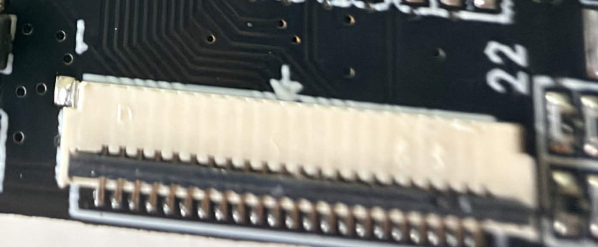
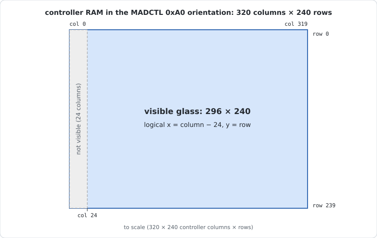

# Display

Status: draft, 2026-11

The AP30 has a 2.0" IPS panel showing **296×240** pixels, connected by a 22-pin FPC and driven over an **8-bit
i8080 ("MCU") bus** by the RKNanoD's LCD controller (**VOP**). The panel's controller IC is not marked; its vendor
command set (`DF 98 53` unlock, `DE` page select) matches the **Jadard JD9853** family [?]. It is a 240×320
controller used in landscape (320×240), of which columns 24-319 are visible. Pixels are **RGB565**. The bus is
write-only (the VOP has no RD pin, and no TE input is used). The backlight is **PWM0 channel 0 on GPIO2_4 at
15 kHz**; the panel reset is GPIO2_15. This page holds the panel facts, the full init sequence as data, the VOP
interface as the AP30 uses it, and the backlight.

Tags: **[AP30]** firmware V1.7.8 or the device · **[TRM]** RKNanoD TRM V1.0 · **[DS]** a datasheet · **[EM]** Echo
Mini · **[WEB]** public source · **[?]** guess.

*22-pin display FPC connector, side A, display-connector edge (silk 1 and 22). [AP30]*

More photos: [photos.md](photos.md).

## Contents

- [Summary](#summary)
- [Wiring](#wiring)
- [Panel and controller](#panel-and-controller)
- [Geometry: 296×240 on a 240×320 controller](#geometry-296240-on-a-240320-controller)
- [Init sequence (stock)](#init-sequence-stock)
- [Drawing: window, pixel modes, DMA](#drawing-window-pixel-modes-dma)
- [Sleep and wake](#sleep-and-wake)
- [VOP interface and bus timing](#vop-interface-and-bus-timing)
- [Backlight](#backlight)
- [Frame buffer and resources (pointers)](#frame-buffer-and-resources-pointers)
- [Echo Mini differences](#echo-mini-differences)
- [Open questions](#open-questions)
- [Sources](#sources)

## Summary

| Item | Value | Tag |
|---|---|---|
| Panel | 2.0" IPS, 296×240 visible, not touch | [WEB] spec, [AP30] |
| Flex | 22 pins, printed `FDT0201B015-V02`; no controller marking visible | [AP30] |
| Controller | JD9853-class (vendor unlock `DF 98 53`, page select `DE`) | command pattern [AP30], part [?] |
| Native frame | 240×320 portrait, used rotated (MADCTL 0xA0) as 320×240; visible columns 24..319 | [AP30], native size [?] |
| Pixel format | RGB565 (COLMOD 0x05) | [AP30] |
| Interface | 8-bit i8080 through the VOP (base 0x60070000): D0-D7, WR, RS, CS; write only | [AP30 + TRM] |
| Reset | GPIO2_15, active low | [AP30] |
| TE | enabled in the controller (cmd 0x35) but read by no SoC pin | [AP30] |
| Backlight | PWMB0 channel 0 on GPIO2_4, 15 kHz, 6-entry duty table | [AP30] |
| DMA | DMAC1, hardware request 14 = VOP, 32-bit items to the VOP data register | [AP30] |

## Wiring

| Signal | SoC pin (ball) | Notes |
|---|---|---|
| LCD_D0..D7 | GPIO0_16..23 = GPIO0_C0..C7 (A11, A10, B11, C11, A9, B10, C9, A8), function 1 | muxed in the board pin setup [AP30]; the reference board's wiring [WEB] EVK |
| LCD_CSN | GPIO0_15 = GPIO0_B7 (B8) | chip select |
| LCD_WRN | GPIO0_24 = GPIO0_D0 (B9) | write strobe |
| LCD_RS | GPIO0_25 = GPIO0_D1 (C8) | command (low) / data (high) |
| Panel reset (active low) | **GPIO2_15** = GPIO2_B7 (A4) | GPIO output; also the JTAG0 TCK pin [DS] |
| Backlight | **GPIO2_4** = GPIO2_A4 (A3), PWM0 function | GPIO output low = off [AP30] |
| RD | none known | the VOP has no RDN pin [TRM]; the Echo Mini bit-bangs RD on GPIO0_12 [EM]; on the AP30 GPIO0_12 is driven when entering USB DAC mode, so "RD on GPIO0_12" is unproven [?] |
| TE | none known | the VOP has no TE input [TRM] |
| FPC | 22 pins, connector on side A, left edge (silk `1`, `22`) | 8 data + WR + RS + CS + reset + backlight + supplies + ground fits 22 pins [?]; pinout unknown |

## Panel and controller

- **Controller guess: Jadard JD9853 class** [?]. Evidence: the vendor "password" `DF 98 53`, page select `DE 00` /
  `DE 01`, vendor registers B2, B7, BB, C0-C4, C8, D0, D7, E6, BE, and standard MIPI-DCS commands for everything else
  [AP30]. The `DF` unlock with JD-style paging is not the ST7789 command set; the Echo Mini's two panels are
  ST7789-type, with E0/E1 gamma and no paging [EM].
- **No colour inversion** command (0x21) is sent [AP30]; the ST7789-type Echo Mini panels need it [EM]. The JD9853
  defaults presumably suit the IPS glass [?].
- **Panel ID:** never read by the stock firmware; reading it needs a bit-banged RD on a GPIO, and the RD pin is not
  known [AP30, ?].
- The stock panel driver is a loadable overlay (overlay 4), chosen by an index in the firmware's configuration
  block [AP30]; see [../firmware/display_and_input.md](../firmware/display_and_input.md).

## Geometry: 296×240 on a 240×320 controller

- The init sets **MADCTL = 0xA0** (row/column exchange + row-address order flip, RGB order) and **COLMOD = 0x05**
  (16 bpp) [AP30].
- In that orientation the controller addresses 320 columns × 240 rows; the glass shows **columns 24..319** (the
  window routine adds 24 to every column address) and rows 0..239 [AP30]. So the native controller frame is
  240×320 portrait [?].
- A portrait mode (240×296) for the picture viewer, the boot logo and a menu animation is done in software by
  rotating coordinates before they reach the frame buffer; the panel stays at MADCTL 0xA0 [AP30].

## Init sequence (stock)

The bus is in byte mode for the whole sequence (VOP write-data bypass on, no split). Each parameter byte is one data
cycle. Delays are the minimums the stock firmware uses [AP30, panel driver in overlay 4]. The vendor values
(steps 2-21) are panel tuning: treat them as opaque data, their meaning needs the controller datasheet.

| # | Command | Parameters (hex) | Delay after | Meaning |
|---|---|---|---|---|
| 0 | (GPIO2_15) | reset high, low, high | 10 ms, 100 ms, 10 ms | hardware reset pulse, 100 ms low |
| 1 | `01` | — | 10 ms | SWRESET |
| 2 | `DF` | `98 53` | | vendor command unlock [?] |
| 3 | `DE` | `00` | | select register page 0 [?] |
| 4 | `B2` | `25` | | vendor (page 0) |
| 5 | `B7` | `00 29 00 51` | | vendor |
| 6 | `BB` | `4F 1A 55 73 63 F0` | | vendor |
| 7 | `C0` | `44 A4` | | vendor (power?) [?] |
| 8 | `C1` | `12` | | vendor |
| 9 | `C3` | `7D 07 14 06 C8 71 6C 77` | | vendor |
| 10 | `C4` | `00 00 94 79 25 0A 16 79 25 0A 16 82` | | vendor |
| 11 | `C8` | `3F 32 2A 22 26 25 1E 1E 1C 1C 19 0E 09 02 06 00`, then the same 16 bytes again (32 bytes) | | gamma (positive / negative identical) [?] |
| 12 | `D0` | `04 06 6B 0F 00` | | vendor |
| 13 | `D7` | `00 30` | | vendor |
| 14 | `E6` | `10` | | vendor |
| 15 | `DE` | `01` | | select page 1 [?] |
| 16 | `B7` | `03 13 EF 35 35` | | vendor (page 1) |
| 17 | `C1` | `14 15 C0` | | vendor (page 1) |
| 18 | `C2` | `06 3A` | | vendor (page 1) |
| 19 | `C4` | `72 12` | | vendor (page 1) |
| 20 | `BE` | `00` | | vendor (page 1) |
| 21 | `DE` | `00` | | back to page 0 |
| 22 | `35` | `00` | | TEON, V-blank only |
| 23 | `36` | `A0` | | MADCTL: landscape (see Geometry) |
| 24 | `3A` | `05` | | COLMOD: 16 bit/pixel RGB565 |
| 25 | `2A` | `00 00 00 EF` | | CASET 0..239 (left over and harmless: every draw sets its own window) |
| 26 | `2B` | `00 00 01 27` | | RASET 0..295 (same) |
| 27 | `11` | — | 120 ms | SLPOUT |
| 28 | `29` | — | 1 ms | DISPON |

After step 28 the driver switches the VOP to two-phase split mode for pixel data [AP30].

**Bring-up order used by the stock firmware** [AP30]: pins to the LCD function, GPIO2_15 output, GPIO2_4 as GPIO
low (backlight off) → release the VOP soft reset (CRU reset id 0x0d) and ungate `hclk_vop` (CRU gate id 0x7f) →
program the bus timing for the current clock → reset pulse + init table → fill and flush a blank frame, draw the
boot logo → only then start the backlight PWM, so GRAM garbage is never visible.

## Drawing: window, pixel modes, DMA

- **Set window:** CASET with (x0 + 24, x1 + 24), RASET with (y0, y1), each as two big-endian 16-bit values, then
  RAMWR (`2C`). Logical coordinates x 0..295, y 0..239 [AP30].
- **Single pixels (CPU):** with two-phase split, one 16-bit write to the VOP data register sends one RGB565 pixel as
  two bus bytes. Used for clears and fills [AP30].
- **DMA blocks:** four-phase split, no half-word swap; each 32-bit word sends two pixels. The stock frame buffer
  stores each pixel pair swapped inside its 32-bit word (the even-x pixel in the upper half), so the VOP sends the
  upper half-word first [AP30, inferred from the pixel writer]. The TRM instead asks for the half-word swap bit with
  this layout; either works if used consistently [TRM, ?].
- **DMA setup** [AP30, decoded with the TRM field names]: DMAC1, memory → peripheral, DMAC flow control; 32-bit
  source and destination; source increments, destination fixed (the VOP data register); bursts of 16 items; source
  on AHB master 2, destination on master 1; destination hardware handshake on **request 14**. One block carries at
  most 0xFF8 (4088) items; longer transfers are chained, up to 18 blocks (~73 000 words). A full 296×240 frame is
  35 520 words, so at least 9 blocks [AP30 + arithmetic].
- The flush is **synchronous**: the CPU sleeps (WFI) until the DMA-done callback [AP30]. The same DMAC carries the
  I2S audio stream (channel 5) and other users.
- A full frame is 142 080 bytes on the 8-bit bus; its transfer time has not been measured.

## Sleep and wake

| Action | Sequence [AP30] |
|---|---|
| Standby | DISPOFF (`28`), SLPIN (`10`), 120 ms; then the VOP clock is gated |
| Wake | clock on, SLPOUT (`11`), 120 ms, DISPON (`29`) |
| Screen off (auto-off or a Power short press) | **backlight only**: PWM stopped, GPIO2_4 low. The panel stays in normal display mode with its last picture; no SLPIN |
| Power-off | goodbye picture with the backlight on (~0.5 s), backlight off, panel standby, then power off |

The stock firmware puts the panel to sleep only for reboot and power-off [AP30]. Sending SLPIN while the screen is
off would probably save panel current [?, unmeasured]. Screen-off key handling:
[../firmware/display_and_input.md](../firmware/display_and_input.md).

## VOP interface and bus timing

The RKNanoD's VOP is an AHB-slave LCD controller with an i8080 output (8-bit, 16-bit option), RGB565 or YUV420
input, half-word and byte swap, up to 400×400, and four data paths (command/data registers, RGB565 FIFO, YUV420
FIFO with line buffer and colour conversion, read path) [TRM ch. 15]. The AP30 uses only the command/data register
path [AP30]. Register-level notes: [soc_peripherals.md](soc_peripherals.md).

Registers the stock driver uses [AP30]:

| Register | Offset | Use on the AP30 |
|---|---|---|
| `VOP_MCU_CON` | 0x00 | written 0x800 (write-data bypass) and 0x002; bits 2:1 (write split phases) switched between 0 (byte mode), 1 (two-phase) and 3 (four-phase) |
| `VOP_MCU_TIMING` | 0x08 | recomputed on every system-PLL change |
| `VOP_MCU_CMD` | 0x28 | one command cycle (RS low) |
| `VOP_MCU_DATA` | 0x2c | data cycles (RS high); DMA target |
| size, FIFO watermark, soft reset, interrupts, status, start | 0x0c-0x24, 0x30 | never used; the CRU reset is used instead of the soft reset |

**Bus timing rule** [AP30]: with n = f_sys / 8 MHz, `csrw` ≈ n/16 (CS-to-strobe lead), `rwpw` ≈ n/12 (strobe
width, clamped 1..63), `rwcs` ≈ n/16 (strobe-to-CS trail, clamped 1..31); e.g. 200 MHz gives 1 / 2 / 1 (register
value 0x1041). The aim is a strobe width roughly constant in nanoseconds across clock levels. When the system runs
from the 24 MHz crystal the register is left at its reset value (all fields act as 1 cycle). Which clock the VOP
counts in, and the resulting WR pulse width, are not established. The Echo Mini study reports 0x3083 at 200 MHz,
the RECHO firmware uses 0x1021 [EM]; neither matches the AP30 rule.

The VOP has a second DMA target address (0x60090000 + 0x0c) referenced only by two uncalled routines; probably the
e-ink controller block, unused on the AP30 [AP30, ?].

## Backlight

| Item | Value | Tag |
|---|---|---|
| Output | PWMB0 (base 0x400f0000) channel 0, GPIO2_4 muxed to PWM0 | [AP30] |
| Frequency | 15 kHz: PERIOD = PWM clock / 15 000 | [AP30] |
| Duty | DUTY = percent × PERIOD / 100; CTRL = enabled, continuous mode, duty polarity "negative"; 0 % or 100 % disables the channel instead | [AP30] |
| Level table | six entries **85 / 80 / 70 / 60 / 40 / 95 %**, indexed by a settings-block byte (+0x17) | [AP30] |
| UI | brightness 1-5 in Settings; the mapping from UI level to table index is not checked | [WEB] + [?] |
| Polarity | on the Echo Mini (same firmware base and PWM settings) DUTY was measured to be the **off** time. If the same holds here, the on-times are 15 / 20 / 30 / 40 / 60 / 5 % and the brightest stock level is only ~60 % on | [EM], [?] for the AP30 |
| Off | PWM channel stopped, its clock gated when no other channel runs, GPIO2_4 back to GPIO output low | [AP30] |
| Auto-off timeouts | 15 / 30 / 60 / 180 / 300 / 1800 s or never (settings byte +0x18) | [AP30] |
| Clock / reset ids | pclk_pwm0 gate 0x90, pwm0 reset 0x17 | [AP30 + TRM names] |

Reviewers find the screen hard to read in sunlight [WEB]; whether a higher on-time is possible depends on the
polarity question above. The reference board also puts the backlight on PWM0 [WEB] EVK (its user guide draws it on
PWM2, a documentation error).

## Frame buffer and resources (pointers)

How the stock firmware draws (a 296×240 RGB565 frame buffer in RAM split into two pieces, a dirty row band, one
flush per main-loop pass, software effects) is firmware behaviour:
[../firmware/display_and_input.md](../firmware/display_and_input.md). Image, font and string formats (RGB565
big-endian images streamed from flash, 1-bit fonts indexed by Unicode, so no anti-aliasing):
[../formats/resources.md](../formats/resources.md).

## Echo Mini differences

[EM]: 320×170 ST7789-type panel in two variants (ID read with a bit-banged RD), row offset 35, reset timing
50 / 150 / 120 ms, pixels written by the CPU (no DMA) in the stock firmware, backlight PWM at 10 kHz in later work
with DUTY = off time (measured). Same VOP, same PWM block, same GPIO2_15 reset line.

## Open questions

| # | Question | How it could be answered |
|---|---|---|
| 1 | Exact controller part (JD9853?) | compare the init table with a JD9853 datasheet; read the ID (0x04 / 0xDA-0xDC) with a bit-banged RD once the RD pin is known |
| 2 | 22-pin FPC pinout (RD, TE, backlight, supplies) | continuity with the panel unplugged |
| 3 | Is TE routed to any SoC pin? Panel frame rate? | scope the FPC's TE pin (TE is enabled, so pulses should appear) |
| 4 | WR timing in ns; which clock `VOP_MCU_TIMING` counts | logic analyser on WRN at two clock levels |
| 5 | Byte and half-word order in two- and four-phase modes, effect of the swap bit | on-device test pattern |
| 6 | Backlight polarity, real on-time per level, UI level → table index | scope GPIO2_4 |
| 7 | Do the 24-column offset and MADCTL 0xA0 cover the glass exactly (no hidden rows / columns)? | draw a 1-pixel frame at the window edges |

## Sources

- [AP30] analysis of firmware V1.7.8: board pin setup, panel driver (overlay 4: init, window, standby, wake, blit),
  pixel writer and frame-buffer routines, PWM backlight driver and its duty table; board inspection (FPC marking,
  connector).
- [TRM] [RKNanoD TRM V1.0](https://rockchip.fr/Rockchip%20RKNanoD%20TRM%20V1.0.pdf) ch. 3 (CRU), 8 (DMAC), 15 (VOP),
  21 (PWM); [DS] [RKNanoD datasheet V1.8](https://rockchip.fr/RKNanoD%20datasheet%20V1.8.pdf) (pins).
- [EM] [iamcheyan/echo-mini-newfw](https://github.com/iamcheyan/echo-mini-newfw) `ETUDE.md` §3.1; RECHO
  ([recho.atzkey.workers.dev](https://recho.atzkey.workers.dev/)).
- [WEB] spec and reviews: [Head-Fi AP30 showcase](https://www.head-fi.org/showcase/hidizs-ap30-music-boy.29215/),
  [../community/user_feedback.md](../community/user_feedback.md); EVK documents in public SDK copies
  ([brian0218/RKNanoD_Wireless_Audio_SDK_V1.5](https://gitlab.com/brian0218/RKNanoD_Wireless_Audio_SDK_V1.5)).
