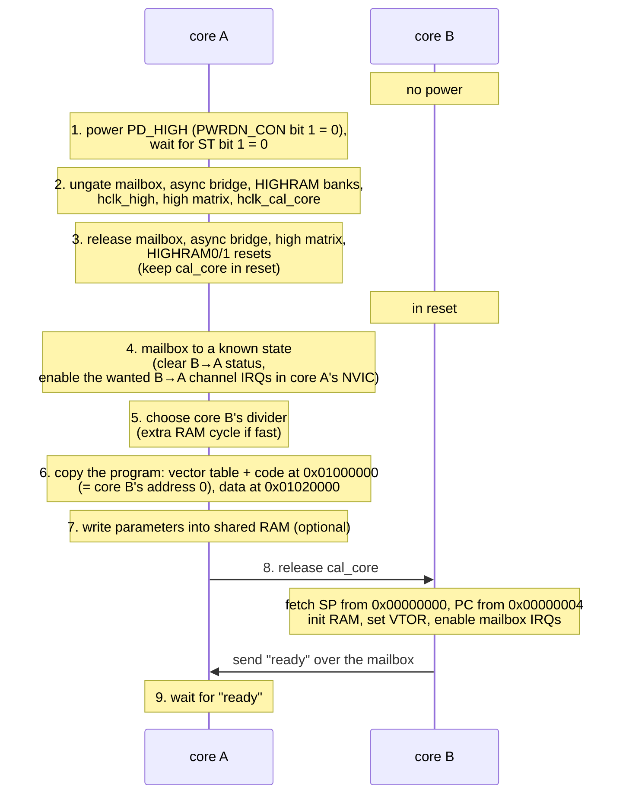
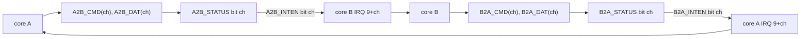

# The two cores: core B, mailbox, shared RAM and accelerators

Status: draft, 2026-11

The RKNanoD has two Cortex-M3 cores. **Core A** boots from the ROM and runs the system. **Core B** sits in reset after
power-on, in its own switchable power domain (PD_HIGH) together with 384 KiB of HIGHRAM, the HIFI accelerator and
DMAC2. Core A powers the domain, copies a program into HIGHRAM and releases core B, which fetches its vector table from
HIGHRAM0 aliased at address 0. The cores talk through a four-channel mailbox (one command word, one data word and one
status bit per channel and direction, no FIFO) and through RAM that both see at the same addresses. There are no
caches, no documented hardware semaphores, no documented cross-core exclusive monitor and no bus protection: **core B
can read and write all memory and every peripheral, including the CRU that resets core A**; what core A can always do
is stop core B. The AP30's stock firmware uses core B only as an audio decoder that it reloads and restarts for every
track; that protocol is documented in [core_b_codecs.md](../firmware/core_b_codecs.md) and only summarised here.

Names: "core A" = the TRM's sys-core / core 0 / "MCU core"; "core B" = cal-core / core 1 / "MPU core" (not a memory
protection unit). The SoC overview is in [soc_rknanod.md](soc_rknanod.md); register details of the shared blocks in
[soc_peripherals.md](soc_peripherals.md).

## Contents

- [Core A and core B compared](#core-a-and-core-b-compared)
- [Memory as seen by each core](#memory-as-seen-by-each-core)
- [Core B control: clock, reset, power](#core-b-control-clock-reset-power)
- [Starting core B](#starting-core-b)
- [Stopping core B](#stopping-core-b)
- [Mailbox](#mailbox)
- [Shared memory and ordering](#shared-memory-and-ordering)
- [Interrupt routing](#interrupt-routing)
- [DMA from either core](#dma-from-either-core)
- [Accelerators](#accelerators)
- [Isolation](#isolation)
- [Debugging core B](#debugging-core-b)
- [How the stock firmware uses core B](#how-the-stock-firmware-uses-core-b)
- [Open questions](#open-questions)
- [Sources](#sources)

## Core A and core B compared

| | Core A ("system") | Core B ("calculation") | Source |
|---|---|---|---|
| CPU | Cortex-M3 (ARMv7-M) | Cortex-M3 (ARMv7-M) | [TRM ch7] |
| Power domain | PD_LOGIC | **PD_HIGH** (switchable) | [TRM ch5 table 5-1] |
| State after power-on | running from the boot ROM | **held in reset** (`CRU_SOFTRST3_CON` bit 2 resets to 1) | [TRM ch3.7] |
| At address 0 | boot ROM (or PMU-SRAM with remap) | **HIGHRAM0 alias** (128 KiB) | [TRM fig 2-1] |
| "Own" RAM | SYSRAM0 320 KiB ("IRAM for core 0"), SYSRAM1 256 KiB ("DRAM for core 0") | HIGHRAM0 128 KiB ("IRAM for core 1"), HIGHRAM1 256 KiB ("DRAM for core 1") | [TRM ch1.1, ch12] |
| Clock | `CRU_CLKSEL0` bits 3, 2:0: PLL or USB 480 MHz, ÷1-8 | `CRU_CLKSEL0` bits 15, 14:12: PLL or USB 480 MHz, ÷1-8 | [TRM ch3.7] |
| SysTick reference | `CRU_CLKSEL0` bits 6:4 | `CRU_CLKSEL0` bits 10:8 | [TRM ch3.7] |
| Bus clock gate | `hclk_sys_core` (CLKGATE0 bit 1) | `hclk_cal_core` (CLKGATE0 bit 2) | [TRM ch3.7] |
| Reset bit | `sys_core` (SOFTRST3 bit 1) | `cal_core` (SOFTRST3 bit 2) | [TRM ch3.7] |
| Status | `GRF_SOC_STATUS0` | `GRF_SOC_STATUS1` | [TRM ch4] |
| Debug port | JTAG0 / SWD | JTAG1 / SWD | [TRM ch6.5] |
| Local DMA | DMAC1 (6 channels, PD_LOGIC) | DMAC2 (2 channels, PD_HIGH) | [TRM ch8] |
| Local accelerators | — | HIFIACC (PD_HIGH); IMDCT36 and SYNTH are only used from core B | [TRM ch26-28]; [AP30] |
| Stock clock cap | 200 MHz | 450 MHz | [AP30] |

* **Which core am I:** `GRF_CPU_ID` (0x500100FC) bit 0 reads 0 on core A and 1 on core B, so one binary can branch per
  core [TRM ch4].
* Each core has its own private System Control Space (NVIC, SysTick, SCB, MPU if any): neither core can program the
  other's NVIC [WEB] Arm.

## Memory as seen by each core

| Range | Size | Block | Domain | Core A | Core B |
|---|---|---|---|---|---|
| `0x00000000` | 16 K / 64 K / 128 K | alias | | boot ROM (remap = 0) or PMU-SRAM (remap = 1) | **HIGHRAM0** (128 K): core B's reset vector table |
| `0x01000000-0x0101FFFF` | 128 K | HIGHRAM0 | PD_HIGH | yes | yes |
| `0x01020000-0x0105FFFF` | 256 K | HIGHRAM1 | PD_HIGH | yes | yes |
| `0x01060000` | 64 K | HIFIACC | PD_HIGH | yes | yes |
| `0x01070000` | 64 K | DMAC2 | PD_HIGH | yes | yes |
| `0x03000000-0x0304FFFF` | 320 K | SYSRAM0 | PD_LOGIC | yes | yes |
| `0x03050000-0x0308FFFF` | 256 K | SYSRAM1 | PD_LOGIC | yes | yes |
| `0x03090000-0x0309FFFF` | 64 K | PMU-SRAM | PD_PMU | yes (not with remap = 1) | yes |
| `0x40000000-0x600BFFFF` | | peripherals | | yes | yes (one map; no per-core column in the TRM) |
| `0xE000E000` | | System Control Space | | private | private |

[TRM fig 2-1, ch12.1]

* **The only difference is address 0.** "IRAM/DRAM for core 0/1" in the TRM is a naming and power split, not an access
  restriction: the stock firmware has core A write HIGHRAM (program load, file data) and DMA out of it, and core B read
  a descriptor in SYSRAM [AP30].
* **HIGHRAM exists only while PD_HIGH is powered** and loses its contents when the domain is powered down [TRM ch5.2,
  ch12.1].
* **Core B reaches PD_LOGIC through an asynchronous AHB-to-AHB bridge** (`hclk_async_brg` gate 0x4C, reset
  `async_brg` 0x36) [TRM fig 1-1, ch3.7]; such accesses are slower than HIGHRAM accesses [EM].
* **Bit-banding** is not available for any RAM (no RAM in the 0x20000000 region), and the peripheral bit-band window
  does not cover the mailbox [TRM fig 2-1]; [WEB] Arm.
* **RAM timing:** HIGHRAM0/1 have their own "one more response cycle" bits (`GRF_INTER_CON0` bits 14/15) for high core-B
  clocks ([soc_rknanod.md § SRAM response cycles](soc_rknanod.md#sram-response-cycles)) [TRM ch4, ch12.3].

## Core B control: clock, reset, power

| What | Register | Bits | Notes |
|---|---|---|---|
| Core B reset | `CRU_SOFTRST3_CON` 0x401800CC | bit 2 `cal_core`, **reset value 1** | reset id 0x32 [TRM ch3.7] |
| Core A reset | same register | bit 1 `sys_core` | reachable by core B too (see [Isolation](#isolation)) |
| Core B bus clock | `CRU_CLKGATE0_CON` 0x40180080 | bit 2 `hclk_cal_core` (1 = off) | gate id 0x02 |
| Core B clock | `CRU_CLKSEL0_CON` 0x40180014 | 15 source (0 PLL, 1 USB 480 MHz), 14:12 divider (`clk = src/(n+1)`), 10:8 SysTick reference divider (reset 3) | write mask in 31:16 |
| PD_HIGH power | `PMU_PWRDN_CON` 0x5002000C | bit 1 `pd_high_pwrdwn_en` (1 = off) | **no write mask**; status in `PMU_PWRDN_ST` (0x50020010) bit 1 |
| PD_HIGH clocks | `CRU_CLKGATE3/4_CON` | hdram0-7 + interface (0x30-0x38), hclk_hifi (0x39), hiram0-3 + interface (0x40-0x43, 0x48), hclk_high (0x49), hclk_high_matrix (0x4A), hclk_high_dma (0x4B, DMAC2), hclk_async_brg (0x4C) | 32 KiB bank gating [TRM ch3.7, ch12.1] |
| PD_HIGH resets | `CRU_SOFTRST2_CON` bits 0-3, `SOFTRST3` bits 6-7 | high_matrix 0x20, highram1 0x21, highram0 0x22, hifi 0x23, async_brg 0x36, dma2 0x37 | [TRM ch3.7] |
| Mailbox | gate `pclk_mailbox` 0x92, reset `mailbox` 0x1E | | in PD_LOGIC [TRM ch3.7] |
| Core B status | `GRF_SOC_STATUS1` 0x500100E4 | 0 sleeping, 1 sleepdeep, 2 **lockup**, 3 halted (debug) | lets core A detect a locked-up core B [TRM ch4] |

CRU and GRF registers have per-bit write masks in bits 31:16, so each core can change its own bits with one store and
no read-modify-write race [TRM ch3.7, ch4]. `PMU_PWRDN_CON` has no mask: give it one owner.

`PMU_CORE_PWRUP_CNT` resets to 0x5DC0 cycles of 24 MHz (about 1 ms); whether it governs PD_HIGH power-up time is not
stated [TRM ch5.4; ?].

## Starting core B

Required order, from the TRM, the stock firmware and the Echo Mini work:

1. **Power PD_HIGH** and wait for `PMU_PWRDN_ST` bit 1 to read 0 [TRM ch5.3.1, ch5.4]. Nothing in HIGHRAM, HIFIACC or
   DMAC2 is reachable before this [EM]. The stock firmware does not poll the status bit [AP30].
2. **Clocks on:** `pclk_mailbox`, the async bridge, the HIGHRAM bank gates, `hclk_high`, the high matrix,
   `hclk_cal_core` [AP30].
3. **Release the infrastructure resets** (mailbox, async bridge, high matrix, HIGHRAM1, HIGHRAM0), **keep `cal_core`
   asserted** [AP30]. On a restart after an earlier session also reset HIFIACC and DMAC2: on the Echo Mini a restart
   without resetting the mailbox, DMAC2 and HIFIACC left stale interrupt enables and DMA state and hung the second run
   [EM].
4. **Mailbox:** clear the B→A status bits, enable the B→A channel interrupts core A wants, register and enable the NVIC
   lines [AP30].
5. **Speed and RAM timing:** choose the divider in `CRU_CLKSEL0`. The stock firmware sets the HIGHRAM extra-cycle bits
   (`GRF_INTER_CON0` bits 15:14) when core B runs at ≥ 300 MHz [AP30]. On the Echo Mini core-A writes into HIGHRAM1
   caused random imprecise bus faults with core B at 200 MHz and single-cycle HIGHRAM, and stopped with multi-cycle
   mode [EM]. Treat the extra cycle as required above ~150 MHz [TRM ch12.3].
6. **Load the image** while core B is in reset: word 0 = initial SP, word 1 = reset handler, both as core B sees them
   (the low alias works: stock modules use a reset address like 0x00002999 and SP = 0x01022000) [AP30].
7. **Parameters:** anything core B needs goes in shared RAM before release. The stock firmware writes a 0x90-byte
   clock-information block at 0x01020000; its modules read only +0x20 (core-B SysTick clock, Hz) and +0x24 (core-B
   bus clock, Hz) [EM; AP30].
8. **Release `cal_core`.** The stock firmware waits 5 ms after the load first; the RECHO firmware waits 5 µs and clears
   both mailbox status registers before release [AP30; EM].
9. **Ready handshake:** core B's runtime clears its BSS, points VTOR at its RAM vector table, enables its mailbox
   interrupts and sends "ready" (B→A channel 0, command 1). The stock core A polls up to 200 000 times with a ≥ 1 µs
   delay (≥ 0.2 s) [AP30].

Restarting core B without reloading its code (reset, re-copy only the initialised data, release) took 33-42 µs on the
Echo Mini [EM].

## Stopping core B

* **Kill switch, always available to core A:** assert `cal_core` reset (SOFTRST3 bit 2), gate `hclk_cal_core`, and,
  if nothing else in PD_HIGH is needed, power the domain down. No cooperation from core B is required [TRM ch3.7,
  ch5].
* **Orderly stop (stock, per track):** core A asks core B to shut its hardware down over the mailbox (core B de-inits
  its accelerator interrupts and DMA and acknowledges), then asserts `cal_core` and gates `hclk_cal_core`; for the MP3
  module it also re-asserts the IMDCT/SYNTH resets and gates their clocks. PD_HIGH stays powered and HIGHRAM keeps its
  contents until the next load overwrites them [AP30].
* **Full power-down (stock, when the music player ends):** resets for the high matrix, HIGHRAM0/1, core B and the
  mailbox asserted; all PD_HIGH clocks, `hclk_cal_core` and `pclk_mailbox` gated; PD_HIGH powered down; mailbox
  channel 0/3 interrupts disabled and unregistered [AP30].
* Assert resets before gating clocks and before powering down, so no block is left mid-transaction [AP30 order].

## Mailbox

**Base 0x40110000 (64 KiB window, PD_LOGIC), IRQ 9-12 on each core** [TRM fig 2-1, ch2.3].

The TRM lists the mailbox only as a feature: "four mailbox elements, each element includes one data word, one command
word register and one flag bit that can represent one interrupt; four interrupts to MCU core, four interrupts to MPU
core"; there is **no register chapter** [TRM ch1.1]. The layout comes from the stock drivers on both cores and is the
same as Rockchip's Linux `rockchip-mailbox` driver [AP30; EM; WEB]:

| Offset | Direction | Register | Meaning |
|---|---|---|---|
| `+0x00` | A→B | A2B_INTEN | bit *ch* = raise core B's interrupt for channel *ch* |
| `+0x04` | A→B | A2B_STATUS | bit *ch* = message pending; write 1 to clear |
| `+0x08 + 8·ch` | A→B | A2B_CMD(*ch*) | 32-bit command word |
| `+0x0C + 8·ch` | A→B | A2B_DAT(*ch*) | 32-bit data word |
| `+0x28` | B→A | B2A_INTEN | as above, for core A |
| `+0x2C` | B→A | B2A_STATUS | as above |
| `+0x30 + 8·ch` | B→A | B2A_CMD(*ch*) | |
| `+0x34 + 8·ch` | B→A | B2A_DAT(*ch*) | |

* **4 channels per direction, each a single slot: no FIFO, no queue.** A second message overwrites the first if the
  receiver has not consumed it. The stock protocol never checks; it relies on strict request/response lock-step
  [AP30].
* **Sending** = write CMD, then DAT; both stock sides always use that order. The Echo Mini study states that the DAT
  write is what raises the status bit [EM]; not verified on the AP30.
* **Receiving:** the handler clears the status bit (write 1) and reads CMD/DAT. CMD and DAT keep their values after the
  status is cleared (stock core A sometimes clears first and reads afterwards) [AP30].
* **"Busy" detection:** a sender can see whether its previous message is still pending by reading its own direction's
  status bit [?: follows from the layout]. The stock firmware instead polls the *command* register of the other
  direction in one place (core B waiting for the end of a clock change) [AP30].
* **IRQ numbers:** both cores use IRQ 9-12 (vectors 0x19-0x1C) for channels 0-3; the line a core receives is the one for
  messages *towards* it [TRM table 2-1; AP30].
* The stock drivers take an "instance" argument with a 0x50 stride, but only instance 0 exists [AP30; EM].
* Gate `pclk_mailbox` 0x92, reset 0x1E [TRM ch3.7].

How the stock firmware assigns the channels: channel 0 system (ready, clock-change hold), channel 1 decoder control,
channel 2 file service (core B pulls the compressed stream from core A), channel 3 debug text. Commands, data
layouts, timeouts and the info structure: [core_b_codecs.md](../firmware/core_b_codecs.md).

## Shared memory and ordering

* **No caches** on either core, so no cache maintenance: memory is coherent between the cores [TRM ch7]; [WEB] Arm.
* **Write buffer:** stores to Normal memory can sit in a core's write buffer. Write the data, execute `DSB`, then ring
  the mailbox [WEB] Arm. The AHB peripherals at 0x6000_0000 are "Normal" memory in the default map, so the same applies
  to them ([soc_rknanod.md § Bus attributes](soc_rknanod.md#bus-attributes-caches-xip-bit-banding-memory-types)).
* **No hardware semaphore or spinlock block** in the address map, the GRF or the PMU [TRM ch2.1, ch4, ch5].
* **No documented global exclusive monitor.** The Cortex-M3 has a local monitor; making `STREX` fail after the other
  core's write needs a system-level monitor, which the TRM does not mention [WEB] Arm; [TRM ch7]. Assume
  `LDREX`/`STREX` are atomic only against the same core's interrupts, not against the other core, until tested.
* **What is safe without atomics:** aligned 32-bit loads and stores are single-copy atomic, which is enough for
  single-producer / single-consumer rings with barriers [WEB] Arm. The Echo Mini's own firmware moves data this way
  (input ring and PCM ring in HIGHRAM1, a shared block at 0x01020000) [EM].
* **CRU/GRF updates** from both cores are safe per bit thanks to the write masks; `PMU_PWRDN_CON`, GPIO `DR`/`DDR`
  and DMA channel ownership need a software rule [TRM ch3.7, ch4, ch5, ch19].
* **Where to keep state:** anything in PD_HIGH is lost when the domain powers down; SYSRAM survives that; PMU-SRAM
  survives soft resets but not power-off [TRM ch5; EM].

## Interrupt routing

* All 41 interrupt lines are level-high [TRM ch2.3]. Each core has its own NVIC with the same line numbering
  [AP30: core-B modules register the same numbers as the TRM table].
* **Lines the stock core-B modules use** [AP30]: SysTick (exception 15), mailbox IRQ 9-12, SYNTH IRQ 1 and IMDCT IRQ 7
  (MP3 module only), DMAC2 IRQ 40 (FLAC, ALAC, APE modules). **None registers IRQ 34 (HIFIACC):** HIFIACC completion
  is seen through DMAC2 and register polling.
* **Not documented:** whether every peripheral line reaches both NVICs (could core A take IRQ 40, could core B take
  DMAC1's IRQ 6 or a GPIO line?). The TRM's "20 external interrupts" per NVIC (ch7.1.1) contradicts the 41-line table
  and core B's use of IRQ 40 [TRM vs AP30].
* Each core's NVIC is private: core A cannot pend, enable or mask core B's interrupts directly; it can only signal
  through the mailbox or a peripheral [WEB] Arm.
* The stock core B's RAM vector table and initial SP are both at 0x01022000 [AP30].

## DMA from either core

| | DMAC1 | DMAC2 |
|---|---|---|
| Base / IRQ | 0x60000000 / 6 | 0x01070000 / 40 |
| Domain | PD_LOGIC | PD_HIGH (gone when core B's domain is off) |
| Channels | 6 | 2 |
| Hardware requests | I2S0/1, SPI0/1, UART0/2, UART1, SDMMC, eMMC, VOP | 0 HIFIACC RX, 1 HIFIACC TX |
| Stock user | core A only | core B only (feeds HIFIACC) |
| Known reach | reads HIGHRAM1 (stock audio copy) [AP30]; PMU-SRAM [EM]; HIGHRAM0 untested | HIGHRAM, HIFIACC; SYSRAM untested |

[TRM ch2.4, ch8; AP30; EM]

* Both controllers are on the shared map: either core *can* program either, and the hardware has no channel
  ownership [TRM fig 2-1].
* The stock MP3 module has DMA entry points for its accelerators, but they are empty in this build: IMDCT36 and SYNTH
  are fed by CPU stores [AP30].
* DMA transfers bypass any CPU-side MPU, so DMA programming is as privileged as the core that does it [WEB] Arm.

Register layout: [soc_peripherals.md § DMAC1 and DMAC2](soc_peripherals.md#dmac1-and-dmac2).

## Accelerators

| Block | Base | Domain | IRQ | Gate / reset ids | Driven by (stock) |
|---|---|---|---|---|---|
| HIFIACC | 0x01060000 | PD_HIGH | 34 | hclk_hifi 0x39 / hifi 0x23 | core B (FLAC, ALAC, APE modules), via DMAC2 |
| IMDCT36 | 0x60010000 | PD_LOGIC [?] | 7 | hclk_imdct 0x7E / imdct 0x0E | core B (MP3 module); core A ungates and releases it before starting the module |
| SYNTH | 0x60050000 | PD_LOGIC [?] | 1 | hclk_synth 0x6E / synth 0x0F | core B (MP3 module); core A ungates and releases it |

[TRM ch2, ch3.7, ch26-28; AP30]. The core-B modules for FLAC, ALAC, APE and DSF write the CRU themselves (HIFIACC
gate 0x39 and reset 0x23, DMAC2 gate 0x4B and reset 0x37) [AP30].

### HIFIACC

**What the TRM says** [TRM ch26]: a fixed-point accelerator with:

* FFT/IFFT of order 64, 128, 256, 512, 1024, in place, CPU or DMA access;
* MAC: 1 to 1024 terms, 32 × 32-bit products, 64-bit result in a register;
* FLAC: fixed-coefficient FIR, order 1-32; ALAC: adaptive FIR, order 1-32; CPU or DMA bursts of 2/4/8/16;
* APE: NN filters for compression levels 2000/3000/4000/5000 (versions below 3990) and 2000/3000/4000 (below 3970);
  "192 k × 24 bit at 300 MHz";
* 32 × 32-bit transmit and receive FIFOs.

The TRM has **no register list** for it. What is known comes from the stock modules and the Echo Mini work:

| Offset | Use | Source |
|---|---|---|
| +0x00 | DMA/general control; stock writes 0x01080108 once | [AP30]; [EM] |
| +0x04 | interrupt control; stock writes 0x00830083; bit 15 = LPC mode, set before a block and cleared after | [AP30]; [EM] |
| +0x08 | status: bit 15 = block done | [EM] |
| +0x0C | function and start: bits 31:29 function (0 APE channel X, 1 APE channel Y, 2 FFT, 3 ALAC, 4 MAC, 5 FLAC), bits 27:15 block length (13 bits, ≤ 8191), low bits = 3 to start; write 0 after the block (and before reading FFT results) | [EM] |
| +0x10 | clear; stock writes 3 | [AP30] |
| +0x24 | FFT: size code in bits 31:29 (64 → 0 … 1024 → 4), bit 27 no scaling, bit 20 real input | [EM, measured] |
| +0x28 | ALAC: `bps << 24` OR `order << 16` OR `quantisation << 8` | [AP30]; [EM] |
| +0x2C | FLAC LPC: `order << 16` OR `shift << 8` | [AP30]; [EM] |
| +0x40 | input FIFO | [EM] |
| +0xA0 | output FIFO | [EM] |
| 0x01061000 / 0x01062000 | FFT imaginary / real parts, 1024 words each, result in place | [EM, measured] |
| 0x01069000 | ALAC coefficient memory | [EM] |
| 0x0106B000 | FLAC coefficient memory, **reverse order** (the TRM's H(i) = h(N−1−i)) | [EM] |

* The stock driver addresses its registers as instances with a 0x3C stride [AP30].
* **Measured behaviour on the Echo Mini** [EM]: the FLAC LPC path is bit-exact for orders 3-32 at 16 and 24 bits;
  **orders 1 and 2 give wrong output** (the stock FLAC module computes those in software too); about one product per
  core-B clock, so a full 8191-sample block at order 32 takes ~5 ms at 50 MHz; FFT inputs go in bit-reversed order,
  outputs come out in natural order, forward transform only, twiddles of about 14 bits; while the function field still
  says FFT, the data memory returns a fixed value.
* The MAC and FFT functions are not used by any stock module [AP30].
* Clock gate: the Echo Mini study names CLKGATE7 bit 15 for HIFIACC; the TRM register table puts `hclk_hifi` at
  CLKGATE3 bit 9 (id 0x39), and that is the bit the AP30's core-B modules use. CLKGATE7 bit 15 is `hclk_lcdc`
  [TRM ch3.7; AP30 vs EM].

### IMDCT36 (MP3)

**What the TRM says** [TRM ch28]: an MP3 36-point IMDCT cell with a standard and a "pre-right-shift" output mode, an
AHB slave interface, a 54 × 32-bit memory-mapped SRAM (18 input words, then 36 result words) and an interrupt.

| Offset | Use | Source |
|---|---|---|
| +0x000-+0x044 | 18 inputs; the computation starts when they are written | [TRM]; [EM] |
| +0x048-+0x0D4 | 36 outputs (read-only) | [TRM]; [AP30]; [EM] |
| +0x800 | mode: 3 at start in the stock module (pre-right-shift, output scaled down), 1 unscaled, 0 stop | [AP30]; [EM, measured] |
| +0x80C | acknowledge: written 0 by the interrupt handler | [AP30]; [EM] |

* **Completion is an interrupt (IRQ 7), not a pollable register:** +0x80C never changes when polled; the pending bit in
  the NVIC is set 0.4-1.5 µs after the last input [EM, measured].
* Precision: 20-bit coefficients; in mode 3 the output is the exact transform scaled by 2^-8 (99.99 % within 1 LSB);
  mode 1 saturates [EM, measured].

### SYNTH (MP3)

**What the TRM says** [TRM ch27]: MP3 sub-band synthesis, AHB slave, a 32 × 32-bit SRAM0 (input, then results), a
1024 × 20-bit memory-mapped SRAM1 used as the history FIFO, a coefficient ROM and an interrupt.

| Offset | Use | Source |
|---|---|---|
| +0x000-+0x07C | SRAM0: 32 sub-band samples in; 32 PCM samples out (low 16 bits) | [TRM]; [EM] |
| +0x800 | 1 = on, 0 = off | [AP30]; [EM] |
| +0x804 | `channel` OR `(15 − phase) << 1`, written before each slot | [AP30]; [EM] |
| +0x80C | becomes non-zero when a slot is done; write 0x11 to acknowledge | [AP30]; [EM] |
| +0x810 | write 0 after each slot (the stock interrupt handler does) | [EM] |
| +0x1000-+0x1FFC | SRAM1: history, 1024 words; clear it at the start of a stream | [AP30]; [EM] |

* One slot takes a few microseconds; IRQ 1 signals completion. The stock module (libmad-based) writes its Q28 samples
  as they are [EM].
* Measured on the Echo Mini: within 2 LSB of a software synthesis; MP3 decoding load on core B fell from ~38 MHz to
  ~22 MHz [EM, measured].

**Address quirk:** the TRM's IMDCT36 and SYNTH memory-map figures show addresses at 0x6204_2000 and 0x6204_4000, which
contradict the address map (0x60010000 / 0x60050000) and the firmware; trust the address map [TRM ch27-28 vs fig 2-1;
AP30].

## Isolation

**The hardware gives no isolation between the cores.** [TRM ch2.1, ch4, ch5, ch7; AP30]

* One shared address map; the only per-core difference is the alias at address 0. No firewall, no TrustZone (ARMv7-M
  has none), no master-ID filtering, no per-core peripheral enables.
* **Core B can:** write the CRU (the stock core-B modules do), hence reset core A (`SOFTRST3` bit 1), trigger a global
  soft reset (0xFDB9 into `CRU_GLB_SRST_FST_VALUE`), gate core A's clocks or reprogram the PLL; write GRF pin muxes and
  PMU power control; program DMAC1 and DMAC2, whose transfers bypass any CPU-side MPU; overwrite any RAM.
* **Core A can always:** stop core B (assert `cal_core`, gate `hclk_cal_core`, power PD_HIGH down), read core B's lockup
  and sleep state (`GRF_SOC_STATUS1`). That is fault containment by kill switch, not protection.
* **Each core's NVIC and SCS (including its MPU, if one exists) is private**, so neither core can reconfigure the other's
  interrupts or memory protection [WEB] Arm.
* **MPU:** not documented and never used by the stock firmware; whether either core has one is unknown
  ([soc_rknanod.md § The MPU question](soc_rknanod.md#the-mpu-question)). Without an MPU, any code on core B can corrupt
  anything.
* **Stock firmware:** core A trusts every pointer core B sends; in the file service it writes file data wherever core
  B's request says [AP30]. Core A never checks core B's lockup status; a timed-out wait is treated as if the reply had
  arrived [AP30]. Known core-B hangs on malformed files are listed in [known_bugs.md](../firmware/known_bugs.md).

## Debugging core B

* Core B has its own SWJ-DP: JTAG1 / SWD with TCK on GPIO2_13 and TMS on GPIO2_12 (`GRF_GPIO2B_IOMUX` bits 11:8 = mux
  value 2) [TRM ch6.5 table 6-2]. Rockchip's reference board brings it out as a separate SWD header [WEB] Rockchip EVK
  documents.
* **On the AP30** those pins carry the CS43198 DAC's I2C bus (I2C1 route C), so core B cannot be debugged over SWD while
  the DAC is in use [AP30].
* **Text output:** stock core-B print requests (mailbox channel 3) are forwarded by core A to UART0, which the firmware
  never initialises; core-B fault dumps go to UART1, which on the AP30 is the Bluetooth module link [AP30]. See
  [board_ap30.md](board_ap30.md).

## How the stock firmware uses core B

Summary only; the protocol and the codec modules are in [core_b_codecs.md](../firmware/core_b_codecs.md), the
playback flow in [audio_playback.md](../firmware/audio_playback.md).

* **Only for music decoding.** PD_HIGH is powered when the music player (or Bluetooth music) service starts and powered
  down when it ends; games and menus never start core B [AP30].
* **One module per format** (overlays 71-80: MP3, WMA, AAC, WAV, Ogg Vorbis, FLAC, ALAC, APE, DSDIFF, DSF), each
  **linked at 0x01000000** with its data at 0x01020000, 31-115 KiB per load [AP30]. Overlays 71-80 are described in
  [stage3_sections.md](../formats/stage3_sections.md).
* **Reloaded from flash and restarted for every track**, including automatic advance: stop, reset, load, 5 ms, release,
  ready, open [AP30]. This is one reason the stock player was not gapless; V1.8.3 avoids the restart for FLAC by
feeding the next file to the running decoder instead (see
[../firmware/audio_playback.md](../firmware/audio_playback.md#gapless-playback-v183)).
* **Core B pulls the compressed file from core A** through the mailbox file service; core A runs the file system
  inside the mailbox interrupt and writes data straight into HIGHRAM [AP30].
* **Decoded PCM** is copied by DMAC1 from core B's buffers in HIGHRAM1 into core A's buffers in SYSRAM, then sent to
  I2S1 [AP30].
* **Clock changes:** core A parks core B with a mailbox handshake before reprogramming the PLL; the 0x90-byte clock
  block is copied only at start, so core B's delays are wrong after a later frequency change [AP30; EM].

## Open questions

1. **Which mailbox write raises the status bit**, CMD or DAT? [EM] says DAT; unverified on the AP30.
2. **Cross-core exclusives:** does `STREX` on one core fail after the other core wrote the location? (Expected: no global
   monitor.) Also: bit-band atomicity on a 0x400x_xxxx register from both cores.
3. **MPU** on core A or core B: never probed (`MPU_TYPE` at 0xE000ED90).
4. **Interrupt routing:** does every line reach both NVICs; is `ICTR` the same on both cores?
5. **DMA reach:** can DMAC2 access SYSRAM and PMU-SRAM; can DMAC1 access HIGHRAM0?
6. **PD_HIGH power-down:** does HIGHRAM really lose its contents (the TRM implies it), and how long does power-up take?
7. **HIGHRAM extra-cycle threshold:** the stock firmware switches at 300 MHz, the TRM says ~150 MHz, and the Echo Mini
   saw faults at 200 MHz without it.
8. **IMDCT36 / SYNTH power domain:** PD_LOGIC (block diagram) or tied to PD_HIGH? Test: access them with PD_HIGH off.
9. **HIFIACC MAC function** and the APE filter registers: mapped from code only, not measured.

## Sources

* [TRM] Rockchip RKNanoD Technical Reference Manual V1.0: <https://rockchip.fr/Rockchip%20RKNanoD%20TRM%20V1.0.pdf>
  (ch1.1 mailbox and memory organisation, ch2 address map, interrupts, DMA requests, ch3.7 CRU, ch4 GRF, ch5 PMU, ch6.5
  debug pins, ch7 CPU, ch8 DMAC, ch12 SRAM, ch26 HIFIACC, ch27 SYNTH, ch28 IMDCT36).
* [WEB] Arm: *ARMv7-M Architecture Reference Manual* <https://developer.arm.com/documentation/ddi0403/latest> and
  *Cortex-M3 TRM r2p0* <https://developer.arm.com/documentation/ddi0337/h> (private SCS, exclusive monitors, write
  buffer and barriers, bit-banding, single-copy atomicity).
* [WEB] Rockchip Linux kernel `drivers/mailbox/rockchip-mailbox.c`: <https://github.com/rockchip-linux/kernel>.
* [WEB] Rockchip RKNanoD EVK documents in public SDK repositories (separate SWD header for core B); see
  [sources.md](../overview/sources.md).
* [EM] [berettavexee/echo-mini-newfw](https://github.com/berettavexee/echo-mini-newfw) (MIT): `ETUDE.md` §1.1-1.4
  (mailbox, core-B start), §13, §16, §18 (restart pitfalls, HIGHRAM bus faults), §21 (timings), and [HIFIACC.md](https://github.com/berettavexee/echo-mini-newfw/blob/main/docs/HIFIACC.md),
  [MP3ACC.md](https://github.com/berettavexee/echo-mini-newfw/blob/main/docs/MP3ACC.md) (accelerator register maps, measured on the device). The Echo Mini runs the same stock core-B modules
  (its module numbers are the AP30's + 2), see [snowsky_echo_mini.md](../related/snowsky_echo_mini.md).
* [AP30] analysis of firmware V1.7.8: the core-A start/stop code and mailbox driver, the core-B modules (vector tables,
  interrupt registrations, CRU writes, accelerator drivers), and the stage3 section records.
