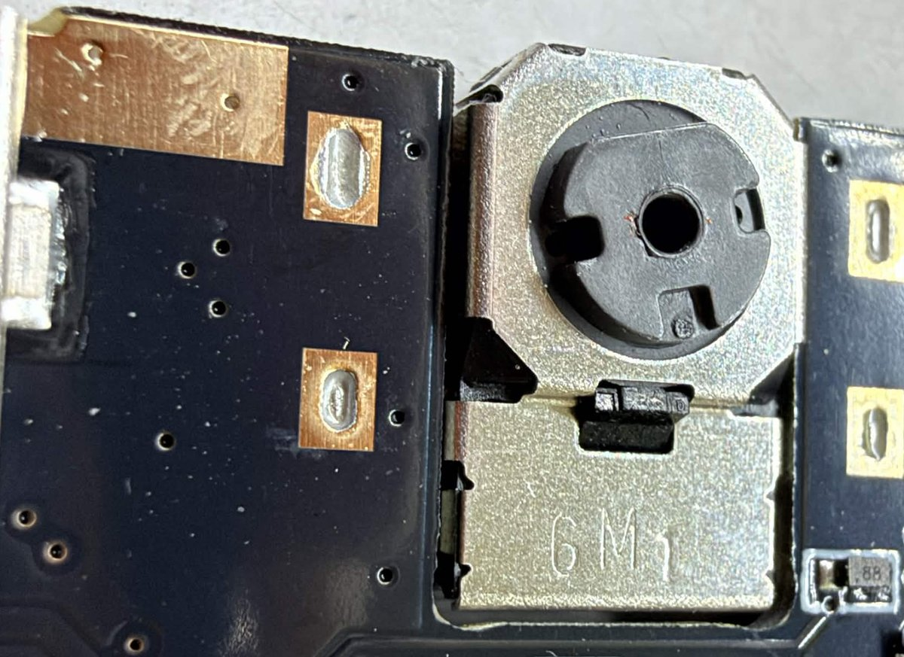

# Input: key ladder, volume wheel, Power key

Status: draft, 2026-11

The AP30's controls are eight face buttons (D-pad, A, B and two pill buttons), an ALPS volume wheel and a Power
key. The **eight face buttons share one resistor ladder on SAR-ADC channel 1**, so only one can be read at a time.
The **wheel is a quadrature encoder on GPIO2_0 / GPIO2_9**. The **Power key is the SoC's dedicated PLAYON input
(GPIO2_5)**; it has no tact switch of its own on the board and is almost certainly a push switch inside the wheel.
D-pad Right sits on the ladder's 0 V slot, which makes it the boot loader's recovery button. This page gives the
ladder thresholds and key codes, the wheel decoding, the Power key hardware and the scan timing of the stock
firmware.

Tags: **[AP30]** firmware V1.7.8 or the device · **[TRM]** RKNanoD TRM V1.0 · **[DS]** a datasheet · **[EM]** Echo
Mini · **[WEB]** public source · **[?]** guess.

*ALPS volume-wheel encoder, side B: black rotor with D-hole in a stamped metal frame marked 6M1, in a board-edge notch. [AP30]*

More photos: [photos.md](photos.md).

## Contents

- [Summary](#summary)
- [Key ladder (SAR-ADC channel 1)](#key-ladder-sar-adc-channel-1)
- [D-pad Right is the recovery key](#d-pad-right-is-the-recovery-key)
- [Power key (PLAYON)](#power-key-playon)
- [Volume wheel (ALPS encoder)](#volume-wheel-alps-encoder)
- [Scan timing](#scan-timing)
- [Event codes](#event-codes)
- [Open questions](#open-questions)
- [Sources](#sources)

## Summary

| Control | Hardware | Tag |
|---|---|---|
| D-pad, A, B, two pill buttons | 8 SMD tact switches on board side A, resistor ladder into SAR-ADC ch1 (10-bit) | [AP30] |
| Volume wheel | ALPS encoder, phase A = GPIO2_0 (ball B5), phase B = GPIO2_9 (ball C5), SoC pulls disabled | [AP30] |
| Power | PLAYON = GPIO2_5 (ball A2), input, no pull, high = pressed; wheel push switch [?] | [AP30], location [?] |
| Interrupts | none: the stock firmware polls everything (GPIO edge interrupts exist in the SoC [TRM]) | [AP30] |
| Key tick | 10 ms (SysTick-driven software timer) | [AP30] |
| Wheel sampling | every 200 µs from TIMER0 (and on every key tick) | [AP30] |

## Key ladder (SAR-ADC channel 1)

The SAR-ADC is ratiometric: 10-bit codes, full scale = the 2.5 V internal reference [TRM]. The battery formula
(mV = code × 5000 / 1024 behind a 2:1 divider) confirms a 2.5 V full scale [AP30]. Volts below are code × 2.5 / 1024
[?].

| ADC code range | ≈ volts | Key code | Button | Device reading by a third party [WEB] |
|---|---|---|---|---|
| 0–69 | < 0.17 | `0x004` | **D-pad Right** (0 V slot; boot-loader key) | ~0 |
| 100–183 | 0.24–0.45 | `0x010` | D-pad Up | 120–121 |
| 200–309 | 0.49–0.75 | `0x008` | D-pad Left | 241 |
| 320–429 | 0.78–1.05 | `0x020` | D-pad Down | 365 |
| 442–559 | 1.08–1.36 | `0x002` | left pill button (vendor spec: "Function"; firmware role "Select") | 488 |
| 560–679 | 1.37–1.66 | `0x100` | right pill button (vendor spec: "Play"; firmware role "Start") | 610 |
| 700–849 | 1.71–2.07 | `0x040` | B | 733 |
| 850–949 | 2.08–2.32 | `0x080` | A | **855, only 5 codes from the range edge** |
| ≥ 950 | ≥ 2.32 | 0 | released | |
| 70–99, 184–199, 310–319, 430–441, 680–699 | | — | gaps: treated as "no new sample" (a key whose resistor drifts into a gap stops working instead of snapping to a neighbour) | |

- **One key at a time:** two keys held together read as the lower-voltage key, priority Right > Up > Left > Down >
  Select > Start > B > A [WEB, follows from the ladder].
- **8 switches, 8 codes:** the board has exactly eight tact switches, no button flex [AP30].
- **Reference design:** the RKNanoD reference board uses the same circuit, ADC1 with a 51 kΩ pull-up and six keys
  (0 V, 0.36 V, 0.8 V, 1.25 V, 1.88 V, 2.3 V) [WEB] EVK. The AP30's resistor values are not known.
- **Other ADC channels:** ch0 = battery (see [power.md](power.md)); ch2-7 unused [AP30].
- Pill-button roles in the stock UI: `0x080` (A) confirms and `0x040` (B) goes back in popups; reviewers say left
  pill = favourites / music settings / leave game, right pill = play / pause [AP30 + WEB]. Key mapping and its
  changes between firmware versions: [../firmware/display_and_input.md](../firmware/display_and_input.md).

## D-pad Right is the recovery key

- The boot loader reads the ladder **by voltage**, not by key code: it enters loader USB mode when ADC ch1 ≤ 0x40
  for about 500 samples **and** USB power (VBUS) is present [AP30, loader analysis].
- On the reference board the 0 V slot is the MENU key, which the SDK also defines as the upgrade key [WEB] EVK.
  Hidizs wired D-pad Right there, so it inherited the upgrade role; its key code 0x004 corresponds to the SDK's
  fast-forward key bit [AP30].
- Procedure (USB connected, hold D-pad Right, then Power or the ~8 s Power long-press): see
  [../guides/recovery.md](../guides/recovery.md) and [../firmware/boot_loader.md](../firmware/boot_loader.md).

> **Warning:** loader USB mode gives raw write access to the internal flash. Never write the boot-loader area
> (physical sectors 0x0000-0x1FFF), never run `rkdeveloptool ef`, never download a foreign loader (`db` / `ul`).
> Restoring FW1 / FW2 from a backup is the recovery path, described in [../guides/recovery.md](../guides/recovery.md).

## Power key (PLAYON)

| Item | Value | Tag |
|---|---|---|
| Pin | GPIO2_5 = GPIO2_A5, ball A2, mux function PLAYON (dedicated power-on input; other functions I2C2C_SCL, JTAG0_TDO) | [DS] |
| Electrical | input, pull disabled, **high = pressed**; the key also drives the regulator enable directly (diode-OR with POWERHOLD and VBUS) | [AP30] + [WEB] EVK |
| Power domain | GPIO2 is in the always-on PMU domain, so PLAYON stays valid when the logic domain is down; GPIO2 is the only wake source of the SoC's low-power mode | [TRM] |
| Key code | `0x001`; read before the ladder on every scan and wins over any ladder key | [AP30] |
| After USB insertion | the firmware ignores PLAYON for 5 s after VBUS appears and reads only the ladder; presumably plugging USB raises PLAYON for a while [?] | [AP30] |
| Long press (firmware) | held past ~2 s: power-off request | [AP30] |
| Long press (hardware) | **~8 s**: an external circuit cuts power and reboots, **repeating about every 10.5 s** while held, whatever the software does; it clears the PMU boot-marker register (a power-on-class reset). With D-pad Right held it lands in loader USB mode | [AP30] measured |
| Physical location | **no tact switch on the board** and nothing on any edge; all 8 switches are ladder keys. Six reviewers describe the wheel press as screen on/off and the wheel press-and-hold as power on/off, exactly the firmware's PLAYON behaviour (short release = screen toggle, 2 s hold = power off). So the ALPS encoder almost certainly has a **push switch wired to PLAYON** [?] | [AP30] + [WEB] |

The long-press reset is described in [power.md](power.md#the-8-s-long-press-reset).

## Volume wheel (ALPS encoder)

| Item | Value | Tag |
|---|---|---|
| Part | ALPS rotary encoder ("ALPS" legible on the body) in a board-edge notch, orange knurled metal knob; rotor in a metal frame marked `6M1` | [AP30] |
| Pins | phase A = GPIO2_0 (GPIO2_A0, ball B5), phase B = GPIO2_9 (GPIO2_B1, ball C5); GPIO inputs, SoC pulls disabled, so the pull-ups are external or inside the encoder [?] | [AP30] |
| Test pads | `P` and `M` next to the encoder may be its phases [?] | [AP30] |
| Sampling | TIMER0 interrupt every **200 µs** (5 kHz, NVIC line 0x23) and again on every 10 ms key tick | [AP30] |
| Decoding | ×2 on phase A: every change of A counts one step, B alone is ignored. After an A edge, A ≠ B → direction "A" (code `0x200`), A = B → direction "B" (code `0x400`) | [AP30] |
| Direction | `0x200` lowers the volume, `0x400` raises it; which physical direction is "up" follows from the wiring and was not tested | [AP30] |
| Boot mask | wheel ignored for the first **3 s** after boot | [AP30] |
| Steps | volume 0-100, one wheel step per unit (100 steps) | [AP30] + [WEB] |
| Detents | steps per detent and detents per turn unknown | [?] |
| Backlog | steps accumulate in two per-direction counters, but the UI takes one step per key-event request and the backlog is clamped to one pending step, so a fast spin loses steps (a firmware limitation) | [AP30] |
| USB DAC mode | the RKNanoD keeps sampling the wheel, but audio then comes from the Realtek ALC5686 and the firmware has no channel to it, so the wheel does nothing | [AP30] + [WEB] |
| GPIO2 domain | both phases are GPIO2 pins, so they could wake the SoC from its low-power mode; the ladder keys (ADC only) cannot | [TRM], not used by stock |

On the Echo Mini GPIO2_0 is one of the Bluetooth analog-routing lines [EM]; on the AP30 it is the wheel.

## Scan timing

Stock firmware [AP30]:

- **Tick:** 10 ms. Each tick polls the encoder, scans the keys, then starts the next ADC conversion.
- **ADC rotation:** channel order 1, 1, 1, 0 (keys three times, battery once). Ladder scans advance only on ticks
  with a fresh channel-1 sample, so ladder timings are about 4/3 longer than the nominal tick counts [AP30 +
  arithmetic]. Power (a GPIO) advances on every tick.
- **ADC clock:** 24 MHz / 24 = 1 MHz; up to 100 kS/s per the TRM (the datasheet says 200 kHz) [AP30 + TRM + DS].

| Event | Condition | Power key (10 ms steps) | Ladder keys (≈ 4/3) |
|---|---|---|---|
| press | same code for 2 steps | 20 ms | ~27 ms |
| long press | held 40 steps | 400 ms | ~530 ms |
| repeat | every 12 steps after the long press | 120 ms | ~160 ms |
| short release | released before 40 steps | | |
| long release | released after 40 steps | | |
| power-off request | Power still held at a repeat step after more than 200 steps | ~2.08 s | — |

- Moving from one ladder key to another after the debounce keeps the first key's identity until release.
- One event slot: scanning pauses while an event waits for the UI, so nothing is lost, but holds are not timed while
  the UI is busy.

## Event codes

Event word = type in bits 31:28, key code in the low bits [AP30].

| Type (top nibble) | Meaning |
|---|---|
| 1 | press |
| 2 | long press |
| 3 | repeat |
| 4 | short release (wheel steps arrive as type 4 with code 0x200 / 0x400) |
| 5 | long release |

| Key code | Source |
|---|---|
| `0x001` | Power (PLAYON) |
| `0x002` | left pill ("Select") |
| `0x004` | D-pad Right |
| `0x008` | D-pad Left |
| `0x010` | D-pad Up |
| `0x020` | D-pad Down |
| `0x040` | B |
| `0x080` | A |
| `0x100` | right pill ("Start") |
| `0x200` / `0x400` | wheel, volume down / up |

What the firmware does with these events (screen-off key filter with four modes, media shortcuts, key lock) is in
[../firmware/display_and_input.md](../firmware/display_and_input.md).

## Open questions

| # | Question | How it could be answered |
|---|---|---|
| 1 | Is the wheel push switch wired to PLAYON (ball A2)? | continuity, or log GPIO2_5 while pressing the wheel |
| 2 | Encoder edges per detent, detents per turn, which direction is "up" | log A/B transitions per detent from a test image |
| 3 | Why PLAYON is ignored for 5 s after VBUS insertion | scope GPIO2_5 while plugging USB |
| 4 | Ladder resistor values; real per-unit spread (A at 855 is close to its edge) | measure codes on several units |
| 5 | Real ladder timings with the ADC rotation | timestamped key events from a test image |

## Sources

- [AP30] analysis of firmware V1.7.8 (key ladder routine, encoder poll and event routines, key timer and ADC
  channel table, Power-key handling) and of the boot loader's button check; board inspection (8 switches, ALPS
  encoder, no power switch); measurements on a device (8 s reset, D-pad Right loader entry).
- [TRM] [RKNanoD TRM V1.0](https://rockchip.fr/Rockchip%20RKNanoD%20TRM%20V1.0.pdf) ch. 5 (PMU), 17 (SAR-ADC), 18
  (timer), 19 (GPIO); [DS] [RKNanoD datasheet V1.8](https://rockchip.fr/RKNanoD%20datasheet%20V1.8.pdf).
- [WEB] ladder readings and key priority: [nkahoang/hidizs-ap30-game-emu](https://github.com/nkahoang/hidizs-ap30-game-emu)
  (its FINDINGS document); wheel-as-power and volume steps: reviews in
  [../community/user_feedback.md](../community/user_feedback.md); EVK key ladder: Rockchip RKNanoD EVK schematic V2.2
  in public SDK copies ([brian0218/RKNanoD_Wireless_Audio_SDK_V1.5](https://gitlab.com/brian0218/RKNanoD_Wireless_Audio_SDK_V1.5)).
