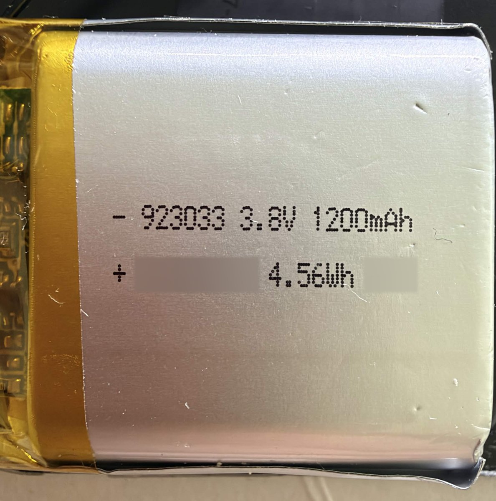
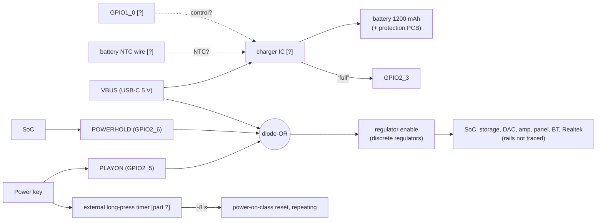

# Power: latch, VBUS, long-press reset, battery, charging

Status: draft, 2026-11

The AP30 has **no PMIC**. Discrete regulators are enabled by a diode-OR of three signals: the Power key (the SoC's
**PLAYON** input, GPIO2_5), a SoC-driven latch (**POWERHOLD**, GPIO2_6) and **USB VBUS**. Whatever runs on the SoC
must raise POWERHOLD while the key is still pressed and drop it to switch off; with USB power present the board
cannot switch itself off at all. An **external circuit resets the player about 8 s after Power is pressed** and
repeats every ~10.5 s while the key stays down, independent of any software: this is what makes a hung image
recoverable. The battery (1200 mAh Li-po) is measured on SAR-ADC channel 0 through a 2:1 divider; a separate,
unidentified charger reports "full" on GPIO2_3. The stock firmware never uses the SoC's low-power mode. This page is
the hardware view; the firmware's power policy is in
[../firmware/power_management.md](../firmware/power_management.md).

Tags: **[AP30]** firmware V1.7.8 or the device · **[TRM]** RKNanoD TRM V1.0 · **[DS]** a datasheet · **[EM]** Echo
Mini · **[WEB]** public source (Rockchip reference-board documents in public SDK copies cited as "[WEB] EVK") ·
**[?]** guess.

*Battery: 923033 3.8V 1200mAh, 4.56 Wh Li-po. [AP30]*

More photos: [photos.md](photos.md).

## Contents

- [Summary](#summary)
- [Power path](#power-path)
- [Power-on](#power-on)
- [Power-off](#power-off)
- [The ~8 s long-press reset](#the-8-s-long-press-reset)
- [Battery](#battery)
- [Charging](#charging)
- [Sleep and low-power facts](#sleep-and-low-power-facts)
- [Watchdog](#watchdog)
- [Reset markers that survive a reset](#reset-markers-that-survive-a-reset)
- [Open questions](#open-questions)
- [Sources](#sources)

## Summary

| Item | Value | Tag |
|---|---|---|
| PMIC | none; discrete regulators (part markings in [board_ap30.md](board_ap30.md#chips-and-markings)) | [AP30] |
| Regulator enable | diode-OR of PLAYON, POWERHOLD, VBUS | [WEB] EVK pattern; AP30 behaviour matches [AP30] |
| Power key | PLAYON = GPIO2_5 (ball A2), input, high = pressed | [AP30] |
| Power latch | POWERHOLD = GPIO2_6 (ball A1), 1 = stay on | [AP30] |
| VBUS sense | GRF 0x50010000 + 0xE8 bit 1 | [AP30 + TRM] |
| Long-press reset | external, ~8 s, repeats ~10.5 s while held, power-on-class | [AP30] measured |
| Battery | 1200 mAh, 3.8 V, 4.56 Wh Li-po (`923033`), protection PCB, pads BAT+ / BAT- / NTC | [AP30] |
| Battery measurement | SAR-ADC ch0, mV = raw × 5000 / 1024 | [AP30] |
| Charger | not identified; "full" on GPIO2_3 (high = full); GPIO1_0 driven on charger attach [role ?] | [AP30] |
| Input rating | 5 V / 2 A | [WEB] vendor spec |
| Low-power mode | not used by the stock firmware | [AP30] |

## Power path

Power domains inside the SoC [TRM ch. 5]: the **PMU domain** (always on while the chip has power) holds the PMU,
GRF, the **GPIO2 bank** and the 64 KiB PMU SRAM; the logic domain holds the system core, SYSRAM, ROM and most
peripherals; the HIGH domain holds core B, its RAM and the HiFi accelerator. PLAYON and POWERHOLD are GPIO2 pins, so
they stay valid when the logic domain is powered down. More: [soc_rknanod.md](soc_rknanod.md).

## Power-on

[AP30 unless tagged]

1. Power key pressed → PLAYON high → regulators on → boot ROM → boot loader [WEB EVK + AP30].
2. The boot loader drives **POWERHOLD high at the very start**, before anything else; from then on the key can be
   released. Its banner then goes out on UART1A TX at 115200 8N1.
3. **USB power alone also powers the board** (VBUS is in the diode-OR), so plugging USB into a switched-off player
   boots it; with VBUS present at boot the firmware shows the charge screen instead of the main menu.
4. The firmware's pin setup sets POWERHOLD high again, parks the Bluetooth pins and the backlight pin low, and points
   the USB switch at the RKNanoD.
5. **Boot battery check:** 18 ADC samples on ch0, the first 10 discarded, averaged; if VBUS is absent and the result
   is **≤ 3299 mV**, the firmware waits 200 ms and drops POWERHOLD (off).
6. The firmware ignores the Power key for 5 s after VBUS appears (plugging USB presumably raises PLAYON for a while
   [?]); see [input.md](input.md#power-key-playon).

Reviewers measure about 4-5 s from power-on to the main menu [WEB].

## Power-off

Triggers [AP30]: Power held > 2 s; the low-battery popup (3 s after it opens); the idle auto-off timer (off / 1 / 5 /
10 min, held during playback); the sleep timer (off / 10 / 15 / 30 / 60 / 120 min).

Hardware-relevant order of the stock power-off [AP30] (full sequence in
[../firmware/power_management.md](../firmware/power_management.md)):

1. Power the Bluetooth chip down and drive its UART pins low.
2. **If VBUS is present, do not switch off:** go to the charge screen (dropping POWERHOLD would not cut power).
3. Save settings with the clean-shutdown mark.
4. Mute (GPIO2_1 high), goodbye picture ~0.5 s.
5. Backlight off, panel standby, ADC stop, watchdog stop, storage shut down.
6. Wait 1 s, **POWERHOLD = 0**.
7. If code still runs, something else holds power (PLAYON still pressed, or VBUS): wait for the key release; a new
   press of more than ~10 polls of 10 ms reboots.

Device observations [AP30]: holding Power while on gives the goodbye screen and then a normal restart; holding it
*through* that restart ends in the ~8 s hardware reset without a goodbye screen, followed by a boot with the
"Updating Library…" screen (~480 ms, measured from a video), because the firmware's clean-shutdown mark was not set.

## The ~8 s long-press reset

| Item | Value | Tag |
|---|---|---|
| Delay | **~8 s** after Power is pressed (countdown-timed on the device) | [AP30] measured |
| Repeat | **every ~10.5 s** while Power stays held (seen as repeated USB re-enumerations) | [AP30] measured |
| Software dependence | none: it fires the same with the boot loader or the stock firmware running, and from any screen | [AP30] measured |
| Reset class | power-on class: it clears the PMU boot-marker register (`PMU_SYS_REG3`), like the Echo Mini's pinhole reset | [AP30] + [EM] |
| With D-pad Right held | the boot loader's button check sees the key after the reset and enters loader USB mode (with USB connected) | [AP30] measured |
| Source | an external circuit, not the SoC and not the firmware; the part is not identified. The RKNanoC datasheet documents an 8 s PLAYON long-press power-off; the RKNanoD datasheet does not [?]. The reference board has no such timer | [AP30] + [DS] + [WEB] EVK |
| Limits | it cannot be disabled, so any "hold Power" UI must finish well before 8 s (stock: 2 s); it does not help against an image that crashes every time it starts, unless D-pad Right is held | [AP30] |

This hardware reset is the basis of the recovery procedure for a hung image:
[../guides/recovery.md](../guides/recovery.md).

> **Warning:** loader USB mode, which this reset can reach, gives raw write access to the internal flash. Never write
> physical sectors 0x0000-0x1FFF (the boot loader), never run `rkdeveloptool ef`, never download a foreign loader
> (`db` / `ul`). In loader mode, unplugging USB leaves the player powered and stuck ("power down" on the loader
> console, POWERHOLD still high) until the next 8 s reset [AP30, loader analysis; not tested on the device].

## Battery

| Item | Value | Tag |
|---|---|---|
| Cell | Li-po pouch `923033`, 3.8 V nominal, 1200 mAh, 4.56 Wh | [AP30] marking + [WEB] spec |
| Connection | soldered wires to pads BAT+ (red), BAT- (black), NTC (white) on board side B, edge opposite the jacks | [AP30] |
| Protection | green strip PCB on the cell, under kapton (IC not readable) | [AP30] |
| Measurement | SAR-ADC ch0 through a 2:1 divider (200k / 200k on the reference board [WEB] EVK); **mV = raw × 5000 / 1024** (2.5 V reference × 2) | [AP30] |
| ADC reference | internal 2.5 V source, trimmable 2.4-2.6 V in GRF `VREF_CON` (reset value 2.5 V) | [TRM ch. 17] |
| Sampling | the ADC rotates channels 1, 1, 1, 0 from the 10 ms key tick, so ch0 gets one sample every 40 ms | [AP30] |
| NTC | not read by any firmware ADC channel (only ch0 and ch1 are used); probably wired to the charger's temperature input, i.e. hardware battery-temperature protection [?] | [AP30] + [?] |

Battery levels used by the stock firmware [AP30]:

| Voltage | Level (0-4) | Note |
|---|---|---|
| ≤ 3299 mV at boot, no VBUS | — | boot aborted, power off |
| < 3450 mV for 21 consecutive samples | 0 | low-battery popup, power-off 3 s later |
| 3450 / 3540 / 3666 / 3774 / 3964 mV | thresholds | level = (number of thresholds ≤ mV) − 1, clamped at 0; above 3964 mV → 4 |
| while charging | — | the reading is inflated by the charge current; the UI animates instead of showing a level; on charger removal 10 fresh samples are averaged and the level recomputed |

The Echo Mini community firmware also shuts down below 3450 mV [EM]. Reviewer battery-life figures: about 9.5-11 h on
3.5 mm, 7.5-9 h on 4.4 mm, 7+ h on Bluetooth; vendor standby claim 60 days [WEB].

## Charging

| Item | Value | Tag |
|---|---|---|
| Charger IC | not identified. Candidates: `DP1 165` (leadless, power inductor beside it, side A right edge: a switching charger if so) or one of the SOT-23 parts `06T2` / `S2ZQ` / `705628` | [AP30], identity [?] |
| "Full" status | GPIO2_3 (ball B1), input with pull, high = full; sampled every 5 s, more than 20 consecutive highs (≈ 100 s) → "full" | [AP30] |
| Charge control | GPIO1_0 (ball G1, also the I2S1A MCLK pin) driven high when a charger / host is attached, held low in USB DAC mode | [AP30], role [?] |
| Charge current / termination | no firmware control: the charge-current setter only stores a value, the charge hooks are empty; the charger sets its own current | [AP30] |
| Charger present | VBUS seen and no USB host within 3 s (charger only), or an active USB session | [AP30] |
| USB DAC mode | **no charging** (firmware keeps GPIO1_0 low; vendor: "DAC mode and USB charging mode are separate") | [AP30] + [WEB] |
| Charge time | about 1 h to full on a fast charger, 3-4 h from a PC USB-A port, i.e. roughly 1 A set by the charger [?] | [WEB] |
| Reference board | GPIO0_B4 (= GPIO0_12) is a charge-current select line there; on the AP30 GPIO0_12 changes in USB DAC mode | [WEB] EVK + [AP30], same role [?] |

More on charging and USB modes: [usb.md](usb.md#charging-and-usb).

## Sleep and low-power facts

- **No SoC low-power mode in the stock firmware:** its only PMU accesses are the HIGH-domain power-down control and
  the boot-marker register; it never writes the power-mode or wake-up configuration registers [AP30].
- **Idle = backlight off + key lock** while the main loop keeps running and waits in WFI [AP30].
- **Core B and its RAM are powered down** (HIGH domain off) whenever no decoder runs, at boot and when playback
  stops [AP30].
- **Clock scaling:** the firmware sums per-subsystem clock requirements and clamps them (system core ≤ 200 MHz, core
  B ≤ 450 MHz, APB ≤ 75 MHz, floor 96 MHz while active); with only the base modules active it runs the PLL and system
  core at 200 MHz, APB 50 MHz; at or below 24 MHz it runs from the crystal. Audio clocks come from the separate
  ACODEC PLL and are not disturbed [AP30]. Details: [../firmware/power_management.md](../firmware/power_management.md),
  [soc_rknanod.md](soc_rknanod.md).
- **What the SoC could do** [TRM ch. 5]: a power mode that switches to a low-frequency clock, can power down the
  logic domain, the oscillator and the PLL, and wakes **only on GPIO2 events**. On the AP30 the Power key (GPIO2_5)
  and the wheel phases (GPIO2_0 / GPIO2_9) are GPIO2 pins and could wake the chip; the ladder keys (ADC) could not.
  What the CPU executes on wake, and the board's standby current, are unknown [?].
- **PMU SRAM** (64 KiB at 0x03090000) survives soft resets and logic power-down [TRM]; the stock firmware uses it as
  ordinary memory (overlay windows) and keeps a reboot marker in its top 16 bytes (0x0309FFF0) [AP30].
- The vendor's "60 days standby" cannot be reached with the CPU running; it probably means "off" [?].

## Watchdog

The SoC's DesignWare watchdog (base 0x40120000, IRQ 8) is armed at boot in "interrupt first, reset on the second
timeout" mode with range 13 (2^29 pclk cycles: ~10.7 s at a 50 MHz APB clock, so ~21 s until the reset). The firmware
kicks it from about 60 places; its interrupt handler just spins so that the second timeout resets the chip. Reboot
and power-off stop it first [AP30 + TRM ch. 20]. A watchdog reset is not power-on class: the boot-marker register
survives it [TRM + ?, not measured].

## Reset markers that survive a reset

`PMU_SYS_REG3` (0x5002004C) keeps its value across soft and watchdog resets but is cleared by the ~8 s hardware
reset [AP30]. The boot loader and firmware use its low half as a boot-mode marker: 0x18DF = booted from FW1,
0x18CF = booted from FW2 (sticky fallback), 0x18AF = enter loader USB mode, 0x18EF = one extra loader-mode boot,
0x18BF = MaskROM [AP30]. Details: [../firmware/boot_loader.md](../firmware/boot_loader.md).

## Open questions

| Question | How it could be answered |
|---|---|
| Charger IC, its charge current; is GPIO1_0 its enable or a current select? | continuity from balls G1 / B1 to the `DP1 165` / SOT-23 parts; USB power meter with and without DAC mode |
| Where does the NTC wire go? | continuity from the `NTC` pad, power off |
| Which part makes the 8 s reset; does it cut power or pull the SoC reset? | scope POWERHOLD and the SoC reset ball during a long press |
| What powers the RTC when the player is off? | see [rtc.md](rtc.md) |
| Real standby / off current | battery-side current measurement |
| Behaviour of the SoC's logic-domain power-down (resume vector, what is lost) | bare-metal test waking on GPIO2_5 |
| Real APB clock in normal use (watchdog period) | stop kicking in a test image and time the reset |
| Is the boot battery check's 3299 mV threshold safe for the cell? (protection PCB cut-off unknown) | read the protection IC |

## Sources

- [AP30] analysis of firmware V1.7.8 (pin setup, boot battery check, battery service and thresholds, charge and
  VBUS services, power-off path, watchdog, clock manager) and of the boot loader; board inspection (battery, pads,
  regulator markings); measurements on a device (8 s reset and its repeat, library-screen time).
- [TRM] [RKNanoD TRM V1.0](https://rockchip.fr/Rockchip%20RKNanoD%20TRM%20V1.0.pdf) ch. 4 (GRF), 5 (PMU), 12 (SRAM),
  17 (SAR-ADC), 20 (watchdog); [DS] [RKNanoD datasheet V1.8](https://rockchip.fr/RKNanoD%20datasheet%20V1.8.pdf),
  [RKNanoC datasheet V1.7](https://rockchips.net/wp-content/uploads/2025/08/RKNanoC-datasheet-V1.7.pdf) (8 s
  PLAYON power-off on the older chip).
- [WEB] EVK: RKNanoD EVK main-board schematic V2.2 (power latch, battery divider, charge-current select) in public
  SDK copies such as [brian0218/RKNanoD_Wireless_Audio_SDK_V1.5](https://gitlab.com/brian0218/RKNanoD_Wireless_Audio_SDK_V1.5);
  vendor spec and reviews (charge time, battery life, DAC-mode charging):
  [Head-Fi AP30 showcase](https://www.head-fi.org/showcase/hidizs-ap30-music-boy.29215/),
  [Moonstar Reviews](https://moonstarreviews.net/hidizs-ap30-music-boy-review/),
  [../community/user_feedback.md](../community/user_feedback.md).
- [EM] EchoPod ([BasilSkyWalk/echopod](https://github.com/BasilSkyWalk/echopod)) hardware notes (3450 mV
  shutdown); Echo Mini pinhole reset.
