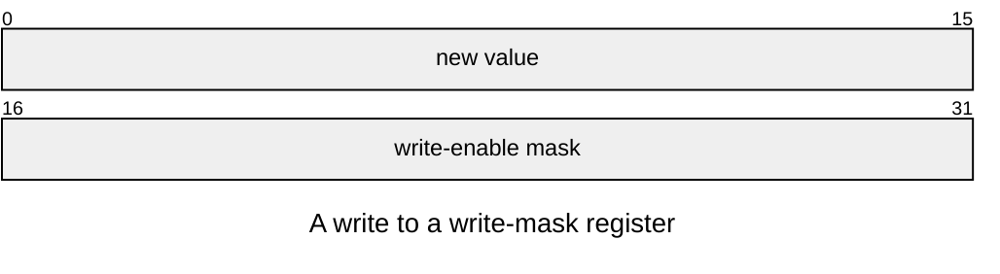
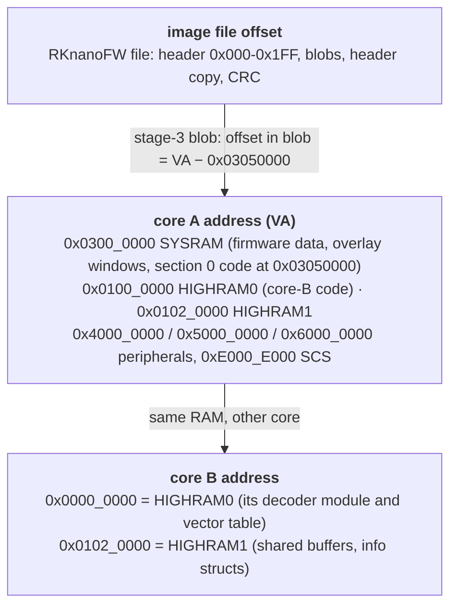

# Conventions

Status: draft, 2026-11

How the pages in this collection are written: provenance tags, number and unit formats, how registers, bits, pins and
addresses are named, the several address spaces of the AP30 (two cores, overlays, image file, flash), and the common
page structure. Read this once before the hardware, firmware and format pages.

## Contents

- [Provenance tags](#provenance-tags)
- [Numbers and units](#numbers-and-units)
- [Registers](#registers)
- [Pins and pin sets](#pins-and-pin-sets)
- [I2C addresses](#i2c-addresses)
- [Address spaces](#address-spaces)
- [Sections, overlays and slots](#sections-overlays-and-slots)
- [Firmware versions](#firmware-versions)
- [How pages are structured](#how-pages-are-structured)
- [Safety boxes](#safety-boxes)
- [What this collection does not contain](#what-this-collection-does-not-contain)

## Provenance tags

Every claim carries one or more tags saying where it comes from.

| Tag | Meaning | Example |
|---|---|---|
| **[AP30]** | confirmed in the AP30 firmware (V1.7.8 unless another version is named), in its boot loader, or on the device | "the DAC is at I2C address 0x66 [AP30]" |
| **[TRM]** | the Rockchip RKNanoD Technical Reference Manual V1.0 | "CRU base 0x40180000 [TRM]" |
| **[DS]** | a chip datasheet; the chip is named in the text or the Sources section | "the CS43198 supports DoP [DS]" |
| **[EVK]** | Rockchip reference-board or SDK documentation (EVK schematics, porting guides); describes Rockchip's design, not necessarily the AP30 | "SWD header on the EVK [EVK]" |
| **[EM]** | found on the Snowsky Echo Mini (same SoC, same code base), not yet checked on the AP30 | "core-B vector table at 0x01022000 [EM]" |
| **[WEB]** | a public web source, linked in the text or in the page's Sources | "61 mW at 32 Ω [WEB]" |
| **[?]** | a guess, an inference, or a reading we could not confirm | "the CLK pad forces MaskROM [?]" |

Rules:

* Tags combine: **[AP30 + EM]** = an Echo Mini finding we confirmed in the AP30 image; **[AP30 + ?]** = a fact plus
  our interpretation of it.
* A **[?]** stays a [?] until someone checks it. Pages never upgrade it silently.
* **Measured** values say how: "measured on a device with a phone video", "seen in Linux `dmesg`", "read from a full
  flash read-out".
* "[AP30, chip marking]" means a marking read on an opened retail unit. Lot and date codes of that unit are not given.
* When two sources disagree, both are given with their tags, and the page says which one we believe and why.

## Numbers and units

| Thing | Notation | Example |
|---|---|---|
| Hexadecimal | `0x` prefix, lower or upper case digits | `0x03050000`, `0x18AF` |
| Decimal | no prefix; thousands separated by a comma in prose | 29,360,132 bytes |
| Binary sizes | KiB = 1024 B, MiB = 1024 KiB. Vendor figures keep the vendor's unit ("1 MB SRAM", "256 GB") | 28 MiB slot = 0xE000 sectors |
| Sectors | 512 bytes unless stated (the IDB read reply is 528 B per sector) | |
| Bit numbers | bit 0 = least significant | |
| Bit fields | `[high:low]`, inclusive | `CLKSEL0[14:12]` |
| Byte order | little-endian unless stated (the CPU is little-endian). Big-endian data is called out, e.g. RGB565 resources, SCSI CDB fields | |
| Byte strings | hex bytes separated by spaces | `FF E0 FF FF FF FE 00 01` |
| Frequencies, power | SI units with a space | 24.576 MHz, 61 mW, 32 Ω |
| Dates | ISO 8601 | 2026-10-19 |

## Registers

### Names

* Register names follow the RKNanoD TRM where it has one: **block + register name**, e.g. `CRU_CLKSEL0`,
  `CRU_MODE_CON`, `PMU_SYS_REG3`. For a numbered instance the number goes in the block: `UART1_THR`, `I2C1_CON`.
* A single bit or field is written **"REGISTER bit n"** or **"REGISTER[h:l]"**: `CRU_SOFTRST_CON3 bit 2` (core B reset),
  `SARADC_CTRL bit 3` (start).
* Where the TRM has no name, the page uses **block + offset**: `VOP +0x28` (MCU command port), `Mailbox +0x0C + 8·ch`.
* Arm core registers use Arm's names: `SCB_VTOR` (0xE000ED08), `SCB_AIRCR` (0xE000ED0C), `SysTick`, `NVIC`.
* Registers of external chips use the chip datasheet's numbering. The CS43198 uses 24-bit register addresses written
  as `0x090001` [DS].

### Addresses

Peripheral addresses are given as **base + offset**, with the absolute address where it helps:
`PMU_SYS_REG3` = PMU 0x50020000 + 0x4C = **0x5002004C**. Block bases are listed in
[../hardware/soc_rknanod.md](../hardware/soc_rknanod.md); per-register notes in
[../hardware/soc_peripherals.md](../hardware/soc_peripherals.md).

### Write-mask registers

Many Rockchip control registers (GRF, CRU clock gates / soft resets / selectors, some PMU registers) use a **write
mask**: in a 32-bit write, bits [31:16] say which of bits [15:0] are changed; bits whose mask bit is 0 keep their old
value. The TRM marks the mask half as write-only ("WO") [TRM].

* bit (16+n) = 1 → bit n takes the new value
* bit (16+n) = 0 → bit n is left alone

Examples:

* Setting the boot-mode marker: write `0xFFFF18AF` to `PMU_SYS_REG3` → low 16 bits become 0x18AF [AP30].
* Asserting core B's reset: write `(1 << (16+2)) | (1 << 2)` = `0x00040004` to `CRU_SOFTRST_CON3`; releasing it:
  `0x00040000` [TRM].
* The firmware's clock-gate / soft-reset helpers address a bit with one number, **id = register index × 16 + bit**
  (gates at CRU +0x80, resets at CRU +0xC0). Example: id 0x32 = `SOFTRST_CON3` bit 2 = core B reset [AP30 + TRM].

Pages say "(write-mask)" next to a register when this applies.

### Register tables

Register tables in this collection use the columns **Offset · Name · Bits · Access · Meaning · Tag**. Access is
`RW`, `RO`, `WO`, `W1C` (write 1 to clear) or `WM` (write-mask).

## Pins and pin sets

* GPIO pins are **`GPIOb_n`**: bank b (0, 1, 2), pin n (0..31). Example: `GPIO2_13`. The TRM / datasheet letter
  style (`gpio2b5`, `GPIOP2_B5` = bank 2, group B, pin 5 = `GPIO2_13`) is converted to the numeric style; group A =
  pins 0-7, B = 8-15, C = 16-23, D = 24-31.
* A peripheral that can be routed to several pin groups has a **pin-set letter**: `I2C1C` = I2C1 on its pin set C,
  `UART1A` = UART1 on set A. The letters come from the RKNanoD datasheet pin-mux tables [DS].
* Package balls (LFBGA121) are given as ball names from the datasheet when relevant; the AP30 pin table is in
  [../hardware/board_ap30.md](../hardware/board_ap30.md).

## I2C addresses

I2C addresses are **8-bit write addresses** unless marked "7-bit": the DAC is **0x66** (7-bit 0x33), the RTC **0xA2**
(7-bit 0x51) [AP30].

## Address spaces

The same bytes have different addresses depending on who looks. Pages always say which space an address is in.

| Space | Used for | Notes |
|---|---|---|
| **Image file offset** | positions inside an `.IMG` file | header at 0, magic "RKnanoFW" at 0x1F8 [AP30] |
| **Stage-3 offset** | positions inside the code-stage blob | for section 0 code and the overlays: offset = VA − 0x03050000 [AP30] |
| **Core A address (VA)** | what the system core sees; all firmware addresses unless stated | memory map in [../hardware/soc_rknanod.md](../hardware/soc_rknanod.md) |
| **Core B address** | what the calculation core sees | HIGHRAM0 appears at 0 for core B and at 0x01000000 for core A; decoder modules are linked at 0x01000000 in the image [AP30 + TRM] |
| **Overlay window address** | an overlay's run address | several overlays share one window (e.g. the main window at 0x030815C4); an address means nothing without the overlay number [AP30] |
| **Code offset** (community usage) | file offset − 0x200 | used by the AP30 game-emulator project; convert before comparing [WEB] |

### Flash addresses

| Numbering | Definition | Used by |
|---|---|---|
| **Physical sector** | sector number on the internal flash chip | this collection's flash maps |
| **Loader LBA** | physical − 0x2000 | Rockusb read/write LBA commands; loader LBA 0 = FW1 header [AP30] |
| **IDB read address** | physical − 64 | Rockusb READ_SECTOR (opcode 0x04), the only way to read the hidden area [AP30] |

Physical sectors **0..0x1FFF** (the first 4 MiB) are the hidden boot area (IDB + loader). They must never be written.
Map: [../formats/idb_and_flash_layout.md](../formats/idb_and_flash_layout.md).

## Sections, overlays and slots

* **Section n** / **slot n** = record n of the stage-3 section table (0..112 in V1.7.8). **Overlay n** = the same
  thing seen as loadable code. "ov 38" is short for overlay 38.
* Section numbers are those of **V1.7.8** unless another version is named; they shift between releases (BT Music is
  slot 82 in `HIFIYF26`, 92 in `HIFIYF05`, 112 in V1.7.8) [AP30].
* Echo Mini module numbers differ: Echo Mini codec module = AP30 number + 1 (up to V1.4.6) or + 2 (from V1.5.0) [EM].
* Code locations are given as **section + address**, e.g. "overlay 9 at 0x03084ABE". Function names are only used
  where they are our own descriptive handles; names from vendor SDKs are not used.

## Firmware versions

* "V1.7.8" = `HIFIYF18.IMG` (header 2026-10-19 / 8.0.0); "5.0.0" = `HIFIYF05.IMG` (2026-08-19); "0.0.0" or "YF26" =
  `HIFIYF26.IMG` (2026-07-23). See [firmware_releases.md](firmware_releases.md).
* "Loader 4.16" = the AP30's boot loader version as reported over USB [AP30].

## How pages are structured

Every page follows the same shape:

1. **Title** and a one-line **Status** ("draft, 2026-11").
2. A **summary paragraph**: what the page covers and the main facts.
3. A **Contents** list when the page is longer than a screen.
4. **Sections**, with tables for registers, pins, commands and limits, and ASCII diagrams for layouts and flows.
5. **Open questions**: what is not known yet.
6. **Sources**: tags and public links. Internal evidence is cited as "[AP30] analysis of firmware V1.7.8" or
   "measured on a device".

One topic has one home: a fact is written in full on one page; other pages give a one-line summary and link there.

## Safety boxes

Any procedure that writes to the device carries a box like this, with the recovery path and the things never to
write:

> **Warning**
> This procedure writes to the player. If it fails, hold **D-pad Right + Power** with USB connected to reach loader
> USB mode and restore an official image ([../guides/recovery.md](../guides/recovery.md)). Never write physical
> sectors 0..0x1FFF (the boot area), never run `rkdeveloptool ef`, and never download a random loader (`db` / `ul`).

## What this collection does not contain

* No decompiled or disassembled vendor code, no copied SDK source, no vendor images, fonts or text dumps. Behaviour,
  data layouts and register values are described in our own words and tables.
* No personal data: no owner names, no serial numbers of a specific unit, no contents of anyone's backup.
* No work on new firmware: this collection documents the AP30 as shipped.

## Sources

* [TRM] Rockchip RKNanoD TRM V1.0 (write-mask registers, register names, address map); [DS] RKNanoD datasheet V1.8
  (pin-mux letters). Links: [sources.md](sources.md).
* [AP30] analysis of firmware V1.7.8 and the boot loader.
