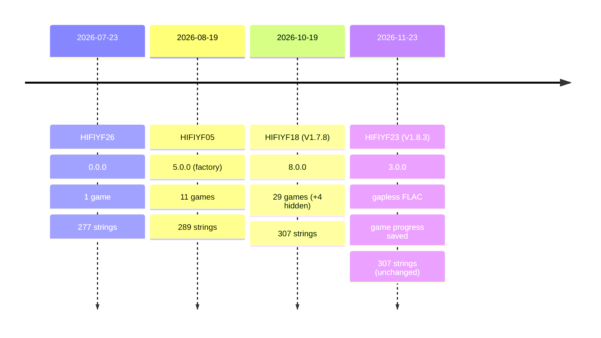

# Firmware releases

Status: draft, 2026-11

Four official AP30 firmware files are known: `HIFIYF26.IMG` (header date 2026-07-23), `HIFIYF05.IMG` (2026-08-19,
the "11-Game Firmware", found as the factory firmware on a retail unit), `HIFIYF18.IMG` (2026-10-19, **V1.7.8**, 29
games) and `HIFIYF23.IMG` (2026-11-23, **V1.8.3**: gapless FLAC playback and saved game progress). All four are
29,360,132-byte RKnanoFW containers with valid checksums. This page gives their identity
(dates, versions, sizes, SHA-256, section counts), what changed between them, how the `HIFIYFnn` naming works, and
one non-Hidizs file that uses the same container (`HIFIEC90.IMG`, the RECHO community firmware for the Echo Mini).
The container format itself is described in [../formats/rknanofw_container.md](../formats/rknanofw_container.md).

## Contents

- [The files](#the-files)
- [Where they come from](#where-they-come-from)
- [Container facts per file](#container-facts-per-file)
- [What changed between releases](#what-changed-between-releases)
- [Version numbers: header, UI, file name](#version-numbers-header-ui-file-name)
- [File names: HIFIYFnn and ECHOMINI](#file-names-hifiyfnn-and-echomini)
- [The non-Hidizs file: HIFIEC90.IMG (RECHO)](#the-non-hidizs-file-hifiec90img-recho)
- [Open questions](#open-questions)
- [Sources](#sources)

## The files

| File | Hidizs name | Header date | Header version | Size (bytes) | SHA-256 |
|---|---|---|---|---|---|
| `HIFIYF26.IMG` | "AP30-HIFIYF26 Firmware-0727" (Drive folder title) | 2026-07-23 | 0.0.0 | 29,360,132 | `ca8c991ec33dc98ebe4381c1db91262ad73f8eec098adccedb6d8028be3429b0` |
| `HIFIYF05.IMG` | "AP30 Music Boy 11-Game Firmware" | 2026-08-19 | 5.0.0 | 29,360,132 | `d69ca5012ff13fbf55d22dbb517a3419938e0673530d75452d6a82ee07c9cfc3` |
| `HIFIYF18.IMG` | "AP30 Music Boy V1.7.8 Firmware" | 2026-10-19 | 8.0.0 | 29,360,132 | `c7601873cb3be8d1320225c69669e504576f7bcb1126595a9040492338e79840` |
| `HIFIYF23.IMG` | "AP30 Music Boy V1.8.3" (instructions title) | 2026-11-23 | 3.0.0 | 29,360,132 | `79d186f5f2fe60e46a3ff3a54f91221675fdfe2802654f7fab8d046f12aaba55` |

All hashes and header fields [AP30, read from the files]. The factory firmware found on the internal flash of a
retail unit (both slots) is byte-identical to the public `HIFIYF05.IMG` [AP30, device read-out]. No build older than
`HIFIYF26.IMG` and none newer than V1.8.3 is known (2026-11).

## Where they come from

| File | Published at | Notes |
|---|---|---|
| `HIFIYF26.IMG` | a public Google Drive folder ["AP30-HIFIYF26 Firmware-0727"](https://drive.google.com/drive/folders/1FS4LT7nPmJlrgBJD76_OU4EqBXUDNuzb), linked from reviews (Chris Love on mobileaudiophile, IceIceberg on Head-Fi) and reportedly from Head-Fi; **not** on the Hidizs Download Center | file dated "Jul 23", instructions document "Jul 27" [WEB] |
| `HIFIYF05.IMG` | [Hidizs Download Center](https://www.hidizs.net/pages/download-center) → [Drive folder "11-Game Firmware"](https://drive.google.com/drive/folders/1eh8GAXxhXflLeVO4Y43jqXNZsKySmr3K) | file and instructions dated "Sep 28" [WEB] |
| `HIFIYF18.IMG` | Hidizs Download Center → [Drive folder "AP30 Firmware-V 1.7.8"](https://drive.google.com/drive/folders/1UtbNfDBERrcP6VWIMiwKfIeSnyiECXn8) | file dated "Oct 18" (one day before its header date, probably a time-zone effect [?]), PDF instructions "Oct 27" [WEB] |
| `HIFIYF23.IMG` | [Hidizs Download Center](https://www.hidizs.net/pages/download-center) → [Drive folder](https://drive.google.com/drive/folders/1I7IYvuXKublGF4vxao-_PG0ZX7zFGGLh) | with a bilingual (Chinese / English) PDF "V1.8.3 Firmware Update Instructions"; downloaded 2026-11-24 [WEB] |

The folders are public; no login is needed [WEB]. Drive shows no year on these dates.

### Hidizs changelogs [WEB]

| File | Changelog (Hidizs instructions, as quoted) |
|---|---|
| `HIFIYF26.IMG` | improved DSD256 compatibility; fixed a blank screen in Favorites; new **Screen-Off Button** setting (Function → System Settings → Screen-Off Button Settings) so buttons work with the screen off; fixed A/B input recognition; updated translations |
| `HIFIYF05.IMG` | "11-Game Firmware": the ten extra games |
| `HIFIYF18.IMG` | V1.7.8: 29 games; playback stutter fixed; Custom EQ fixed |
| `HIFIYF23.IMG` | V1.8.3: gapless playback added; better information on the playback screen; better playback performance and fixes for some files that played badly; game progress kept after leaving a game or powering off, and holding B in a game restarts it from level 1. Notes: gapless works automatically, there is no setting for it; V1.8.3 contains all earlier updates and can be installed over any earlier version (summarised from the instructions) |

**Oddity:** the `HIFIYF26.IMG` instructions describe fixes, yet by content it is the oldest build of the three (fewest
games and strings, oldest header date) [AP30]. Its header date equals the Kickstarter launch day [WEB + AP30]. It was
probably the update offered to early reviewers on top of an even earlier pre-release build that is not public [?].

## Container facts per file

| | `HIFIYF26` | `HIFIYF05` | `HIFIYF18` (V1.7.8) | `HIFIYF23` (V1.8.3) |
|---|---|---|---|---|
| Header vendor / model | "Rockchip" / "RKnano SDK 1.0" | same | same | same |
| `header.size` (image + padding, = offset of the header copy) | 0x1b24000 | 0x1b3c000 | 0x1b90000 | 0x1b98000 |
| Total file | 0x1c00000 + 4-byte CRC | same | same | same |
| Checksum, header copy, zero padding | all valid | all valid | all valid | all valid |
| Boot stages 0-2 | empty | empty | empty | empty |
| Code stage (stage 3) size | 0x15a664 | 0x1649f8 | 0x188714 | 0x18e3e8 |
| Section slots in the code stage | **83** | **93** | **113** | 113 |
| Slots that contain code | 61 | 71 | 91 | 91 |
| Second-core codec modules | slots 71-80 (10 decoders) + slot 70 | same | same | same |
| Game overlays | slot 81 (one game) | slots 81-91 (11 games) | slots 81-111 (29 menu games + 4 hidden) | same as V1.7.8 |
| "BT Music" (Bluetooth output screen) | slot 82 | slot 92 | slot 112 | slot 112 |
| Font blobs | 12 px (0x201c06 B) + 16 px (0x211c06 B) | same sizes | same sizes | byte-identical to V1.7.8 |
| GBK table blob | 0x1ca34a B | same | same | byte-identical to V1.7.8 |
| String table: languages × records | 21 × **277** | 21 × **289** | 21 × **307** | byte-identical to V1.7.8 |
| String record size | 0x102 B | 0x102 B | **0x112 B** (more child slots in the menu tree) | 0x112 B |
| Image resources | 478 images, 296 × 240 boot screen, blob 0x127a526 B | same | same | byte-identical to V1.7.8 |

All values [AP30]. Layouts: [../formats/stage3_sections.md](../formats/stage3_sections.md),
[../formats/resources.md](../formats/resources.md).

The BT Music overlay has the same size (0x168a B of code) in all four files, and the code-page tables, fonts and
image resources keep their sizes [AP30]: the releases differ in code and strings, not in artwork.

## What changed between releases

### HIFIYF26 (0.0.0) → HIFIYF05 (5.0.0)

* **Games: 1 → 11** [AP30]. `HIFIYF05` has game overlays 81-91. A reviewer lists the eleven games that the update
  brought (Retro Block Puzzle, Snake, Box Pusher, Brick Breaker, Block Shooter, Tank Battle, Gomoku, Minesweeper, Maze,
  Sudoku, Make 24; "production units will have all 11 games built in") [WEB]; these are exactly the first eleven
  games of V1.7.8's game menu (overlays 81-91) [AP30]. `HIFIYF26`'s single game overlay is about the size of the
  block-puzzle game, so it is probably the block game the Kickstarter page advertised [?].
* **Strings: 277 → 289 records** (same record layout) [AP30].
* **Second-core decoders:** both images carry the same generation of decoder modules for MP3, WMA, OGG, FLAC, ALAC and
  APE, and the same AAC and WAV modules. `HIFIYF05` also has newer DSDIFF and DSF modules [AP30]. That generation
  matches the Echo Mini's V3.8.0 rebuild (2026-07-18), including a long FLAC seek debug trace (15 "FLAC seek:"
  strings) [AP30 + EM]. See [../related/snowsky_echo_mini.md](../related/snowsky_echo_mini.md).
* Compared with V1.7.8, the `HIFIYF26` MP3 module has 212 of 279 functions identical, 61 moved, 6 changed; its FLAC
  module has about 60 changed functions; AAC is identical (303 / 303) in all three files [AP30].
* USB connection prompt: reviewers on `HIFIYF26` saw the "USB Audio / File Transfer" prompt vanish after about 3 s
  [WEB]; in V1.7.8 the timeout is 60 s [AP30]. Not yet checked in the older images' code [?].

### HIFIYF05 (5.0.0) → HIFIYF18 (V1.7.8, 8.0.0)

* **Games: 11 → 29 in the menu, plus 4 hidden games** that have code and windows but no menu entry (a pipe-flying
  game, a bomb-laying maze game, a dot-eating maze chase and a dig-and-climb gold game) [AP30]. Game list:
  [../firmware/games.md](../firmware/games.md).
* **Strings: 289 → 307 records**, and the record grows from 0x102 to 0x112 bytes (29 instead of 21 child slots per
  menu node), needed by the longer game menu [AP30]. A Traditional Chinese string that used the Simplified characters
  for "games" in 5.0.0 is corrected in V1.7.8 [AP30].
* **Decoders rolled back.** V1.7.8 carries **older** second-core decoders than the two earlier AP30 images: its MP3,
  WMA, AAC, OGG, FLAC, DSDIFF and DSF modules are byte-identical to Echo Mini modules from before FiiO's V3.8.0
  rebuild; its WAV, ALAC and APE modules match no known Echo Mini release; the FLAC seek trace is gone [AP30 + EM].
  Hidizs's changelog says "playback stutter fixed"; going back to the older decoders is a plausible way that fix was
  made [?].
* **Heavy files refused:** 5.0.0 opened APE files above 96 kHz and DSF/DFF above about DSD512; V1.7.8 rejects them
  with a decoder-open error [AP30]. Such files were too heavy to decode in real time and were a likely stutter source
  [?].
* **EQ skipped for hi-res:** V1.7.8 skips the per-block EQ / effect call when the sample rate is 192 kHz, the file is
  DSD, or the bit depth is 24 or more [AP30; "bit depth" reading of the field: ?]. 5.0.0 applied it whenever an EQ
  preset was active. So the custom EQ probably has no effect on hi-res playback in V1.7.8 [?]; it looks like a CPU
  budget fix for the stutter [?]. Details: [../firmware/known_bugs.md](../firmware/known_bugs.md).
* "Custom EQ fixed" (changelog): the specific change was not isolated [?].
* Port offsets: a community project that patches V1.7.8 found 18-24 of its 25 patch-point functions again in 5.0.0
  by masked signatures, shifted by 0x280-0x678 bytes (not a constant shift) [WEB].

### HIFIYF18 (V1.7.8, 8.0.0) → HIFIYF23 (V1.8.3, 3.0.0)

A function-by-function comparison of the two images [AP30]: of about 5,300 functions, 3,734 are byte-identical,
1,360 are the same code at new addresses, 172 changed and 29 are gone; about 33 KiB of code is new.

* **Gapless playback, FLAC only.** A FLAC track flows into the next FLAC track with no gap and no fade **when both have
  the same sample rate, bit depth and channel count**, in sequential play (also across the wrap of folder repeat).
  Every other transition (other formats, a format change between two FLACs, shuffle, repeat one, CUE tracks, a FLAC
  file that starts with an ID3v2 tag) still stops and restarts with a gap and the end-of-track fade [AP30, code;
  confirmed on a device for FLAC 16/44.1 and 24/96, rate, bit-depth and channel changes, MP3 and WAV]. There is no
  setting; it is always on. How it works and its limits: [../firmware/audio_playback.md](../firmware/audio_playback.md#gapless-playback-v183).
* **FLAC reworked.** The FLAC front end on the system core and the FLAC module on the second core were rewritten (new
  frame and seek code, a new copy path into the output buffers) [AP30]. That is the likely substance of "fixes for some
  files that played badly" [?]. The other nine decoder modules (MP3, WMA, AAC, WAV, OGG, ALAC, APE, DSDIFF, DSF) are
  byte-identical to V1.7.8 [AP30].
* **Game progress saved.** A new save routine writes a block tagged "GAME" to a reserved area of the internal flash
  (not to the settings record) [AP30]. 28 games gained a new save flag and code for it [AP30]; three hidden games (the bomb-laying
  maze game, the dot-eating maze chase and the dig-and-climb game) are unchanged [AP30]. Details:
  [../firmware/games.md](../firmware/games.md#saved-progress-v183).
* **Playback screen.** One tag-reading routine was replaced by a new one and the MP4 tag parser and the now-playing
  window changed [AP30]. What the screen shows differently has not been analysed yet [?].
* **Unchanged:** the string table (all 21 languages), both fonts, the GBK table and all 478 images are byte-identical,
  so V1.8.3 adds no menu item and no text [AP30]. The settings record keeps its layout, so settings carry over in both
  directions [AP30, layout]. The updater's code only moved, and the image keeps the same 28 MiB slot rule [AP30].
* **Default clock date:** when the clock has never been set or was reset, V1.8.3 starts it at 2026-11-23 (V1.7.8 used
  2026-08-19, the factory build's date) [AP30].
* The header version went **down**, from 8.0.0 to 3.0.0. The updater does not compare versions, so this does not matter
  for installing [AP30].
* New possible bugs in the gapless code (elapsed time after seeking, early title switch): see
  [../firmware/known_bugs.md](../firmware/known_bugs.md#playback-engine-eq-and-now-playing-screen).

### Unchanged in all four

* Container, header vendor/model, fonts, GBK table, image set (478 images), the ten codec modules' set (MP3, WMA, AAC,
  WAV, OGG, FLAC, ALAC, APE, DSDIFF, DSF), the AAC module bytes [AP30].
* No licence notice, attribution or source offer for the open-source code inside the decoders, in any of the four
  images (code, strings, About page, image names) [AP30; V1.8.3's strings and images are identical to V1.7.8's]. See
  [../firmware/third_party_components.md](../firmware/third_party_components.md).
* The update logic that accepts `ECHOMINI.IMG` and `HIFIYFnn.IMG` (checked in V1.7.8; the template strings are in all
  four; V1.8.3's updater code is the same, only moved [AP30]).

## Version numbers: header, UI, file name

Three numbering schemes exist and none maps cleanly onto another:

| Scheme | Values seen | What it is |
|---|---|---|
| Header version field (BCD major.minor.rev) | 0.0.0, 5.0.0, 8.0.0, 3.0.0 | written by the image builder; the firmware stores the installed value in its settings and returns it from a Rockchip vendor SCSI command ("fw version 5.0.0 → 8.0.0" seen after updating a device) [AP30] |
| Header date (BCD) | 2026-07-23, 2026-08-19, 2026-10-19, 2026-11-23 | build date; shown on the About page [AP30]. Not used by the updater [AP30] |
| Public version | "V1.7.8", "V1.8.3" | Hidizs's names for `HIFIYF18.IMG` and `HIFIYF23.IMG`; the About page of V1.8.3 shows "Ver 1.8.3" [WEB; AP30] |
| UI versions reported by reviewers | "1.2.9" (July 2026), "1.3.5" (August 2026) | pre-release / review builds; which files they correspond to is unknown [WEB, ?] |
| File number | 26, 05, 18, 23 | not chronological; any `HIFIYF00`-`89` name is accepted [AP30] |

The Echo Mini shows the same pattern: its header version is the release number only by accident (V1.2.5 = 5.0.0,
V1.6.2 = 0.6.2, most others 0.0.0) [EM].

## File names: HIFIYFnn and ECHOMINI

At boot the firmware scans the volume for an update file [AP30]:

1. `ECHOMINI.IMG` first;
2. then `HIFIYF00.IMG` … `HIFIYF89.IMG`; the last one found wins and its number is stored.

The scan uses two name templates in the firmware's data. The second template is the Snowsky Echo Mini's own name,
left in place when Hidizs changed the first one [AP30 + EM]:

| Firmware | Template 1 | Template 2 |
|---|---|---|
| AP30 (all releases) | `HIFIYF00.IMG` | `ECHOMINI.IMG` |
| Echo Mini 8 GB (every version) | `HIFIEC00.IMG` | `ECHOMINI.IMG` |
| Echo Mini 512 MB (V3.7.0 and later) | `MINIV100.IMG` | `MINIMINI.IMG` |

Consequences:

* An AP30 accepts any `HIFIYFnn.IMG` and also `ECHOMINI.IMG`; installing a rebuilt V1.7.8 under the name
  `ECHOMINI.IMG` was proven on a device [AP30].
* **An Echo Mini firmware named `ECHOMINI.IMG` would also be picked up by an AP30.** The container check would pass
  (same format), but the Echo Mini firmware is built for a different board (320 × 170 panel, two CS43131 DACs, other
  pins). Never put an Echo Mini image on an AP30 under that name [?: not tried; the result would at best be a
  non-working image, recoverable through loader mode].
* No Echo Mini build accepts `HIFIYF*.IMG`, so an AP30 image on an Echo Mini is ignored by name alone [EM].
* "YF" probably is Hidizs's product/project code; its meaning is unknown [?].

How the update then proceeds (checks, FW2-then-FW1 write order): [../firmware/update_process.md](../firmware/update_process.md).

> **Warning**
> Installing any image rewrites both firmware slots. Keep an official image at hand and know the recovery path
> (D-pad Right + Power with USB connected → loader USB mode, [../guides/recovery.md](../guides/recovery.md)) before
> trying anything unofficial. The hidden boot area (physical sectors 0..0x1FFF) is never written by updates and must
> never be written by hand; never use `rkdeveloptool ef` or download random loaders.

## The non-Hidizs file: HIFIEC90.IMG (RECHO)

`HIFIEC90.IMG` is **not an AP30 firmware**. It is RECHO 0.10.1, a closed-source community firmware for the Snowsky
Echo Mini, published at [recho.atzkey.workers.dev](https://recho.atzkey.workers.dev/) [WEB]. It is listed here because
it uses the same RKnanoFW container, so tools for the AP30 format read it too.

| Field | Value [AP30, read from the file] |
|---|---|
| Size | 5,242,884 bytes (`header.size` 0x450000) |
| SHA-256 | `1269a40033ca02e47ddfd091d50327d95c08c8c26fa59914fca5b483e933a560` (matches the hash on the RECHO site [WEB]) |
| Header date / version | 2026-10-23 / 0.10.1 |
| Header vendor / model | "RECHO" / "2d11bdcd" (the stock images say "Rockchip" / "RKnano SDK 1.0") |
| Checksum, header copy, padding | valid |
| Blobs | code stage (0x3b8e8 B) + three font blobs; **no** string table, GBK table or image resources |
| Code stage | 91 section slots (the Echo Mini's count), 9 with code, one second-core module (slot 78) |

* The file name follows the Echo Mini pattern `HIFIECnn`, which the AP30 updater does **not** accept, so an AP30
  ignores it [AP30].
* RECHO says it plays FLAC and MP3 on the second core with its hardware accelerators, WAV, and has a 10-band EQ;
  source code "will be published after the project matures"; no licence is stated [WEB]. More:
  [../related/community_projects.md](../related/community_projects.md).

## Open questions

* Which internal builds the reviewers' "1.2.9" and "1.3.5" were, and whether a build older than `HIFIYF26` was ever
  public [?].
* Which game is in `HIFIYF26`'s single game overlay (size suggests the block-puzzle game) [?].
* The exact code change behind "Custom EQ fixed" in V1.7.8 [?].
* Whether V1.7.8 brings back decoder bugs that FiiO fixed in the Echo Mini's V3.8.0 decoders (OGG "unsupported
  format" on Previous track, missing APE/WMA tags, missing MP3 covers) [?: device test needed].
* The USB prompt timeout and key mapping in the older images (code comparison not done) [?].
* Where V1.7.8's WAV, ALAC and APE modules come from (a Hidizs-only build, or an Echo Mini build not in the public
  archive) [?].
* What V1.8.3's "better information on the playback screen" shows (not analysed or observed yet) [?].

## Sources

* [AP30] analysis of `HIFIYF26.IMG`, `HIFIYF05.IMG`, `HIFIYF18.IMG` and `HIFIYF23.IMG` (headers, section tables,
  string tables, function-level comparison of the images); device read-out of the factory firmware; update and
  downgrade tests on a retail device; V1.8.3 installed by the official copy-file update and its gapless behaviour
  tested with test tones (2026-11-25).
* [WEB] Hidizs "AP30 Music Boy V1.8.3 Firmware Update Instructions" (PDF, Chinese and English).
* [EM] comparison with all 26 official Echo Mini releases: [../related/snowsky_echo_mini.md](../related/snowsky_echo_mini.md).
* [WEB] [Hidizs Download Center](https://www.hidizs.net/pages/download-center) and the Drive folders linked above;
  [Hidizs Kickstarter launch post](https://www.hidizs.net/blogs/news/ap30-music-boy-kickstarter-launch-wearable-hi-res-music-player);
  reviews quoting the changelogs and versions:
  [Austin Brooks](https://www.head-fi.org/showcase/hidizs-ap30-music-boy.29215/review/44196/),
  [ChifiLab](https://www.head-fi.org/showcase/hidizs-ap30-music-boy.29215/review/44230/),
  [jreqtech](https://www.head-fi.org/showcase/hidizs-ap30-music-boy.29215/review/44027/),
  [eboyoyoyoy](https://www.head-fi.org/showcase/hidizs-ap30-music-boy.29215/review/43790/),
  [Ichos](https://www.head-fi.org/showcase/hidizs-ap30-music-boy.29215/review/44646/),
  [Chris Love](https://mobileaudiophile.com/daps/hidizs-ap30-music-boy-review/),
  [IceIceberg](https://www.head-fi.org/showcase/hidizs-ap30-music-boy.29215/review/44119/).
* [WEB] [nkahoang/hidizs-ap30-game-emu](https://github.com/nkahoang/hidizs-ap30-game-emu) `docs/FINDINGS.md` (5.0.0
  port offsets); [RECHO](https://recho.atzkey.workers.dev/).
