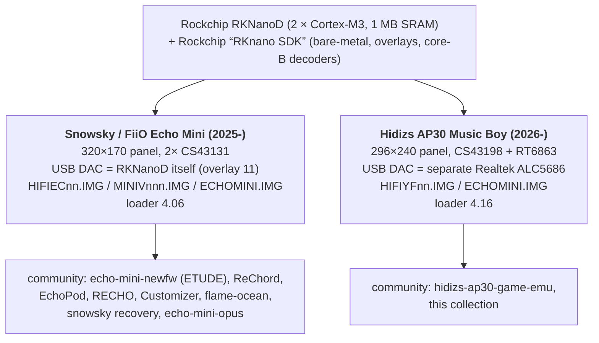

# Related devices and projects

Status: draft, 2026-11

The AP30 is not alone. Its SoC (Rockchip RKNanoD) and its firmware code base are shared with the **Snowsky (FiiO)
Echo Mini**, a player that has a much larger community of tinkerers, and a handful of open and closed community
projects document the chip from different angles. These pages explain how the AP30 relates to them, which findings
carry over, and where the AP30 differs.

| Page | What it covers |
|---|---|
| [snowsky_echo_mini.md](snowsky_echo_mini.md) | the sister player on the same SoC and the same firmware code base: hardware differences, all 26 official Echo Mini firmware releases compared with the AP30, shared decoder modules, update file names, bugs FiiO fixed that the AP30 may share |
| [rockchip_rknano_family.md](rockchip_rknano_family.md) | RKNanoC vs RKNanoD, their datasheets and manual, the RKnano SDK lineage the firmware comes from, other players on the chip, Rockbox status |
| [community_projects.md](community_projects.md) | every community project on the AP30 or the Echo Mini (from-scratch firmwares, patchers, theme editors, recovery guides, the AP30 Game Boy emulator): what each found, licence, where our results agree or disagree |

## In one picture

Tags on these pages: [EM] marks an Echo Mini fact not checked on the AP30; [AP30] marks what we confirmed in the
AP30 image or on the device (see [../overview/conventions.md](../overview/conventions.md)).

## Sources

* [AP30] analysis of the AP30 firmware images and boot loader.
* [EM] / [WEB] the projects and pages listed in [community_projects.md](community_projects.md) and
  [../overview/sources.md](../overview/sources.md).
